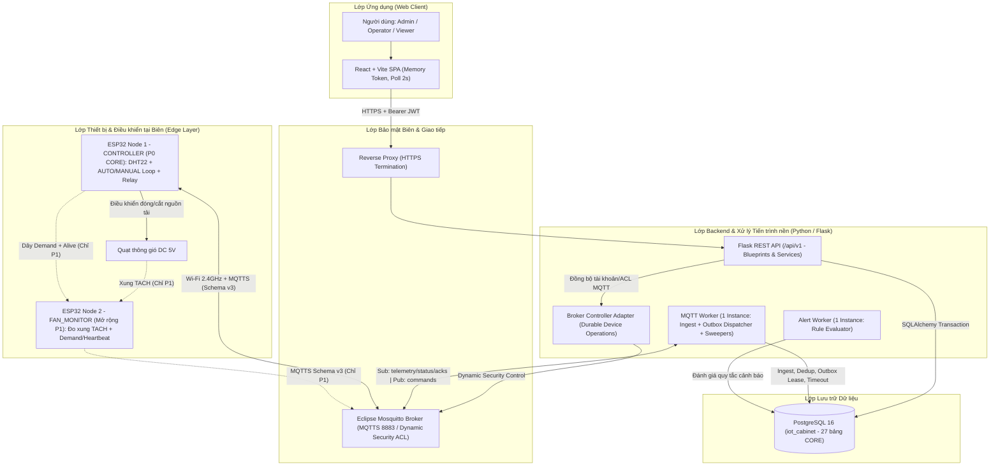
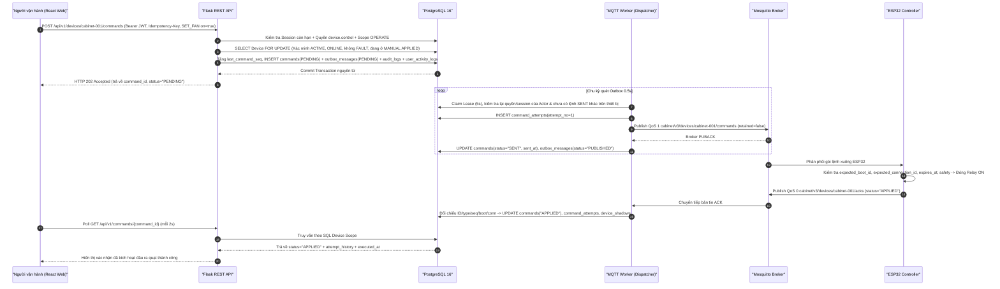
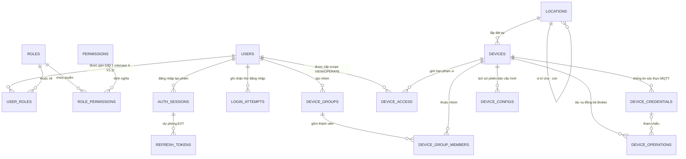
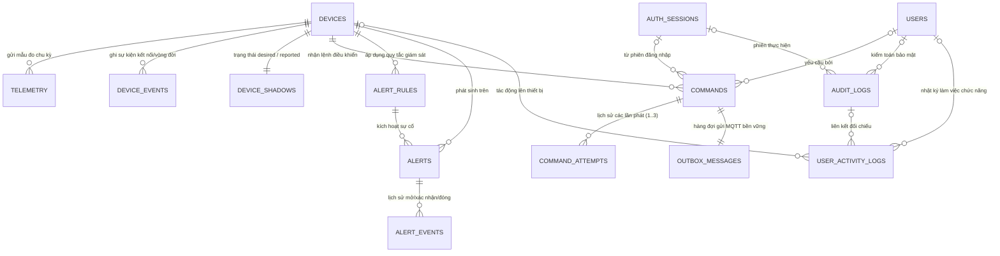
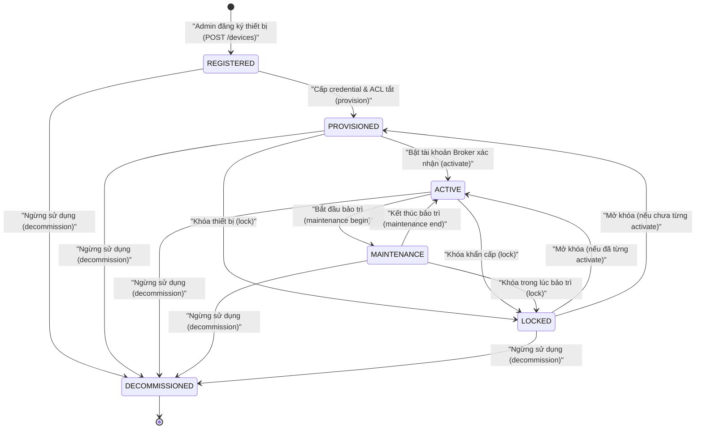
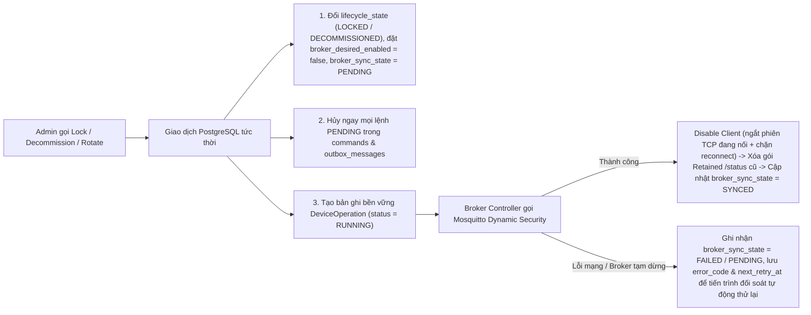

# CHƯƠNG 4: THIẾT KẾ PHẦN MỀM VÀ GIAO TIẾP DỮ LIỆU

> **Phạm vi tài liệu:** Chương này trình bày chi tiết thiết kế kiến trúc phần mềm, giao thức truyền thông hai chiều MQTT v3, lược đồ cơ sở dữ liệu quan hệ PostgreSQL 16 (27 bảng cốt lõi), kiến trúc Backend Flask/Workers, hệ thống RESTful API `/api/v1` và cơ chế quản lý vòng đời thiết bị cho **Hệ thống IoT giám sát nhiệt độ, độ ẩm và điều khiển thông gió tủ thiết bị mạng** (theo Đặc tả kỹ thuật thống nhất V1.3 và mã nguồn thực tế của hệ thống). Trong toàn bộ chương, phạm vi triển khai cốt lõi (**P0 CORE** — một node điều khiển `CONTROLLER` với cảm biến DHT22, relay và quạt DC) được phân định rõ ràng với các điểm mở rộng đã thiết kế sẵn cho giai đoạn sau (**P1** — node giám sát vòng quay `FAN_MONITOR` và **P2** — dự báo tình trạng quạt bằng AI).

---

## 4.1. Kiến trúc phần mềm

### 4.1.1. Sơ đồ kiến trúc tổng thể

Hệ thống được thiết kế theo kiến trúc phân lớp hướng dịch vụ kết hợp xử lý sự kiện bất đồng bộ (Event-Driven & Transactional Outbox Architecture), tách biệt rõ ràng giữa **vòng điều khiển cục bộ tại biên (Edge Control Loop)**, **kênh truyền thông thông điệp IoT (MQTT Broker)**, **khối xử lý nghiệp vụ và tiến trình nền (Backend API & Workers)**, **tầng lưu trữ bền vững (PostgreSQL)** và **giao diện người dùng (React SPA)**.



#### Phân ranh giới trách nhiệm theo 6 lớp kiến trúc IoT

| Lớp kiến trúc | Thành phần triển khai ở P0 (CORE) | Trách nhiệm cốt lõi | Điểm mở rộng kiến trúc (P1 / P2 / EXT) |
| :--- | :--- | :--- | :--- |
| **1. Lớp Thiết bị (Device Layer)** | 01 vi điều khiển `ESP32 WROOM-32`, 01 cảm biến `DHT22`, 01 module `Relay 3.3V`, 01 quạt `DC 5V`, LED trạng thái | Thu thập nhiệt độ/độ ẩm chu kỳ 2s; đóng/cắt relay cấp nguồn quạt; lưu cấu hình vào bộ nhớ không mất dữ liệu `NVS` (`Preferences`) | **P1:** Bổ sung `ESP32 FAN_MONITOR` đọc xung `TACH` bằng ngoại vi phần cứng `PCNT` và kiểm chứng tín hiệu `demand`/`heartbeat` |
| **2. Lớp Điều khiển Biên (Edge Layer)** | Vòng lặp điều khiển tự động `AUTO` có trễ nhiệt (hysteresis) và cơ chế an toàn (fail-safe) ngay trên `ESP32` | Tự động bật quạt khi $T \ge fan\_on\_c$, tắt khi $T \le fan\_off\_c$; tự động chuyển sang `FAULT` (ép bật quạt) khi lỗi DHT22 liên tiếp; tự về `AUTO` khi mất mạng hoặc hết hạn `MANUAL TTL` | **EXT:** Bộ đệm vòng (ring buffer) lưu mẫu đo khi đứt mạng để đồng bộ bù (`backfill`) sau khi kết nối lại |
| **3. Lớp Kết nối (Connectivity Layer)** | Wi-Fi 2.4GHz, `Eclipse Mosquitto 2.0` bật `Dynamic Security`, `MQTTS` (TCP `8883`) và `HTTPS` cho Web | Định tuyến bản tin bất đồng bộ hai chiều giữa thiết bị và hệ thống; kiểm soát xác thực riêng từng thiết bị (`client_id == device_id`), phân quyền ACL chính xác từng topic | **EXT:** Bổ sung `ProtocolAdapter` và kênh `/ota/*`, `/backfill` mà không phá vỡ cấu trúc topic v3 |
| **4. Lớp Backend & Workers** | `Flask` Application Factory chia theo `Blueprints`/`Services`, tách rời 01 tiến trình `mqtt_worker` và 01 tiến trình `alert_worker` | Xác thực người dùng, kiểm soát RBAC + phạm vi thiết bị (Device Scope), quản lý phiên bản cấu hình, xử lý lệnh qua `Transactional Outbox`, đánh giá sự cố cảnh báo | **P1:** `FanFusionService` ghép mẫu nhiệt/ẩm với RPM.<br>**P2:** `InferenceWorker` chạy mô hình phát hiện bất thường/dự báo RUL độc lập |
| **5. Lớp Dữ liệu (Data Layer)** | Hệ quản trị CSDL quan hệ `PostgreSQL 16` (`iot_cabinet`) với 27 bảng `CORE`, quản lý schema bằng `Alembic` | Đảm bảo toàn vẹn giao dịch ACID, khóa dòng chống tranh chấp (`SELECT ... FOR UPDATE`), lưu vết kiểm toán bảo mật (`audit_logs`) và nhật ký thao tác (`user_activity_logs`) | **P1:** Thêm 4 bảng quản lý tài sản quạt vật lý (`fans`, `fan_node_bindings`, `fan_observations`, `fan_maintenance_events`) |
| **6. Lớp Ứng dụng (Application Layer)** | Ứng dụng Web đơn trang `React 19 + Vite`, biểu đồ `Recharts`, cơ chế polling có kiểm soát chu kỳ 2 giây | Cung cấp Dashboard giám sát nhiệt/ẩm thời gian thực, điều khiển quạt `AUTO`/`MANUAL`, cấu hình ngưỡng, xử lý cảnh báo, quản trị tài khoản/thiết bị và tra cứu nhật ký | **P1:** Màn hình tổng quan sức khỏe quạt vật lý & RPM.<br>**EXT:** Luồng đẩy dữ liệu thời gian thực qua `SSE` |

#### Nguyên tắc tách biệt tiến trình trong kiến trúc phần mềm
1. **Không nhúng MQTT Subscriber vào Web Worker:** Tiến trình phục vụ HTTP (`Gunicorn` / `Flask`) có thể mở rộng nhiều worker xử lý đồng thời. Nếu mỗi web worker tự khởi tạo kết nối MQTT subscribe sẽ gây nhân bản việc ghi dữ liệu cảm biến và tranh chấp trạng thái. Do đó, toàn bộ việc nhận/gửi MQTT được cô lập vào **duy nhất một tiến trình `mqtt_worker.py`**.
2. **Giao tiếp liên tiến trình qua PostgreSQL Transactional Outbox:** Khi người dùng gửi lệnh điều khiển hoặc đổi cấu hình trên Web, `Flask API` không gọi trực tiếp hàm publish mạng (tránh treo HTTP request hoặc mất lệnh khi broker chập chờn) mà ghi nguyên tử `Command` + `OutboxMessage` + `AuditLog` + `UserActivityLog` vào PostgreSQL trong cùng một transaction và phản hồi `HTTP 202 Accepted`. Tiến trình `mqtt_worker` quét bảng `outbox_messages` mỗi `0.5s` với cơ chế thuê bao khóa (`lease`) để phát lệnh an toàn.
3. **Độc lập sống còn tại biên (Edge Autonomy):** Mất kết nối tới Backend, PostgreSQL hoặc Mosquitto không bao giờ làm tê liệt chức năng bảo vệ nhiệt của tủ mạng. Node `ESP32` luôn chạy vòng lặp `AUTO` độc lập bằng cấu hình đã lưu trong `NVS`.

---

### 4.1.2. Lựa chọn công nghệ và lý do lựa chọn

Mỗi quyết định công nghệ trong hệ thống được lựa chọn dựa trên sự đánh đổi kỹ thuật (trade-off) giữa yêu cầu nghiệp vụ, độ tin cậy vận hành, tính bảo mật và chi phí triển khai thực tế:

| Hạng mục | Công nghệ lựa chọn | Phương án thay thế đã cân nhắc & Lý do lựa chọn | Giới hạn kỹ thuật & Biện pháp kiểm soát |
| :--- | :--- | :--- | :--- |
| **Vi điều khiển & Cảm biến biên** | **ESP32 WROOM-32** + **DHT22** + **Relay 3.3V** (C/C++ Arduino Core) | *Phương án khác:* Raspberry Pi (chi phí cao, phụ thuộc hệ điều hành Linux dễ lỗi thẻ nhớ khi mất điện đột ngột) hoặc ESP8266 (ít chân GPIO, thiếu ngoại vi đếm xung phần cứng `PCNT`, năng lực xử lý TLS yếu hơn).<br>*Lý do chọn:* ESP32 tích hợp sẵn Wi-Fi 2.4GHz, RAM/Flash đủ cho MQTTS + JSON, có `NVS` bền vững và đủ GPIO để mở rộng sang P1. Một cảm biến `DHT22` cung cấp đồng thời cả hai đại lượng vật lý (nhiệt độ `-40..80°C` và độ ẩm `0..100%RH`). | Chu kỳ lấy mẫu của DHT22 tối thiểu khoảng `2s`; cảm biến có thể đọc lỗi do nhiễu. Firmware thiết kế đọc mẫu không chặn (non-blocking) mỗi `2s` và áp dụng ngưỡng 3 lần lỗi liên tiếp để chuyển sang chế độ an toàn `FAULT` (bật quạt cưỡng bức). |
| **Giao thức truyền thông IoT** | **MQTT v3.1.1** trên **Eclipse Mosquitto 2.0** (kèm plugin **Dynamic Security**) | *Phương án khác:* Thiết bị gọi trực tiếp HTTP REST hoặc CoAP.<br>*Lý do chọn:* HTTP buộc ESP32 phải mở kết nối liên tục hoặc polling tốn tài nguyên để nhận lệnh điều khiển chiều xuống, khó phát hiện mất kết nối tức thời. MQTT cung cấp mô hình Publish/Subscribe nhẹ, hai chiều qua một kết nối TCP duy trì sẵn, hỗ trợ cơ chế di chúc **LWT (Last Will and Testament)** báo mất kết nối tự động và plugin **Dynamic Security** cho phép tạo/khóa tài khoản thiết bị, thu hồi kết nối ngay lúc đang chạy mà không cần khởi động lại Broker. | Thư viện `PubSubClient` trên Arduino chỉ hỗ trợ publish tối đa `QoS 0` chiều lên và giới hạn bộ đệm mặc định thấp. Hệ thống khắc phục bằng cách tăng kích thước buffer gói tin lên `2048 bytes`, đánh số thứ tự `seq` tăng dần để phát hiện mất gói/chống trùng ở tầng ứng dụng, và dùng `QoS 1` chiều từ Worker xuống thiết bị. |
| **Backend & Tiến trình nền** | **Python 3** + **Flask 3.x** + **SQLAlchemy 2.0** + **Marshmallow** + **paho-mqtt** | *Phương án khác:* Node.js/Express, FastAPI hoặc kiến trúc Microservices tách rời nhiều mã nguồn.<br>*Lý do chọn:* Flask với mô hình *Application Factory* và *Blueprints* cho phép tổ chức mã nguồn gọn gàng, dùng chung hoàn toàn tầng ORM Models, dịch vụ phân quyền (`PermissionService`) và cấu hình giữa Web API với các tiến trình nền (`mqtt_worker`, `alert_worker`), đồng thời thuận lợi mở rộng sang xử lý dữ liệu/AI bằng hệ sinh thái Python ở giai đoạn P2. | Flask chạy đồng bộ trên WSGI (`Gunicorn`), do đó không phù hợp giữ kết nối WebSocket hàng loạt ở P0. Hệ thống tách worker độc lập và giữ các giao dịch DB ngắn gọn. |
| **Cơ sở dữ liệu** | **PostgreSQL 16** (thuần, quản lý migration bằng **Flask-Migrate / Alembic**) | *Phương án khác:* SQLite (không chịu tải ghi đồng thời giữa API và các Worker), MongoDB/Firebase (thiếu ràng buộc khóa ngoại chặt chẽ và khóa dòng giao dịch phức tạp), hoặc lắp thêm Redis + TimescaleDB ngay từ đầu.<br>*Lý do chọn:* Với tần suất P0 `5s/mẫu` (~`17.280` bản ghi/ngày, ~`518.400` bản ghi/tháng), một hệ quản trị PostgreSQL 16 duy nhất đáp ứng dư khả năng truy vấn nhờ đánh chỉ mục tổ hợp `(device_id, received_at DESC)`, đồng thời cung cấp **ACID Transaction**, `SELECT ... FOR UPDATE`, **Partial Unique Index**, kiểu `JSONB` và `TIMESTAMPTZ` chuẩn UTC cho toàn bộ 27 bảng nghiệp vụ. | Tránh phân mảnh dữ liệu trên nhiều hệ lưu trữ khác nhau; thiết lập chính sách lưu giữ (retention 90 ngày cho raw telemetry, 180 ngày cho audit logs) để kiểm soát dung lượng đĩa. |
| **Xác thực & Quản lý phiên** | **Argon2id** (`argon2-cffi`) + **Access JWT 15 phút** đối chiếu **Session PostgreSQL** | *Phương án khác:* Băm mật khẩu bằng bcrypt/SHA-256; hoặc dùng JWT stateless thuần túy kèm Refresh Token lưu trong Cookie/LocalStorage.<br>*Lý do chọn:* `Argon2id` là chuẩn khuyến nghị của OWASP chống tấn công vét cạn bằng GPU/ASIC. Việc kết hợp **Access JWT ngắn hạn (15 phút) chỉ lưu trên bộ nhớ RAM của trình duyệt** (không lưu `localStorage`/`Cookie`) cùng bảng `auth_sessions` trong PostgreSQL giúp loại bỏ nguy cơ đánh cắp token bền vững qua XSS hoặc tấn công CSRF qua Cookie, đồng thời cho phép **thu hồi phiên tức thời (server-side revocation)** ngay khi người dùng đăng xuất, đổi mật khẩu hoặc bị Admin khóa tài khoản. | Khi người dùng tải lại trang (F5), mở tab mới hoặc hết 15 phút phiên làm việc, ứng dụng yêu cầu đăng nhập lại (đánh đổi sự tiện lợi của silent refresh lấy tính an toàn và đơn giản tuyệt đối cho P0). |
| **Giao diện Web** | **React 19** + **Vite** + **React Router** + **Recharts** + **REST Polling 2s** | *Phương án khác:* Server-Side Rendering (Jinja2) hoặc WebSocket/SSE ngay ở P0.<br>*Lý do chọn:* React + Vite xây dựng giao diện quản trị và biểu đồ nhiệt/ẩm mượt mà. Cơ chế **HTTP Polling chu kỳ 2 giây** tới các endpoint gọn nhẹ (`/latest`, `/commands`, `/alerts`) giúp đơn giản hóa việc kiểm tra lại quyền truy cập và hiệu lực phiên ở mỗi nhịp mà không phải xử lý bài toán xác thực lại luồng kết nối dài (long-lived stream) khi thu hồi quyền. | Độ trễ hiển thị tăng thêm tối đa `2s` (vẫn nằm gọn trong mục tiêu độ trễ đầu-cuối $p95 \le 8s$). Các thao tác đọc polling tuyệt đối không ghi vào bảng nhật ký làm việc để tránh làm phình CSDL. |
| **Đóng gói & Triển khai** | **Docker Compose** (PostgreSQL 16, Mosquitto 2.0.18, Backend, Workers, Reverse Proxy) | *Phương án khác:* Cài đặt thủ công từng dịch vụ trực tiếp lên hệ điều hành của từng thành viên.<br>*Lý do chọn:* Đảm bảo môi trường đồng nhất giữa các thành viên phát triển và khi kiểm thử khôi phục trên máy sạch; cô lập mạng nội bộ giữa Backend, PostgreSQL và Broker, gắn cố định phiên bản image (`postgres:16-alpine`, `eclipse-mosquitto:2.0.18`). | Vi điều khiển ESP32 vật lý hoạt động ngoài mạng container, kết nối vào máy chủ qua địa chỉ IP LAN và cổng MQTTS `8883` (hoặc `1883` trong cấu hình thử nghiệm nội bộ). |

---

## 4.2. Thiết kế giao thức MQTT và luồng dữ liệu

### 4.2.1. Cấu trúc Topic và quy ước đặt tên

Hệ thống chuẩn hóa hợp đồng giao tiếp **MQTT Schema v3** ngay từ giai đoạn P0 nhằm đảm bảo tính tương thích tiến (forward-compatible) khi bổ sung thiết bị giám sát quạt ở giai đoạn P1 mà không phải thay đổi cấu trúc topic hay nâng cấp lại Broker ACL.

* **Tiền tố không gian tên (Namespace Prefix):**
  ```text
  cabinet/v3/devices/{device_id}/{channel}
  ```
* **Quy ước định danh `{device_id}`:**
  * Do Backend cấp phát và quản lý bất biến trong bảng `devices`, tuân thủ biểu thức chính quy: `^[a-z0-9][a-z0-9_-]{2,63}$` (chỉ gồm chữ thường, chữ số, dấu gạch ngang và gạch dưới, độ dài 3–64 ký tự; ví dụ: `cabinet-001`, `sim-unassigned`, `fan-monitor-001`).
  * Khi kết nối MQTT, thiết bị bắt buộc sử dụng `client_id` trùng khớp với `device_id` và tài khoản xác thực riêng (`mqtt_username`, ví dụ `cabinet-001` hoặc `cabinet-001-c2` sau khi xoay vòng thông tin xác thực).

#### Bảng phân hoạch kênh truyền thông MQTT (Topic Channels)

| Hậu tố Topic (`{channel}`) | Topic đầy đủ | Chiều truyền | QoS | Retained | Mục đích sử dụng |
| :--- | :--- | :---: | :---: | :---: | :--- |
| **`/telemetry`** | `cabinet/v3/devices/{device_id}/telemetry` | Thiết bị $\rightarrow$ Worker | `0` | `False` | Gửi dữ liệu đo cảm biến định kỳ (nhiệt độ, độ ẩm, trạng thái đầu ra quạt, chế độ vận hành) chu kỳ mặc định `5s` (P0). |
| **`/status`** | `cabinet/v3/devices/{device_id}/status` | Thiết bị $\rightarrow$ Worker | Heartbeat: `0`<br>LWT: `1` | `True` | Báo cáo trạng thái kết nối (`ONLINE`), nhịp tim định kỳ `15s`, phiên bản phần cứng/firmware, sức khỏe driver; và bản tin di chúc `OFFLINE` (`reason="LWT"`) do Broker tự phát khi đứt kết nối. |
| **`/commands`** | `cabinet/v3/devices/{device_id}/commands` | Worker $\rightarrow$ Thiết bị | `1` | `False` | Truyền lệnh điều khiển chế độ (`SET_MODE`), bật/tắt quạt thủ công (`SET_FAN`) hoặc đồng bộ cấu hình mới (`APPLY_CONFIG`) từ Backend xuống thiết bị. |
| **`/acks`** | `cabinet/v3/devices/{device_id}/acks` | Thiết bị $\rightarrow$ Worker | `0` | `False` | Thiết bị gửi xác nhận mức ứng dụng (`APPLIED` hoặc `REJECTED`) sau khi kiểm tra tính hợp lệ và thực thi lệnh nhận được. |

#### Chính sách phân quyền truy cập Topic (Broker ACL)
Thông qua plugin **Mosquitto Dynamic Security**, chính sách mặc định là **từ chối toàn bộ (`default deny`)** đối với mọi hành vi publish/subscribe:
* **Tài khoản thiết bị (`device_id`):** Chỉ được quyền *Publish* lên đúng 3 topic `/telemetry`, `/status`, `/acks` của chính `device_id` đó; và chỉ được *Subscribe/Receive* đúng topic `/commands` của chính mình. Một thiết bị bị cấm tuyệt đối việc đọc trộm hoặc giả mạo dữ liệu sang topic của thiết bị khác (như `sim-unassigned`).
* **Tài khoản `worker_service`:** Chỉ được quyền *Subscribe* vào `cabinet/v3/devices/+/telemetry`, `cabinet/v3/devices/+/status`, `cabinet/v3/devices/+/acks` và *Publish* vào `cabinet/v3/devices/{device_id}/commands`; không có quyền quản trị `$CONTROL/dynamic-security/#`.
* **Tài khoản `broker_admin`:** Chỉ dùng riêng cho module `Broker Controller` của Backend để gọi lệnh quản trị tài khoản/ACL trên kênh `$CONTROL/dynamic-security/v1`.

---

### 4.2.2. Định dạng bản tin Telemetry và trạng thái thiết bị

Mọi gói tin MQTT trong hệ thống đều được mã hóa UTF-8 JSON phẳng kèm trường bắt buộc `"schema_version": 3`, tổng kích thước gói tin (gồm cả header, topic và payload) giới hạn nghiêm ngặt $\le 2048\text{ bytes}$ và **cấm tuyệt đối các hằng số thực không hữu hạn** (`NaN`, `Infinity`, `-Infinity`).

#### 1. Bản tin Telemetry của bộ điều khiển (`CONTROLLER` — P0 CORE)
Được gửi lên topic `cabinet/v3/devices/{device_id}/telemetry`:

```json
{
  "schema_version": 3,
  "device_id": "cabinet-001",
  "profile": "CONTROLLER",
  "fan_binding_id": null,
  "boot_id": "4e5b9a32-c830-49c0-b86a-3b561a596389",
  "connection_id": "bdb0d8c6-70c9-414a-897e-45c451ee4ab8",
  "seq": 12,
  "measured_at": "2026-10-09T13:00:00Z",
  "clock_synced": true,
  "uptime_ms": 60000,
  "temperature_c": 31.2,
  "humidity_pct": 62.0,
  "sensor_ok": true,
  "fan_output": true,
  "mode": "AUTO",
  "config_version": 1,
  "config_hash": "3520a5738ade36fecf0a3f72ecf34e9f53fb2b2fe23e0a20245393e6a57a91cb",
  "fault_code": null,
  "extra": {}
}
```

**Đặc tả ý nghĩa và ràng buộc các trường dữ liệu chính:**
* **`device_id` & `profile`:** `device_id` trong payload bắt buộc khớp 100% với `{device_id}` trên đường dẫn topic. `profile` khớp với `device_type` đã đăng ký trong CSDL (`"CONTROLLER"` cho P0; node `CONTROLLER` bị cấm tự khai báo các trường đo vòng quay `rpm`, `pulse_count` của `FAN_MONITOR`).
* **`boot_id`, `connection_id`, `seq`:**
  * `boot_id` (UUID v4): Sinh ngẫu nhiên mới mỗi lần ESP32 khởi động phần cứng (power-on / reset).
  * `connection_id` (UUID v4): Sinh mới mỗi lần phiên kết nối TCP/MQTT tới Broker được thiết lập lại.
  * `seq` (`int >= 0`): Số thứ tự mẫu đo đơn điệu tăng dần trong cùng một `boot_id`. Tổ hợp `(device_id, boot_id, seq)` định danh duy nhất toàn cục cho từng mẫu telemetry.
* **`clock_synced` & `measured_at`:** Nếu thiết bị đã đồng bộ thời gian NTP tin cậy (`clock_synced = true`), `measured_at` chứa chuỗi thời gian chuẩn UTC ISO-8601. Nếu chưa đồng bộ NTP (`clock_synced = false`), thiết bị gửi `measured_at = null` và Backend sử dụng thời điểm nhận thực tế `received_at` làm mốc tham chiếu chính.
* **`sensor_ok`, `temperature_c`, `humidity_pct`:**
  * Khi cảm biến DHT22 hoạt động tốt (`sensor_ok = true`): `temperature_c` thuộc miền `[-40.0, 80.0]` (°C) và `humidity_pct` thuộc miền `[0.0, 100.0]` (%RH).
  * Khi cảm biến DHT22 đọc lỗi (`sensor_ok = false`): cả hai trường `temperature_c` và `humidity_pct` **bắt buộc mang giá trị `null`** (tuyệt đối không gán về `0.0` để tránh làm sai lệch thống kê trung bình và biểu đồ nhiệt), kèm mã lỗi trong `fault_code` (ví dụ `"DHT_READ_TIMEOUT"`).
* **`fan_output` & `mode`:** `mode` nhận giá trị `"AUTO"` hoặc `"MANUAL"`. `fan_output` (`boolean`) phản ánh trạng thái điều khiển chân kích Relay thực tế trên bo mạch (`true` = đóng tiếp điểm cấp điện quạt, `false` = ngắt), không đánh đồng với việc cánh quạt cơ khí chắc chắn đang quay (chức năng kiểm chứng vòng quay thuộc mở rộng P1).
* **`config_version` & `config_hash`:** Cho biết phiên bản và mã băm SHA-256 của bản chụp cấu hình đang thực sự được áp dụng tại thiết bị. Ở trạng thái xuất xưởng chưa từng nhận cấu hình từ máy chủ, thiết bị gửi cả hai giá trị bằng `null`.

#### 2. Bản tin Trạng thái & Nhịp tim (`/status`) và Di chúc mất kết nối (`LWT`)
Được gửi lên topic `cabinet/v3/devices/{device_id}/status`:

* **Bản tin Heartbeat / Khởi tạo kết nối (`connection = "ONLINE"`):**
  ```json
  {
    "schema_version": 3,
    "device_id": "cabinet-001",
    "profile": "CONTROLLER",
    "connection": "ONLINE",
    "boot_id": "4e5b9a32-c830-49c0-b86a-3b561a596389",
    "connection_id": "bdb0d8c6-70c9-414a-897e-45c451ee4ab8",
    "status_seq": 1,
    "config_version": 1,
    "config_hash": "3520a5738ade36fecf0a3f72ecf34e9f53fb2b2fe23e0a20245393e6a57a91cb",
    "firmware_version": "1.2.0",
    "hardware_version": "esp32-wroom32-dht22-relay-controller-v1",
    "uptime_ms": 60000,
    "clock_synced": true,
    "health": "OK",
    "fault_code": null
  }
  ```
* **Bản tin Di chúc LWT do Mosquitto phát tự động khi thiết bị rớt mạng (`connection = "OFFLINE"`):**
  ```json
  {
    "schema_version": 3,
    "device_id": "cabinet-001",
    "connection": "OFFLINE",
    "boot_id": "4e5b9a32-c830-49c0-b86a-3b561a596389",
    "connection_id": "bdb0d8c6-70c9-414a-897e-45c451ee4ab8",
    "reason": "LWT"
  }
  ```
  Việc đính kèm cặp `(boot_id, connection_id)` ngay trong gói LWT giúp Backend phân biệt chính xác sự kiện rớt mạng của phiên cũ với phiên kết nối mới vừa reconnect thành công.

---

### 4.2.3. Định dạng lệnh điều khiển và bản tin xác nhận

#### 1. Bản tin Lệnh điều khiển chiều xuống (`/commands`)
Worker phát lệnh xuống topic `cabinet/v3/devices/{device_id}/commands` với `QoS = 1`, `retained = False`. Hệ thống P0 hỗ trợ 3 loại lệnh chuẩn cho `CONTROLLER`:
1. **`SET_MODE`:** Chuyển đổi giữa chế độ tự động (`{"mode": "AUTO"}`) và chế độ thủ công có thời hạn tự hủy (`{"mode": "MANUAL", "duration_s": 60}`, miền cho phép `10..300` giây).
2. **`SET_FAN`:** Đặt trạng thái đầu ra quạt tuyệt đối (`{"on": true}` hoặc `{"on": false}`). Lệnh này chỉ được chấp nhận khi thiết bị đang ở chế độ `MANUAL` đã được xác nhận `APPLIED` (không dùng cơ chế đảo trạng thái `toggle` để đảm bảo tính lũy đẳng khi retry).
3. **`APPLY_CONFIG`:** Đồng bộ bản chụp cấu hình mới xuống bộ nhớ `NVS` của ESP32 (`{"config_version": 2, "config_json": "<chuỗi canonical JSON>", "content_hash": "<sha256_hex>"}`).

**Ví dụ gói tin lệnh `SET_FAN`:**
```json
{
  "schema_version": 3,
  "device_id": "cabinet-001",
  "command_id": "d5cf70aa-f944-46bf-8c2d-fd36450f3276",
  "type": "SET_FAN",
  "device_command_seq": 8,
  "expected_boot_id": "4e5b9a32-c830-49c0-b86a-3b561a596389",
  "expected_connection_id": "bdb0d8c6-70c9-414a-897e-45c451ee4ab8",
  "params": {
    "on": true
  },
  "issued_at": "2026-10-09T13:00:00Z",
  "expires_at": "2026-10-09T13:00:15Z"
}
```

**Quy tắc chuẩn hóa cấu hình và kiểm toàn vẹn SHA-256 (`APPLY_CONFIG`):**
* Backend sinh chuỗi cấu hình chuẩn tắc (canonical JSON) bằng quy tắc cố định thứ tự khóa và không chèn khoảng trắng thừa:
  `json.dumps(snapshot, sort_keys=True, separators=(",", ":"), ensure_ascii=False, allow_nan=False)`
* Mã băm `content_hash` là hàm băm `SHA-256` tính trực tiếp trên mảng byte UTF-8 của chuỗi `config_json` (ví dụ bản chụp cấu hình mặc định v1 cho kết quả cố định `3520a5738ade36fecf0a3f72ecf34e9f53fb2b2fe23e0a20245393e6a57a91cb`).
* Khi nhận `APPLY_CONFIG`, firmware ESP32 băm trực tiếp chuỗi byte `config_json` nhận được để đối chiếu với `content_hash` *trước khi* phân tích cú pháp (tránh sai lệch biểu diễn số thực dấu phẩy động), lưu bền vững vào `NVS` thành công rồi mới phát bản tin xác nhận `ACK`.

#### 2. Bản tin Xác nhận thực thi lệnh chiều lên (`/acks`)
Thiết bị phản hồi kết quả thực thi lên topic `cabinet/v3/devices/{device_id}/acks`:

```json
{
  "schema_version": 3,
  "device_id": "cabinet-001",
  "command_id": "d5cf70aa-f944-46bf-8c2d-fd36450f3276",
  "status": "APPLIED",
  "type": "SET_FAN",
  "boot_id": "4e5b9a32-c830-49c0-b86a-3b561a596389",
  "connection_id": "bdb0d8c6-70c9-414a-897e-45c451ee4ab8",
  "device_command_seq": 8,
  "executed_at": "2026-10-09T13:00:01Z",
  "result": {
    "fan_output": true,
    "mode": "MANUAL",
    "config_version": 1,
    "config_hash": "3520a5738ade36fecf0a3f72ecf34e9f53fb2b2fe23e0a20245393e6a57a91cb"
  },
  "error_code": null
}
```
Nếu lệnh vi phạm quy tắc an toàn tại biên (ví dụ cảm biến DHT22 đang lỗi `FAULT`, lệnh đã quá hạn `expires_at`, sai `expected_boot_id` hoặc sai mã băm cấu hình), thiết bị giữ nguyên trạng thái an toàn và gửi phản hồi `"status": "REJECTED"` kèm mã nguyên nhân trong `"error_code"`.

---

### 4.2.4. Cơ chế QoS, timeout, gửi lại và xử lý bản tin trùng lặp

Do mạng Wi-Fi và giao thức MQTT không đảm bảo truyền tin đúng một lần (no end-to-end exactly-once guarantee), hệ thống kết hợp chặt chẽ thiết lập MQTT QoS với cơ chế định thời, gửi lại (retry) và chống trùng lặp (deduplication) ở tầng ứng dụng:

#### 1. Chiến lược lựa chọn QoS và cờ Retained
* **Chiều Thiết bị $\rightarrow$ Worker (`QoS 0` cho `/telemetry` và `/acks`):** Tương thích hoàn toàn với giới hạn publish `QoS 0` của thư viện nhúng `PubSubClient`, giảm tải bắt tay cho vi điều khiển để không gây trễ vòng điều khiển nhiệt. Nếu rớt một mẫu telemetry, mẫu tiếp theo sau `5s` sẽ cập nhật trạng thái mới nhất; nếu rớt gói `ACK`, bộ lập lịch của Worker sẽ tự động phát lại lệnh.
* **Chiều Worker $\rightarrow$ Thiết bị (`QoS 1`, `retained = False` cho `/commands`):** Đảm bảo Broker chuyển lệnh ít nhất một lần tới phiên kết nối hiện tại của ESP32. Cờ `retained` bắt buộc bằng `False` để ngăn trường hợp thiết bị khởi động lại sau nhiều giờ lại tự động nhận và thực thi một lệnh bật/tắt quạt thủ công cũ kỹ lưu trên Broker.
* **Phân biệt `PUBACK` tầng Broker và `ACK` tầng Ứng dụng:** Khi `mqtt_worker` phát lệnh `QoS 1` thành công tới Mosquitto (`PUBACK`), lệnh chỉ mới chuyển sang trạng thái `SENT` (ghi nhận `broker_confirmed_at` trong `command_attempts`), tuyệt đối **chưa coi là `APPLIED`**. Chỉ khi nhận bản tin hợp lệ trên topic `/acks` từ chính ESP32, lệnh mới chuyển sang `APPLIED`.

#### 2. Chu trình định thời, gửi lại (Retry) và hết hạn lệnh (Timeout)
* **Thời hạn sống của lệnh (`expires_at`):** Cố định `15 giây` kể từ thời điểm tạo lệnh (`issued_at`). Các lần gửi lại giữ nguyên `command_id`, `device_command_seq`, `sent_at` và **không bao giờ gia hạn thêm `expires_at`**.
* **Lịch gửi lại tự động (Retry Schedule):** Nếu lệnh đang ở trạng thái `SENT` mà chưa nhận được `ACK`, `MqttDispatcherService` chuyển `OutboxMessage` từ `PUBLISHED` về `PENDING` để phát lại tối đa **02 lần** (tổng cộng tối đa **03 lần thử** `attempt_no = 1..3`) tại các mốc:
  * Lần thử 1 (`attempt_no = 1`): Gửi ngay tại $t_0 = sent\_at$.
  * Lần thử 2 (`attempt_no = 2` — Retry 1): Tại $sent\_at + 3\text{s}$.
  * Lần thử 3 (`attempt_no = 3` — Retry 2): Tại $sent\_at + 6\text{s}$.
* **Xử lý Timeout và ACK đến muộn:**
  * Tại mốc $sent\_at + 10\text{s}$ (hoặc khi chạm `expires_at` `15s`) mà vẫn chưa nhận được `ACK`, Sweeper đánh dấu lệnh thành `TIMEOUT` (`error_code = "ACK_TIMEOUT"`). Trạng thái `TIMEOUT` phản ánh trung thực rằng kết quả thực thi chưa xác định được qua mạng.
  * Nếu sau mốc `TIMEOUT` một gói `ACK` hợp lệ của lệnh đó mới tới được Worker, hệ thống cập nhật trạng thái thành **`APPLIED_LATE`** để đồng bộ chính xác lịch sử và `DeviceShadow`.
* **Phát hiện thiết bị mất kết nối (Offline Detection):** Kết hợp hai lớp: (1) nhận tức thời qua gói `LWT` (`QoS 1`) của Mosquitto; và (2) bộ quét `sweep_offline_devices` chạy mỗi `1s` tại Worker để chuyển mọi thiết bị đang `ONLINE` nhưng không có bất kỳ bản tin hợp lệ nào trong vòng **`45 giây`** (3 chu kỳ heartbeat `15s`) sang `OFFLINE` (`HEARTBEAT_TIMEOUT_45S`).

#### 3. Cơ chế chống trùng lặp (Deduplication) và bảo vệ thứ tự gói tin
* **Tại API tạo lệnh:** Bắt buộc header `Idempotency-Key`. Nếu trình duyệt gửi lặp HTTP request với cùng `(actor_user_id, device_id, idempotency_key)` và cùng nội dung lệnh, API trả về lại đúng `command_id` đã tạo mà không sinh lệnh mới; nếu khác nội dung tham số thì từ chối với `HTTP 409 Conflict`.
* **Tại Firmware ESP32:** Lưu mốc `high-water device_command_seq` trong phiên và bộ đệm vòng 20 kết quả `ACK` gần nhất. Khi nhận gói lệnh phát lại từ Worker (do mất gói ACK lần trước), ESP32 nhận diện `command_id` đã thực thi để gửi trả lại đúng bản tin `ACK` cũ mà **không thực thi lặp hoặc kéo dài bộ đếm ngược `MANUAL TTL`**.
* **Tại Luồng Ingest của Backend (`MqttIngestService`):**
  1. *Chống trùng Telemetry:* Ràng buộc duy nhất `UQ(device_id, boot_id, seq)` kết hợp kiểm tra mã băm `raw_payload_hash`. Nếu trùng hoàn toàn mã băm $\rightarrow$ bỏ qua lũy đẳng (`DUPLICATE_IGNORED`); nếu trùng khóa `(device_id, boot_id, seq)` nhưng khác nội dung $\rightarrow$ từ chối (`DUPLICATE_SEQ_HASH_MISMATCH`), không ghi đè lịch sử.
  2. *Chống lùi trạng thái bởi gói tin đến muộn (Out-of-order):* Gói tin có `seq <= latest_seq` trong cùng `boot_id` hoặc từ phiên boot cũ vẫn được lưu vào bảng lịch sử `telemetry` (`INGESTED_HISTORICAL`) nhưng **không cập nhật lùi** `devices.latest_seq`, `last_seen_at` hay `device_shadows.reported`.
  3. *Chặn LWT cũ và Retained ONLINE cũ:* Gói `LWT` có `connection_id` khác với `current_connection_id` hiện tại sẽ bị bỏ qua (`STALE_LWT_IGNORED`) để không đánh sập phiên vừa kết nối lại. Tương tự, gói `ONLINE` mang cờ `retain = True` nhận được lúc Worker mới khởi động lại chỉ mang tính tham khảo (`RETAINED_ONLINE_IGNORED`), không được dùng để gia hạn `last_seen_at`.

---

### 4.2.5. Sequence Diagram cho luồng gửi dữ liệu và điều khiển quạt

#### 1. Luồng thu thập dữ liệu cảm biến Nhiệt độ/Độ ẩm và đánh giá cảnh báo (P0)

```mermaid
sequenceDiagram
  autonumber
  participant ESP as "ESP32 Controller (DHT22 + Relay)"
  participant BRK as "Mosquitto Broker"
  participant WRK as "MQTT Worker (Ingest)"
  participant DB as "PostgreSQL 16"
  participant ALT as "Alert Worker"
  participant WEB as "React Web & Flask API"

  ESP->>ESP: Đọc DHT22 (2s/lần), chạy vòng lặp AUTO hysteresis cục bộ
  ESP->>BRK: Publish QoS 0 cabinet/v3/devices/cabinet-001/telemetry (5s/lần)
  BRK->>WRK: Chuyển tiếp gói tin (đã qua kiểm tra ACL)
  WRK->>WRK: Kiểm tra JSON <= 2048B, cấm NaN/Inf, khớp device_id, dải nhiệt/ẩm
  WRK->>DB: SELECT Device FOR UPDATE (kiểm tra ACTIVE/MAINTENANCE & config_hash)
  alt Gói tin hợp lệ và là mẫu mới nhất (seq > latest_seq)
    WRK->>DB: INSERT telemetry + UPDATE devices(last_seen_at, latest_seq) + UPDATE device_shadows
    DB-->>WRK: Commit Transaction thành công
  else Gói tin trùng lặp cùng raw_payload_hash
    WRK-->>WRK: Bỏ qua lũy đẳng (DUPLICATE_IGNORED), không sửa lịch sử
  end
  ALT->>DB: Quét mẫu đo & ngưỡng applied_config, mở/cập nhật/clear sự cố trong bảng alerts
  WEB->>DB: GET /api/v1/devices/cabinet-001/latest (Kiểm tra JWT + Session + Device Scope)
  DB-->>WEB: Trả về nhiệt độ, độ ẩm, fan_output, mode, độ tươi (stale) & trạng thái đồng bộ
```

#### 2. Luồng điều khiển quạt thủ công từ Web xuống ESP32 qua Transactional Outbox (P0)



---

## 4.3. Thiết kế cơ sở dữ liệu

### 4.3.1. Sơ đồ thực thể liên kết (ERD)

Toàn bộ dữ liệu của hệ thống được lưu trữ thống nhất trên một cơ sở dữ liệu **`PostgreSQL 16` (`iot_cabinet`)** gồm **27 bảng cốt lõi (P0 CORE)** chia làm 4 phân hệ nghiệp vụ chặt chẽ. Tất cả các cột thời gian đều sử dụng kiểu `TIMESTAMPTZ` chuẩn hóa theo múi giờ UTC; khóa chính sử dụng `UUID` do máy chủ cấp phát (riêng `devices.device_id` dùng mã định danh chuỗi `VARCHAR(64)` bất biến).

#### Phân hệ 1 & 2: Quản lý Định danh, Phân quyền (IAM) và Tổ chức Thiết bị (16 bảng)



#### Phân hệ 3 & 4: Dữ liệu Cảm biến, Device Shadow, Lệnh Điều khiển, Cảnh báo và Nhật ký (11 bảng)



*(Ghi chú mở rộng P1: Khi triển khai thêm node `FAN_MONITOR`, lược đồ mở rộng thêm 4 bảng độc lập gồm `fans`, `fan_node_bindings`, `fan_observations` và `fan_maintenance_events` nối vào các cột khóa ngoại chờ sẵn `fan_binding_id` / `fan_id` mà không phải sửa đổi cấu trúc 27 bảng P0).*

---

### 4.3.2. Mô tả các bảng dữ liệu chính

Bảng dưới đây tổng hợp cấu trúc, khóa chính/khóa ngoại và các ràng buộc toàn vẹn quan trọng của 27 bảng trong CSDL `iot_cabinet`:

#### Nhóm A — Định danh, Vai trò, Quyền hạn và Phiên đăng nhập (8 bảng)

| STT | Tên bảng | Khóa chính & Cột trọng tâm | Ràng buộc toàn vẹn & Mục đích nghiệp vụ |
| :-: | :--- | :--- | :--- |
| 1 | **`users`** | `id` (UUID PK), `username`, `password_hash`, `full_name`, `status`, `must_change_password`, `token_version`, `failed_login_count`, `locked_until` | `UQ(username)`, `CHECK status IN ('ACTIVE','LOCKED','ARCHIVED')`. Lưu mật khẩu băm `Argon2id`; không lưu cột `role` trực tiếp trên bảng `users` để tránh hai nguồn quyền mâu thuẫn; tăng `token_version` khi khóa hoặc đổi mật khẩu để vô hiệu hóa mọi phiên cũ. |
| 2 | **`roles`** | `id` (UUID PK), `code` (`ADMIN`, `OPERATOR`, `VIEWER`), `name`, `is_system` | `UQ(code)`. Danh mục vai trò chuẩn của hệ thống. |
| 3 | **`permissions`** | `id` (UUID PK), `code` (vd: `device.control`, `telemetry.export`), `scope_type`, `description` | `UQ(code)`, `CHECK scope_type IN ('GLOBAL','DEVICE','SELF')`. Danh mục quyền nguyên tử. |
| 4 | **`role_permissions`** | `PK(role_id, permission_id)`, `granted_by`, `created_at` | Ánh xạ nhiều-nhiều giữa vai trò và quyền hạn. |
| 5 | **`user_roles`** | `PK(user_id, role_id)`, `assigned_by`, `created_at` | Có thêm `UQ(user_id)` ở V1.3 để đảm bảo mỗi tài khoản giữ đúng một vai trò hệ thống tại một thời điểm. |
| 6 | **`auth_sessions`** | `id` (UUID PK = `sid`), `user_id` (FK), `token_version`, `created_at`, `expires_at`, `revoked_at`, `revoke_reason`, `ip_address`, `user_agent` | Lưu trạng thái phiên phía máy chủ có cùng hạn 15 phút với Access JWT (`expires_at > created_at`). Giữ lại bản ghi theo chính sách lưu vết ngay cả sau khi đăng xuất để phục vụ khóa ngoại từ `commands` và `audit_logs`. |
| 7 | **`refresh_tokens`** | `id` (UUID PK), `session_id` (FK), `token_hash` | Bảng giữ chỗ thiết kế cho mở rộng `EXT`; ở phạm vi P0 hệ thống không phát hành hay đọc/ghi Refresh Token. |
| 8 | **`login_attempts`** | `id` (UUID PK), `username_key` (HMAC-SHA256), `ip_key` (HMAC-SHA256), `success`, `failure_code`, `occurred_at` | Đánh chỉ mục theo `(username_key, occurred_at)` và `(ip_key, occurred_at)`. Phục vụ giới hạn tốc độ chống đoán mật khẩu bền vững qua PostgreSQL (tối đa 5 lần sai/username/15 phút, 20 lần sai/IP/15 phút) mà không lưu lộ chuỗi username nhập sai dưới dạng rõ. |

#### Nhóm B — Tổ chức, Danh mục Thiết bị, Cấu hình và Vòng đời Broker (8 bảng)

| STT | Tên bảng | Khóa chính & Cột trọng tâm | Ràng buộc toàn vẹn & Mục đích nghiệp vụ |
| :-: | :--- | :--- | :--- |
| 9 | **`locations`** | `id` (UUID PK), `code`, `name`, `parent_id` (FK tự tham chiếu) | `UQ(code)`. Quản lý sơ đồ phân cấp vị trí lắp đặt tủ thiết bị (phòng máy, dãy rack). |
| 10 | **`device_groups`** | `id` (UUID PK), `code`, `name`, `created_by` (FK) | `UQ(code)`. Phân nhóm thiết bị phục vụ tổ chức/quản trị (không tự động cấp quyền ngầm). |
| 11 | **`device_group_members`** | `PK(group_id, device_id)`, `added_by` (FK) | Bảng cầu nối gán một thiết bị vào một hoặc nhiều nhóm. |
| 12 | **`devices`** | `device_id` (`VARCHAR(64)` PK), `name`, `location_id`, `device_type`, `data_source`, `lifecycle_state`, `connection_state`, `health_state`, `current_boot_id`, `current_connection_id`, `latest_seq`, `last_command_seq`, `last_seen_at`, `desired_config_version`, `applied_config_version`, `broker_desired_enabled`, `broker_actual_enabled`, `broker_sync_state` | Bảng trung tâm định danh thiết bị. Tách bạch 3 chiều trạng thái: `lifecycle_state` (`REGISTERED`..`DECOMMISSIONED`), `connection_state` (`UNKNOWN`/`ONLINE`/`OFFLINE`), `health_state` (`UNKNOWN`/`OK`/`FAULT`). Nguồn dữ liệu `data_source` (`REAL`/`SIMULATED`) do Admin ấn định. Khóa ngoại tổ hợp `DEFERRABLE` trỏ tới `device_configs(device_id, version)`. |
| 13 | **`device_access`** | `id` (UUID PK), `device_id` (FK), `user_id` (FK), `access_level` (`VIEW` / `OPERATE`), `expires_at` | `UQ(device_id, user_id)`. Quy định phạm vi truy cập từng thiết bị cho `OPERATOR` và `VIEWER`. |
| 14 | **`device_credentials`** | `id` (UUID PK), `device_id` (FK), `credential_version`, `mqtt_username`, `client_id`, `status`, `issued_at`, `revoked_at` | `UQ(device_id, credential_version)`, `UQ(mqtt_username)`, Partial Unique Index `WHERE status = 'ACTIVE'` đảm bảo mỗi thiết bị chỉ có tối đa 1 thông tin xác thực MQTT đang hoạt động. **Tuyệt đối không lưu mật khẩu dạng rõ trong CSDL** (Mosquitto Dynamic Security giữ verifier). |
| 15 | **`device_configs`** | `id` (UUID PK), `device_id` (FK), `version`, `profile`, `fan_on_c`, `fan_off_c`, `temp_alert_c`, `humidity_alert_pct`, `temp_clear_margin_c`, `humidity_clear_margin_pct`, `manual_timeout_s`, `telemetry_interval_ms`, `canonical_json`, `content_hash` | `UQ(device_id, version)`. Bất biến (immutable) theo từng phiên bản; lưu trữ đầy đủ các ngưỡng điều khiển nhiệt, chuỗi chuẩn tắc `canonical_json` và mã băm `SHA-256` `content_hash`. |
| 16 | **`device_operations`** | `id` (UUID PK), `device_id` (FK), `operation_type`, `status`, `phase`, `attempts`, `error_code`, `idempotency_key`, `request_hash` | Theo dõi bền vững các tác vụ quản trị vòng đời bất đồng bộ giữa DB và Mosquitto (`PROVISION`, `ACTIVATE`, `LOCK`, `UNLOCK`, `DECOMMISSION`, `ROTATE_CREDENTIAL`); Partial Unique Index chặn chạy chồng chéo 2 tác vụ `PENDING`/`RUNNING` trên cùng một thiết bị. |

#### Nhóm C — Dữ liệu Cảm biến, Trạng thái Shadow và Hàng đợi Lệnh Outbox (6 bảng)

| STT | Tên bảng | Khóa chính & Cột trọng tâm | Ràng buộc toàn vẹn & Mục đích nghiệp vụ |
| :-: | :--- | :--- | :--- |
| 17 | **`telemetry`** | `id` (UUID PK), `device_id` (FK), `profile`, `boot_id`, `connection_id`, `seq`, `measured_at`, `received_at`, `uptime_ms`, `clock_synced`, `temperature_c`, `humidity_pct`, `sensor_ok`, `fan_output`, `mode`, `config_version`, `config_hash`, `fault_code`, `raw_payload_hash` | `UQ(device_id, boot_id, seq)` chống ghi trùng mẫu đo; chỉ mục `ix_telemetry_device_received (device_id, received_at DESC)` tối ưu truy vấn chuỗi thời gian, thống kê và xuất CSV. |
| 18 | **`device_events`** | `id` (UUID PK), `device_id` (FK), `event_type`, `source` (`DEVICE`/`SYSTEM`/`USER`), `boot_id`, `connection_id`, `received_at`, `details`, `dedup_key` | Partial Unique `(device_id, dedup_key)`. Lưu các mốc chuyển trạng thái quan trọng (`BOOT`, `ONLINE`, `OFFLINE`, `FAULT`, bảo trì/khóa) mà không ghi tràn lan từng gói heartbeat không đổi trạng thái. |
| 19 | **`device_shadows`** | `device_id` (PK & FK), `desired` (JSONB), `reported` (JSONB), `desired_version`, `reported_version`, `desired_at`, `reported_at`, `drift_status` | Quan hệ 1–1 với `devices`. Lưu đối chiếu giữa cấu hình mong muốn (`desired`) và trạng thái thiết bị thực tế báo cáo (`reported`), phản ánh độ lệch `drift_status` (`IN_SYNC`, `PENDING`, `STALE`, `UNKNOWN`). |
| 20 | **`commands`** | `command_id` (UUID PK), `device_id` (FK), `requested_by` (FK), `requesting_session_id` (FK), `source`, `type`, `params`, `device_command_seq`, `idempotency_key`, `status`, `requested_at`, `expires_at`, `sent_at`, `ack_at`, `executed_at`, `attempts`, `result`, `error_code` | `UQ(device_id, device_command_seq)`, Partial Unique `uq_commands_idempotency`, và **Partial Unique Index `uq_commands_single_sent_per_device` (`WHERE status = 'SENT'`)** đảm bảo tại mọi thời điểm mỗi thiết bị chỉ có tối đa 1 lệnh đang chờ ACK trên đường truyền. |
| 21 | **`command_attempts`** | `id` (UUID PK), `command_id` (FK), `attempt_no`, `dispatch_started_at`, `broker_confirmed_at`, `ack_received_at`, `outcome`, `error_code`, `worker_id` | `UQ(command_id, attempt_no)`. Nhật ký chi tiết từng lần phát lệnh (1..3), giúp phân biệt rõ giai đoạn mới gửi lên Broker (`PUBLISHED`), hết hạn thuê bao (`LEASE_EXPIRED`), quá hạn chờ (`TIMEOUT`) hay thiết bị đã xác nhận (`APPLIED`). |
| 22 | **`outbox_messages`** | `id` (UUID PK), `command_id` (UUID FK Unique), `topic`, `payload` (JSONB), `qos`, `retained`, `status` (`PENDING`/`LEASED`/`PUBLISHED`/`FAILED`/`CANCELLED`), `available_at`, `lease_until`, `locked_by`, `publish_count` | Hiện thực hóa mẫu thiết kế *Transactional Outbox*, bảo vệ hệ thống không mất lệnh hoặc gửi trùng mất kiểm soát khi Worker gặp sự cố khởi động lại giữa chừng. |

#### Nhóm D — Cảnh báo, Kiểm toán Bảo mật và Nhật ký Làm việc (5 bảng)

| STT | Tên bảng | Khóa chính & Cột trọng tâm | Ràng buộc toàn vẹn & Mục đích nghiệp vụ |
| :-: | :--- | :--- | :--- |
| 23 | **`alert_rules`** | `id` (UUID PK), `device_id` (FK), `code`, `enabled`, `severity`, `condition_source` | `UQ(device_id, code)`. Định nghĩa quy tắc cảnh báo theo năng lực thiết bị (ở P0 gồm 4 mã: `HIGH_TEMPERATURE`, `HIGH_HUMIDITY`, `OFFLINE`, `SENSOR_FAULT`); ngưỡng nhiệt/ẩm đọc trực tiếp từ `applied_config` để tránh lưu hai nguồn ngưỡng lệch nhau. |
| 24 | **`alerts`** | `id` (UUID PK), `device_id` (FK), `rule_id` (FK), `type`, `severity`, `status` (`OPEN`/`ACKNOWLEDGED`/`RESOLVED`), `opened_at`, `cleared_at`, `acknowledged_by`, `resolved_by`, `observed_value`, `threshold`, `evaluation_quality`, `condition_active` | **Partial Unique Index `uq_live_alert (device_id, rule_id) WHERE status <> 'RESOLVED'`** đảm bảo mỗi quy tắc trên một thiết bị chỉ mở duy nhất 1 sự cố đang hoạt động (nếu lỗi tái phát trước khi đóng sẽ nối thêm sự kiện `REACTIVATED`). |
| 25 | **`alert_events`** | `id` (UUID PK), `alert_id` (FK), `event_type`, `actor_user_id` (FK), `actor_type`, `occurred_at`, `note`, `evidence` | Chỉ ghi nối tiếp (append-only) toàn bộ dòng thời gian vòng đời sự cố: `OPENED` $\rightarrow$ `UPDATED` / `ACKNOWLEDGED` $\rightarrow$ `CLEARED` / `REACTIVATED` $\rightarrow$ `RESOLVED`. |
| 26 | **`audit_logs`** | `id` (UUID PK), `actor_user_id` (FK), `actor_session_id` (FK), `actor_type`, `actor_name_snapshot`, `device_id`, `action`, `target_type`, `target_id`, `success`, `reason_code`, `request_id`, `ip_address`, `detail` | Bảng kiểm toán bảo mật bất biến (append-only) dành riêng cho `ADMIN` tra cứu; đã lược bỏ hoàn toàn mật khẩu, JWT, khóa bí mật trước khi lưu. |
| 27 | **`user_activity_logs`** | `id` (UUID PK), `actor_user_id` (FK), `actor_session_id` (FK), `actor_name_snapshot`, `function_key`, `action`, `device_id`, `outcome` (`SUCCESS`/`ACCEPTED`/`DENIED`/`FAILED`), `summary`, `request_id`, `related_audit_log_id`, `metadata` | `UQ(request_id, function_key, action)`. Phục vụ màn hình **Nhật ký làm việc** cho biết ai đã thực hiện chức năng chính nào, vào lúc nào và kết quả ra sao (chỉ ghi các thao tác thay đổi dữ liệu, đăng nhập/đăng xuất và xuất CSV; không ghi thao tác đọc/polling). |

---

### 4.3.3. Quan hệ giữa người dùng, thiết bị, dữ liệu cảm biến, lệnh điều khiển và cảnh báo

Mô hình quan hệ giữa các thực thể cốt lõi được thiết kế để đảm bảo đồng thời **tính bảo mật đa tầng (Defense-in-Depth)** và **tính toàn vẹn lịch sử kiểm toán**:

1. **Giao thoa giữa Phân quyền Vai trò (RBAC) và Phạm vi Thiết bị (Device Scope):**
   * Một `User` liên kết qua `user_roles` $\rightarrow$ `roles` $\rightarrow$ `role_permissions` $\rightarrow$ `permissions` để xác định **năng lực hành động** (ví dụ `VIEWER` chỉ có `device.read`, `telemetry.read`, `telemetry.export`; `OPERATOR` có thêm `device.control`, `device.configure`, `alert.acknowledge`, `alert.resolve`; `ADMIN` có toàn bộ quyền quản trị hệ thống).
   * Tuy nhiên, đối với `OPERATOR` và `VIEWER`, việc có quyền trên vai trò là **chưa đủ**: truy vấn SQL bắt buộc kết nối (`JOIN`) với bảng `device_access` để kiểm tra người dùng đó có được cấp quyền phạm vi (`VIEW` hoặc `OPERATE`) còn hiệu lực (`expires_at IS NULL OR expires_at > now()`) trên đúng `device_id` đích hay không. Nhờ vậy:
     * Một `OPERATOR` chỉ được gán `VIEW` trên tủ A thì chỉ được xem mà không thể gửi lệnh điều khiển tủ A.
     * Một `VIEWER` dù bị gán nhầm mức `OPERATE` trong `device_access` vẫn bị chặn ở tầng `role_permissions` (thiếu `device.control`).
     * Việc một thiết bị nằm trong `locations` hoặc `device_groups` hay có `owner_user_id` **không tự động sinh quyền ngầm** vượt qua `device_access`.

2. **Tách biệt Cấu hình Mong muốn (`desired`) và Cấu hình Thực thi (`applied`) quanh Thiết bị:**
   * Bảng `devices` nắm giữ hai con trỏ phiên bản độc lập `desired_config_version` và `applied_config_version` cùng tham chiếu tới bảng bất biến `device_configs(device_id, version)`.
   * Khi người vận hành cập nhật ngưỡng nhiệt trên Web, `desired_config_version` tăng lên (ví dụ từ `1` lên `2`), sinh ra một bản ghi trong `commands` (`APPLY_CONFIG`) và `outbox_messages`, đồng thời đặt `device_shadows.drift_status = 'PENDING'`. Con trỏ `applied_config_version` vẫn giữ nguyên là `1` cho đến khi thiết bị thực sự phản hồi `ACK APPLIED` (hoặc gửi gói `telemetry`/`status` hợp lệ chứa `config_version = 2` và đúng `config_hash`).

3. **Liên kết chặt chẽ giữa Cấu hình Thực tế, Chuỗi Dữ liệu Cảm biến và Sự cố Cảnh báo:**
   * Mỗi dòng `telemetry` ghi lại chính xác cặp `(config_version, config_hash)` đang có hiệu lực trên ESP32 ngay tại thời điểm đo.
   * Khác với các thiết kế lưu ngưỡng cố định trên bảng quy tắc, bảng `alert_rules` chỉ định nghĩa loại sự cố và mức độ nghiêm trọng (`severity`), còn ngưỡng kích hoạt/giải tỏa cảnh báo nhiệt độ và độ ẩm (`temp_alert_c`, `temp_clear_margin_c`, `humidity_alert_pct`, `humidity_clear_margin_pct`) được `Alert Worker` đọc từ bản ghi `device_configs` tương ứng với `applied_config_version` của thiết bị. Nếu thiết bị mới xuất xưởng chưa áp dụng cấu hình nào (`applied_config_version IS NULL`), dữ liệu thô vẫn được lưu vào `telemetry` nhưng chưa kích hoạt cảnh báo ngưỡng giả.
   * Mỗi sự cố `alerts` gắn chặt với cả `(device_id, rule_id)` và chuỗi sự kiện con `alert_events`, đồng thời lưu dấu vết người xác nhận (`acknowledged_by`) và người đóng sự cố (`resolved_by` trỏ về `users.id`).

4. **Bảo toàn Dấu vết Lịch sử khi Thu hồi hoặc Khóa Tài khoản / Thiết bị:**
   * Các khóa ngoại lịch sử trọng yếu (`commands.requested_by`, `commands.requesting_session_id`, `alerts.acknowledged_by`, `audit_logs.actor_user_id`, `user_activity_logs.actor_user_id`) đều áp dụng chính sách **`ON DELETE RESTRICT`** kết hợp lưu ảnh chụp tên (`actor_name_snapshot`). Hệ thống không bao giờ xóa vật lý (`DELETE`) người dùng hay thiết bị đã phát sinh dữ liệu vận hành mà chuyển sang trạng thái `ARCHIVED` (với `users`) hoặc `DECOMMISSIONED` (với `devices`), đảm bảo mọi lệnh điều khiển, sự cố và nhật ký kiểm toán đều giữ nguyên chuỗi bằng chứng xuyên suốt vòng đời hệ thống.

---

## 4.4. Thiết kế Backend và RESTful API

### 4.4.1. Cấu trúc và các thành phần chính của Backend

Backend được xây dựng bằng ngôn ngữ Python trên nền tảng **Flask** theo mô hình **Application Factory (`create_app`)** kết hợp phân lớp **Routes (Blueprints) $\rightarrow$ Schemas/Validators $\rightarrow$ Domain Services $\rightarrow$ SQLAlchemy Models**, cho phép dùng chung thống nhất toàn bộ tầng nghiệp vụ và CSDL giữa máy chủ REST API và các tiến trình nền (`mqtt_worker`, `alert_worker`).

```text
backend/
├── app/
│   ├── __init__.py            # Application Factory create_app(), đăng ký Blueprints & Healthchecks
│   ├── config.py              # Cấu hình phân tách môi trường (Development, Testing, Production)
│   ├── extensions.py          # Khởi tạo db (SQLAlchemy), migrate (Alembic), jwt, cors
│   ├── models/                # Định nghĩa 27 bảng ORM cốt lõi (iam, organization, device, telemetry, command, alert, logs)
│   ├── security/              # Middleware gán request_id, kiểm tra Origin allowlist, chuẩn hóa JSON Error Envelope
│   ├── auth/                  # Xác thực Argon2id, cấp Access JWT 15 phút, quản lý phiên PostgreSQL & Rate Limit
│   ├── users/                 # Quản trị tài khoản, gán vai trò, bảo vệ Admin ACTIVE cuối cùng, đặt lại mật khẩu
│   ├── permissions/           # PermissionService (kiểm tra RBAC + SQL Device Scope) & Decorators bảo vệ route
│   ├── devices/               # Truy vấn danh sách/chi tiết thiết bị, trạng thái mới nhất (/latest) và quản lý vòng đời
│   ├── shadows/               # ShadowService tính toán Device Shadow (desired/reported) và độ tươi dữ liệu (stale)
│   ├── telemetry/             # Truy vấn lịch sử chuỗi thời gian, thống kê tổng hợp và xuất CSV chống Formula Injection
│   ├── commands/              # Quản lý phiên bản cấu hình (DeviceConfig) và lệnh điều khiển từ xa (SET_MODE, SET_FAN)
│   ├── outbox/                # OutboxService đóng gói lệnh MQTT v3 vào hàng đợi Transactional Outbox
│   ├── mqtt/                  # Topics parser, Strict JSON Validators, MqttIngestService & MqttDispatcherService
│   ├── broker_operations/     # Đồng bộ bền vững tài khoản & ACL thiết bị với Mosquitto Dynamic Security
│   ├── alerts/                # Quản lý quy tắc cảnh báo, vòng đời sự cố (OPEN -> ACKNOWLEDGED -> RESOLVED)
│   ├── audit/                 # AuditService ghi nhật ký kiểm toán bảo mật bất biến (audit_logs)
│   ├── user_activity/         # UserActivityService ghi nhật ký thao tác chức năng chính (user_activity_logs)
│   └── extensions_optional/   # Điểm neo mở rộng cho P1 (Fan Fusion/Bindings) và P2 (AI Inference)
├── migrations/                # Lịch sử phiên bản lược đồ CSDL quản lý bằng Flask-Migrate / Alembic
├── workers/
│   ├── mqtt_worker.py         # Tiến trình nền độc lập nhận/gửi MQTT, xử lý Outbox, Retry/Timeout & Offline Sweeper
│   └── alert_worker.py        # Tiến trình nền độc lập quét và đánh giá các quy tắc cảnh báo
└── seed.py                    # Kịch bản khởi tạo dữ liệu mẫu lũy đẳng (Roles, Permissions, Users, Cabinet-001)
```

**Vai trò của các khối dịch vụ cốt lõi:**
* **`Security & Request Context`:** Gán mã định danh duy nhất `request_id` (UUID) cho mọi HTTP request để đối chiếu xuyên suốt giữa phản hồi lỗi phía Client, `audit_logs` và `user_activity_logs`; áp đặt `Cache-Control: no-store` cho dữ liệu nhạy cảm; chặn mọi request đăng nhập/đăng xuất có header `Origin` nằm ngoài danh sách trắng `AUTH_ALLOWED_ORIGINS`.
* **`PermissionService`:** Cung cấp hai cơ chế bảo vệ trung tâm là `require(permission_code, device_id)` và bộ lọc truy vấn `visible_devices_query(actor)` đẩy thẳng điều kiện phân quyền phạm vi xuống câu lệnh SQL (`JOIN device_access`), ngăn chặn triệt để lỗ hổng tham chiếu đối tượng trực tiếp không an toàn (**IDOR**).
* **`ShadowService` & `TelemetryService`:** Tách biệt tính toán trạng thái thời gian thực (độ trễ mẫu đo `stale`, độ lệch cấu hình `drift_status`) với truy vấn dữ liệu lịch sử khối lượng lớn, bảo vệ hiệu năng khi giao diện Web thực hiện polling mỗi 2 giây.
* **`CommandService` & `OutboxService`:** Điều phối khóa dòng giao dịch (`SELECT ... FOR UPDATE`), kiểm tra xung đột phiên bản cấu hình (`base_version`), sinh chuỗi cấu hình chuẩn tắc SHA-256 và xếp hàng lệnh điều khiển vào bảng `outbox_messages`.
* **`MqttIngestService` & `MqttDispatcherService`:** Xử lý toàn bộ luồng thông điệp MQTT hai chiều một cách độc lập với tiến trình Web API.

---

### 4.4.2. Xử lý bản tin MQTT và lưu dữ liệu vào cơ sở dữ liệu

Tiến trình `mqtt_worker.py` duy trì một vòng lặp đơn luồng tuần tự bên trong ngữ cảnh ứng dụng Flask (`app_context`), kết hợp lắng nghe các kênh `cabinet/v3/devices/+/{telemetry,status,acks}` và thực thi định kỳ bộ điều phối mỗi `0.5s`. Khi một gói tin từ Mosquitto đi vào `MqttIngestService.ingest_message()`, hệ thống thực hiện chuỗi xử lý 6 bước nghiêm ngặt:

1. **Phân tích Topic và Giải mã JSON Nghiêm ngặt (`parse_incoming_topic` & `parse_strict_json`):**
   * Tách `device_id` và `channel` từ đường dẫn topic, đối chiếu định dạng `^[a-z0-9][a-z0-9_-]{2,63}$`.
   * Kiểm tra kích thước mảng byte $\le 2048\text{ bytes}$, giải mã UTF-8 và dùng hook `parse_constant` từ chối ngay lập tức mọi gói tin chứa hằng số `NaN`, `Infinity`, `-Infinity` hoặc sai phiên bản `schema_version != 3`. Gói tin lỗi bị loại bỏ sớm mà **không làm thay đổi `last_seen_at`** của thiết bị.
2. **Khóa dòng Thiết bị và Kiểm tra Cổng Vòng đời (`_load_and_verify_device`):**
   * Truy vấn thiết bị bằng `SELECT ... FROM devices WHERE device_id = :id FOR UPDATE` để tuần tự hóa các cập nhật đồng thời trên cùng một thiết bị.
   * Nếu thiết bị không tồn tại hoặc đang ở trạng thái `REGISTERED`, `PROVISIONED`, `LOCKED`, `DECOMMISSIONED`, Worker từ chối ingest ngay tại Backend (`DEVICE_LIFECYCLE_DENIED`). Chỉ các thiết bị đang `ACTIVE` hoặc `MAINTENANCE` mới được phép ghi nhận dữ liệu giám sát.
3. **Đối chiếu Profile và Xác thực Cặp Cấu hình (`_verify_device_config_pair`):**
   * Đảm bảo `profile` trong bản tin khớp với `devices.device_type`, chặn việc khai báo chéo trường dữ liệu giữa `CONTROLLER` và `FAN_MONITOR`.
   * Nếu gói tin có khai báo `(config_version, config_hash)` khác `null`, Worker truy vấn bảng `device_configs` để xác minh mã băm `content_hash` khớp tuyệt đối với bản ghi cấu hình trên máy chủ trước khi chấp nhận cập nhật `applied_config_version`.
4. **Xử lý chuyên biệt theo từng kênh thông điệp:**
   * **Với kênh `/telemetry`:** Kiểm tra trùng khóa `(device_id, boot_id, seq)` và `raw_payload_hash`. Nếu là mẫu mới hợp lệ, thêm bản ghi vào bảng `telemetry`. Chỉ khi gói tin thuộc phiên khởi động hiện hành và có `seq > latest_seq` (không phải gói trễ out-of-order hay dữ liệu bù `is_backfill`), hệ thống mới cập nhật `devices` (`latest_seq`, `last_seen_at`, `last_telemetry_at`, `connection_state = 'ONLINE'`, `health_state`), ghi nhận sự kiện `BOOT`/`ONLINE`/`FAULT` vào `device_events` và cập nhật ảnh chụp báo cáo mới nhất trong `device_shadows.reported`.
   * **Với kênh `/status`:** Nếu là gói `OFFLINE` (`LWT`), chỉ chuyển `devices.connection_state = 'OFFLINE'` khi `connection_id` trùng với `current_connection_id` đang hoạt động. Nếu là gói `ONLINE`, bỏ qua nếu mang cờ `retain = True`; khi là gói live mới có `status_seq > latest_status_seq`, cập nhật thông tin phiên bản phần cứng/firmware, gia hạn `last_seen_at`, đồng thời tự động kiểm tra nếu `applied_config_version != desired_config_version` (thiết bị vừa kết nối lại sau khi đổi cấu hình lúc rớt mạng) thì tự động xếp hàng lệnh `SYSTEM` `APPLY_CONFIG` để đồng bộ lại.
   * **Với kênh `/acks`:** Khóa dòng bản ghi `commands` tương ứng với `command_id`, kiểm tra khớp toàn bộ 5 tiêu chí (`device_id`, `type`, `device_command_seq`, `expected_boot_id`, `expected_connection_id`), chuyển trạng thái lệnh sang `APPLIED` (hoặc `APPLIED_LATE` nếu lệnh đã `TIMEOUT`, hoặc `REJECTED`), đóng bản ghi `command_attempts` gần nhất và đồng bộ lại `device_shadows.drift_status` (`IN_SYNC` khi cấu hình đã khớp và không còn lệnh đang chờ).
5. **Cam kết Giao dịch Nguyên tử (`db.session.commit()`):** Mọi thay đổi trên `telemetry`, `devices`, `device_events`, `device_shadows` và `commands` của một gói tin được ghi xuống đĩa trong cùng một giao dịch ngắn gọn; nếu vi phạm ràng buộc toàn vẹn thì `rollback()` an toàn.

---

### 4.4.3. Quy ước thiết kế RESTful API và định dạng phản hồi

Toàn bộ giao diện lập trình ứng dụng phục vụ Web Frontend được đặt dưới tiền tố phiên bản thống nhất **`/api/v1`** và tuân thủ các quy ước thiết kế nghiêm ngặt:

1. **Định dạng dữ liệu và Thời gian:**
   * Sử dụng định dạng `application/json`, đặt tên khóa theo chuẩn `snake_case`.
   * Mọi mốc thời gian trao đổi qua API đều ở chuẩn **UTC ISO-8601** có hậu tố `Z` (ví dụ `"2026-10-22T15:00:00Z"`). Truy vấn khoảng thời gian lịch sử áp dụng nửa khoảng đóng-mở `[from, to)`, giới hạn tối đa `31 ngày` cho truy vấn trực tuyến và tối đa `100.000 dòng` cho tệp xuất CSV đồng bộ (kèm cơ chế tiền tố hóa ký tự nguy hiểm `=`, `+`, `-`, `@` chống tấn công **CSV Formula Injection**).
2. **Cơ chế Xác thực, Bảo vệ Origin và Lũy đẳng:**
   * Các API bảo vệ nhận duy nhất **Access JWT (hạn 15 phút)** qua header `Authorization: Bearer <token>` (không dùng Cookie xác thực). Tại mỗi request, Backend đối chiếu trực tiếp với bảng `auth_sessions` và `users` trong PostgreSQL để đảm bảo người dùng còn `ACTIVE`, phiên chưa bị `revoked` và `ver == users.token_version`.
   * Hai endpoint `/api/v1/auth/login` và `/api/v1/auth/logout` bắt buộc kiểm tra header `Origin` thuộc danh sách trắng `AUTH_ALLOWED_ORIGINS` (sai hoặc thiếu trả `403 Forbidden`).
   * Mọi thao tác thay đổi trạng thái điều khiển, cấu hình hoặc vòng đời thiết bị (`PUT /config`, `POST /commands`, `POST /provision`, `POST /lock`...) bắt buộc đính kèm header **`Idempotency-Key`**.
3. **Cấu trúc Phản hồi Chuẩn hóa (Response Envelopes):**
   * **Phản hồi thành công (đối tượng đơn):**
     ```json
     {
       "data": {
         "device_id": "cabinet-001",
         "connection_state": "ONLINE",
         "health_state": "OK"
       }
     }
     ```
   * **Phản hồi danh sách có phân trang (`page_size` mặc định `100`, tối đa `500`):**
     ```json
     {
       "data": [ ... ],
       "meta": {
         "page": 1,
         "page_size": 100,
         "total": 245,
         "total_pages": 3
       }
     }
     ```
   * **Phản hồi lỗi thống nhất (không bao giờ để lộ stack trace, mật khẩu băm hay chuỗi SQL nội bộ):**
     ```json
     {
       "error": {
         "code": "FORBIDDEN",
         "message": "Bạn không có quyền thực hiện thao tác điều khiển trên thiết bị này.",
         "request_id": "9f8c2a10-4d3b-41e8-92a1-7b08e31d5502"
       }
     }
     ```
4. **Quy ước Mã Trạng thái HTTP (HTTP Status Codes):**
   * `200 OK` / `201 Created`: Truy vấn hoặc khởi tạo tài nguyên đồng bộ thành công.
   * `202 Accepted`: Đã chấp nhận yêu cầu bất đồng bộ (lệnh điều khiển `commands`, cập nhật cấu hình `config`, tác vụ đồng bộ Broker `device_operations`) và lưu vào hàng đợi xử lý; **không đồng nghĩa thiết bị vật lý đã thực thi xong**.
   * `400 Bad Request`: Dữ liệu đầu vào sai cú pháp, thiếu `Idempotency-Key` hoặc vi phạm miền giá trị cấu hình.
   * `401 Unauthorized`: Thiếu Bearer token, chữ ký JWT không hợp lệ, token hết hạn 15 phút hoặc phiên đăng nhập đã bị thu hồi trong DB.
   * `403 Forbidden`: Người dùng đã xác thực và **có quyền nhìn thấy thiết bị (`VIEW`)** nhưng thiếu quyền hành động (ví dụ `VIEWER` cố gửi lệnh `SET_FAN`), hoặc sai `Origin`, hoặc tài khoản đang bị gắn cờ `must_change_password = true`. Các lần từ chối `403` trên thao tác điều khiển/cấu hình đều được ghi nhận vào một giao dịch kiểm toán riêng (`outcome = 'DENIED'`).
   * `404 Not Found`: Tài nguyên không tồn tại **hoặc nằm ngoài phạm vi `device_access` của người dùng** (ẩn hoàn toàn sự tồn tại của thiết bị ngoài phạm vi như `sim-unassigned` để chống dò quét IDOR).
   * `409 Conflict`: Xung đột phiên bản lạc quan (`base_version` cũ khi `PUT /config`), trùng `Idempotency-Key` nhưng khác payload, hoặc trạng thái thiết bị không cho phép thực hiện thao tác (ví dụ gửi `SET_FAN` khi chưa ở chế độ `MANUAL` đã `APPLIED`, hoặc đóng cảnh báo khi lỗi vật lý vẫn còn hoạt động).
   * `429 Too Many Requests`: Vượt giới hạn số lần đăng nhập sai (kèm header `Retry-After`).
   * `503 Service Unavailable`: Cơ sở dữ liệu hoặc dịch vụ nền thiết yếu tạm thời chưa sẵn sàng (cơ chế *fail-closed*).

---

### 4.4.4. Các nhóm API chính

Hệ thống RESTful API `/api/v1` được tổ chức thành 5 nhóm chức năng chính:

#### 1. Nhóm API Xác thực, Quản trị Người dùng và Nhật ký Kiểm toán
| Phương thức & Đường dẫn | Chức năng chính | Quyền yêu cầu |
| :--- | :--- | :--- |
| `POST /api/v1/auth/login` | Xác thực `username`/`password`, kiểm tra giới hạn tốc độ DB, mở phiên `auth_sessions` và cấp Access JWT 15 phút (không đặt Cookie). | Công khai (kiểm tra `Origin` + Rate Limit) |
| `POST /api/v1/auth/logout` | Thu hồi ngay phiên đăng nhập hiện tại (`revoked_at`) và ghi nhật ký đồng thời. | Đã đăng nhập (kiểm tra `Origin`) |
| `GET / PATCH /api/v1/auth/me` | Xem hồ sơ cá nhân, vai trò, danh sách mã quyền P0 hiện hành; cập nhật `full_name`. | Đã đăng nhập (`profile.update` cho PATCH) |
| `POST /api/v1/auth/change-password` | Xác minh `old_password`, đổi mật khẩu mới, tăng `token_version` và thu hồi toàn bộ phiên cũ. | `password.change` |
| `GET / POST /api/v1/users` | Liệt kê danh sách tài khoản; Admin tạo người dùng mới gắn với mã vai trò chuẩn (`ADMIN`/`OPERATOR`/`VIEWER`). | `user.read` / `user.create` (`ADMIN`) |
| `PATCH /api/v1/users/{id}` | Cập nhật họ tên hoặc khóa/lưu trữ tài khoản (`ACTIVE`/`LOCKED`/`ARCHIVED`), bảo vệ không làm mất Admin `ACTIVE` cuối cùng. | `user.update` / `user.lock` (`ADMIN`) |
| `PUT /api/v1/users/{id}/role` | Thay đổi vai trò của người dùng (có hiệu lực ngay ở request kế tiếp nhờ kiểm tra DB). | `user.role.assign` (`ADMIN`) |
| `POST /api/v1/users/{id}/reset-password` | Đặt mật khẩu tạm thời, bật cờ `must_change_password = true` và thu hồi mọi phiên của người dùng đó. | `user.password.reset` (`ADMIN`) |
| `GET /api/v1/roles`, `GET /api/v1/permissions` | Đọc danh mục vai trò và quyền hạn P0 của hệ thống. | `user.read` (`ADMIN`) |
| `GET /api/v1/audit-logs` | Tra cứu nhật ký kiểm toán bảo mật có phân trang và bộ lọc theo tác nhân/hành động/thời gian/`request_id`. | `audit.read` (`ADMIN`) |
| `GET /api/v1/user-activity-logs` | Tra cứu **Nhật ký làm việc** (ai dùng chức năng gì, kết quả `SUCCESS`/`ACCEPTED`/`DENIED`/`FAILED`, liên kết `command_id`/`operation_id`). | `user_activity.read` (`ADMIN`) |

#### 2. Nhóm API Tổ chức, Đăng ký và Quản lý Vòng đời Thiết bị
| Phương thức & Đường dẫn | Chức năng chính | Quyền & Phạm vi (Scope) |
| :--- | :--- | :--- |
| `GET / POST /api/v1/locations` | Xem danh sách vị trí có thiết bị thuộc phạm vi; Admin tạo mới vị trí lắp đặt. | Scope đọc / `location.manage` |
| `GET / POST /api/v1/device-groups`<br>`PUT /api/v1/device-groups/{id}/members` | Xem và quản lý nhóm thiết bị cùng danh sách thiết bị thành viên. | Scope đọc / `device_group.manage` |
| `GET / POST /api/v1/devices` | Liệt kê các thiết bị thuộc phạm vi được cấp; Admin đăng ký thiết bị mới (`REAL`/`SIMULATED`) kèm cấu hình mặc định v1. | `device.read` / `device.register` |
| `GET / PATCH /api/v1/devices/{id}` | Xem thông tin chi tiết thiết bị; Admin cập nhật tên hiển thị, vị trí hoặc người phụ trách. | `device.read` + `VIEW` / `device.lifecycle.manage` |
| `GET / PUT /api/v1/devices/{id}/access` | Xem và cấp/thu hồi quyền phạm vi (`VIEW`/`OPERATE`, thời hạn `expires_at`) cho người dùng trên thiết bị. | `device.access.manage` (`ADMIN`) |
| `POST /api/v1/devices/{id}/provision` | Khởi tạo tài khoản MQTT (trạng thái vô hiệu hóa) + ACL trên Broker; trả mật khẩu thiết bị **duy nhất một lần** (`no-store`). | `device.provision` (`ADMIN`) |
| `POST /api/v1/devices/{id}/activate` | Bật tài khoản MQTT trên Broker và chuyển vòng đời sang `ACTIVE` sau khi xác nhận đồng bộ. | `device.activate` (`ADMIN`) |
| `POST /api/v1/devices/{id}/maintenance` | Bắt đầu hoặc kết thúc chế độ bảo trì (`ACTIVE <-> MAINTENANCE`) kèm ghi chú bảo trì. | `device.lifecycle.manage` (`ADMIN`) |
| `POST /api/v1/devices/{id}/lock`<br>`/unlock`, `/decommission` | Khóa khẩn cấp, mở khóa hoặc ngừng sử dụng vĩnh viễn thiết bị; chặn ngay tại Backend và đồng bộ ngắt kết nối trên Broker. | `device.lifecycle.manage` (`ADMIN`) |
| `POST /api/v1/devices/{id}/credentials/rotate` | Thu hồi thông tin xác thực MQTT cũ và cấp phiên bản credential mới trả một lần. | `device.credential.rotate` (`ADMIN`) |
| `GET /api/v1/device-operations/{op_id}` | Theo dõi tiến độ và trạng thái (`PENDING`/`RUNNING`/`SUCCEEDED`/`FAILED`) của tác vụ đồng bộ Broker. | `ADMIN` |

#### 3. Nhóm API Giám sát Trạng thái, Dữ liệu Cảm biến, Thống kê và Xuất CSV
| Phương thức & Đường dẫn | Chức năng chính | Quyền & Phạm vi (Scope) |
| :--- | :--- | :--- |
| `GET /api/v1/devices/{id}/latest` | Trả về ảnh chụp trạng thái tức thời của tủ: nhiệt độ, độ ẩm, `sensor_ok`, `fan_output`, `mode`, cờ dữ liệu cũ `stale`, trạng thái kết nối và phiên bản cấu hình `desired`/`applied`. | `telemetry.read` + `VIEW` |
| `GET /api/v1/devices/{id}/shadow` | Đọc đối chiếu chi tiết giữa `desired` và `reported` trong `device_shadows`, phiên bản shadow và `drift_status`. | `device.read` + `VIEW` |
| `GET /api/v1/devices/{id}/telemetry` | Truy vấn lịch sử chuỗi thời gian có phân trang theo khoảng `[from, to)` (mặc định theo `received_at`, hỗ trợ chọn `measured_at`). | `telemetry.read` + `VIEW` |
| `GET /api/v1/devices/{id}/statistics` | Tính toán các chỉ số tổng hợp `min`, `max`, `avg`, `sample_count` của nhiệt độ/độ ẩm và thông tin độ phủ mẫu (bỏ qua `null`, không biến `null` thành `0`). | `telemetry.read` + `VIEW` |
| `GET /api/v1/devices/{id}/telemetry/export` | Xuất tệp dữ liệu lịch sử định dạng `.csv` (có bảo vệ chống Formula Injection) và ghi nhận thao tác `EXPORT` vào `user_activity_logs`. | `telemetry.export` + `VIEW` |

#### 4. Nhóm API Cấu hình Thiết bị và Lệnh Điều khiển
| Phương thức & Đường dẫn | Chức năng chính | Quyền & Phạm vi (Scope) |
| :--- | :--- | :--- |
| `GET /api/v1/devices/{id}/config` | Đọc bản chụp cấu hình mong muốn hiện hành, phiên bản đã áp dụng thực tế, lệnh cấu hình gần nhất và danh sách lịch sử phiên bản. | `device.read` + `VIEW` |
| `PUT /api/v1/devices/{id}/config` | Cập nhật cấu hình mới kèm kiểm tra `base_version` (trả `409` nếu xung đột), hủy các lệnh `APPLY_CONFIG` `PENDING` cũ, xếp hàng vào Outbox và trả `202 Accepted`. | `device.configure` + `OPERATE` |
| `POST /api/v1/devices/{id}/commands` | Gửi lệnh điều khiển `SET_MODE` (`AUTO`/`MANUAL`) hoặc `SET_FAN` (`on: true/false`), kiểm tra `Idempotency-Key`, xếp hàng Outbox và trả `202 Accepted`. | `device.control` + `OPERATE` |
| `GET /api/v1/devices/{id}/commands` | Tra cứu danh sách lịch sử lệnh của một thiết bị có phân trang và lọc theo trạng thái/loại lệnh. | `command.read` + `VIEW` |
| `GET /api/v1/commands/{command_id}` | Xem chi tiết một lệnh điều khiển kèm toàn bộ lịch sử các lần phát `attempt_history` (kiểm tra scope qua thiết bị đích). | `command.read` + `VIEW` |

#### 5. Nhóm API Cảnh báo, Hoạt động Thiết bị và Kiểm tra Sức khỏe Hệ thống
| Phương thức & Đường dẫn | Chức năng chính | Quyền & Phạm vi (Scope) |
| :--- | :--- | :--- |
| `GET /api/v1/devices/{id}/alert-rules`<br>`PATCH /api/v1/alert-rules/{rule_id}` | Xem danh sách quy tắc cảnh báo của thiết bị; bật/tắt quy tắc (`enabled`) hoặc đổi mức độ nghiêm trọng (`severity`). | `alert.read` (`VIEW`) / `device.configure` (`OPERATE`) |
| `GET /api/v1/alerts` | Truy vấn danh sách sự cố cảnh báo lọc theo thiết bị, loại lỗi, mức độ, trạng thái (`OPEN`/`ACKNOWLEDGED`/`RESOLVED`) trong phạm vi được cấp. | `alert.read` + SQL Scope |
| `POST /api/v1/alerts/{id}/acknowledge` | Người vận hành xác nhận đã tiếp nhận xử lý sự cố kèm ghi chú (không tự xóa điều kiện lỗi vật lý). | `alert.acknowledge` + `OPERATE` |
| `POST /api/v1/alerts/{id}/resolve` | Đóng sự cố cảnh báo sang `RESOLVED` (chỉ cho phép khi `condition_active = false` và `evaluation_quality = 'VALID'`; ngược lại trả `409 Conflict`). | `alert.resolve` + `OPERATE` |
| `GET /api/v1/devices/{id}/activity` | Xem dòng thời gian tổng hợp các sự kiện thiết bị, lệnh điều khiển và sự kiện cảnh báo (không chứa thông tin audit tài khoản nhạy cảm). | `activity.read` + `VIEW` |
| `GET /health/live`, `GET /health/ready` | Kiểm tra tiến trình còn sống (`live`) và khả năng kết nối sẵn sàng tới CSDL PostgreSQL (`ready`, trả `503` nếu mất kết nối DB). | Hệ thống / Reverse Proxy |

---

### 4.4.5. Quy trình xử lý lệnh điều khiển từ Web đến ESP32

Để đảm bảo an toàn vận hành cho tủ mạng và không bao giờ rơi vào trạng thái báo cáo thành công giả tạo, quy trình xử lý một lệnh điều khiển từ giao diện Web tới phần cứng ESP32 được thiết kế thành **2 pha bất đồng bộ tách biệt**:

#### Pha 1: Xác thực, Kiểm tra An toàn và Ghi nhận Giao dịch tại Flask API (Đồng bộ)
1. **Xác thực & Phân quyền:** Khi trình duyệt gửi `POST /api/v1/devices/{id}/commands` kèm Bearer JWT và `Idempotency-Key`, hệ thống kiểm tra phiên trong `auth_sessions` và gọi `PermissionService.require("device.control", device_id)`. Nếu người dùng chỉ có quyền xem (`VIEWER`), hệ thống không tạo lệnh mà ghi ngay một giao dịch riêng vào `audit_logs` (`success = false`) và `user_activity_logs` (`outcome = 'DENIED'`) rồi trả `403 Forbidden`. Nếu thiết bị nằm ngoài phạm vi truy cập, trả `404 Not Found`.
2. **Khóa dòng Thiết bị & Kiểm tra Lũy đẳng:** Thực thi `SELECT ... FROM devices WHERE device_id = :id FOR UPDATE` để chống điều kiện tranh chấp (race condition). Tiếp theo, kiểm tra `(requested_by, device_id, idempotency_key)` trong bảng `commands`: nếu là request gửi lại hợp lệ thì trả lại kết quả của lệnh trước đó mà không tăng số thứ tự lệnh.
3. **Kiểm tra Điều kiện Tiên quyết Vận hành (Safety Preconditions):**
   * Thiết bị phải thuộc loại `CONTROLLER`, đang ở vòng đời `ACTIVE` (từ chối nếu đang `MAINTENANCE`, `LOCKED` hay `DECOMMISSIONED`), kết nối `ONLINE`, sức khỏe khác `FAULT`.
   * Ảnh chụp báo cáo gần nhất trong `device_shadows` phải tươi mới (`stale = false`), đồng hồ đã đồng bộ NTP (`clock_synced = true`) và cảm biến bình thường (`sensor_ok = true`).
   * Riêng đối với lệnh bật/tắt quạt `SET_FAN`: bắt buộc thiết bị **phải đang ở chế độ `MANUAL` đã được xác nhận `APPLIED`** và không còn lệnh `SET_MODE` nào đang chờ hoàn tất (`PENDING` / `SENT`).
4. **Ghi Nguyên tử vào Outbox & Phản hồi `202`:** Tăng bộ đếm `devices.last_command_seq` thêm 1, tạo bản ghi `Command` (`status = 'PENDING'`, gắn cứng `expected_boot_id`, `expected_connection_id` hiện tại và `expires_at = requested_at + 15s`), tạo bản ghi `OutboxMessage` (`status = 'PENDING'`, `qos = 1`, `retained = false`), đồng thời ghi `AuditLog` và `UserActivityLog` (`outcome = 'ACCEPTED'`). Toàn bộ 4 bảng được `commit()` trong một giao dịch duy nhất và API trả về `HTTP 202 Accepted`. Giao diện Web hiển thị trạng thái *"Đang gửi lệnh..."* thay vì báo quạt đã chạy.

#### Pha 2: Điều phối Phát lệnh, Gửi lại và Đối chiếu Xác nhận tại MQTT Worker (Bất đồng bộ)
1. **Thu hồi Thuê bao treo & Lập lịch Gửi lại:** Ở mỗi chu kỳ `0.5s`, `MqttDispatcherService` thu hồi các bản ghi `outbox_messages` bị kẹt `LEASED` quá hạn `5s` (nếu lần chạy trước gặp sự cố), đánh dấu `TIMEOUT` cho các lệnh quá `10s` chờ ACK, và chuyển các lệnh `SENT` đã chạm mốc `+3s` hoặc `+6s` về `PENDING` để phát lại.
2. **Tái kiểm tra Quyền & Tuần tự hóa từng Thiết bị:** Trước khi phát lần đầu (`status == 'PENDING'`), Worker kiểm tra lại trong DB xem người tạo lệnh và phiên đăng nhập `requesting_session_id` còn hiệu lực và còn giữ quyền `OPERATE` hay không (nếu Admin vừa thu hồi quyền trong lúc lệnh đang nằm chờ trong hàng đợi, Worker hủy lệnh sang `CANCELLED` với mã `ACTOR_PERMISSION_REVOKED`). Đồng thời, Worker đảm bảo trên thiết bị đó chưa có lệnh nào khác đang ở trạng thái `SENT` (tuân thủ ràng buộc `uq_commands_single_sent_per_device`).
3. **Thuê bao khóa (`LEASED`) & Phát MQTT QoS 1:** Worker đặt `outbox_messages.status = 'LEASED'`, tạo dòng lịch sử `CommandAttempt(attempt_no)` rồi gọi hàm publish tới topic `cabinet/v3/devices/{id}/commands`. Khi Mosquitto xác nhận đã nhận gói tin, Worker cập nhật `Command.status = 'SENT'`, `OutboxMessage.status = 'PUBLISHED'`.
4. **Thực thi tại ESP32 & Khép vòng bằng Application ACK:** ESP32 nhận gói lệnh, kiểm tra đúng `expected_boot_id`, `expected_connection_id`, chưa hết hạn `expires_at` và không vi phạm an toàn nhiệt, sau đó kích đóng/ngắt chân GPIO điều khiển Relay và phát bản tin phản hồi lên `/acks`. `MqttIngestService` nhận gói `/acks`, xác thực chữ ký ngữ cảnh và chuyển lệnh sang trạng thái kết thúc `APPLIED` (hoặc `APPLIED_LATE` / `REJECTED`), đồng thời cập nhật `DeviceShadow.reported`. Khi trình duyệt Web gọi nhịp poll kế tiếp (`2s`), trạng thái thực tế của quạt được cập nhật chính xác lên màn hình.

---

## 4.5. Thiết kế quản lý vòng đời thiết bị

### 4.5.1. Các trạng thái vòng đời thiết bị

Để phản ánh trung thực tình trạng quản trị và vận hành vật lý, hệ thống **không gộp chung** mọi tính chất của thiết bị vào một cột trạng thái duy nhất mà tách thành **3 chiều trạng thái trực giao (orthogonal dimensions)** trên bảng `devices`:

1. **Chiều Vòng đời Quản trị (`lifecycle_state`):** `REGISTERED`, `PROVISIONED`, `ACTIVE`, `MAINTENANCE`, `LOCKED`, `DECOMMISSIONED`.
2. **Chiều Kết nối Mạng (`connection_state`):** `UNKNOWN`, `ONLINE`, `OFFLINE`.
3. **Chiều Sức khỏe Phần cứng/Cảm biến (`health_state`):** `UNKNOWN`, `OK`, `FAULT`.

Nhờ cách thiết kế tách bạch này, hệ thống biểu diễn chính xác các tình huống thực tế như: một tủ thiết bị đang được phép vận hành nhưng tạm rớt Wi-Fi (`ACTIVE + OFFLINE + UNKNOWN`), hoặc đang kết nối mạng bình thường nhưng hỏng cảm biến DHT22 (`ACTIVE + ONLINE + FAULT`).

#### Sơ đồ máy trạng thái vòng đời thiết bị (`lifecycle_state`)



#### Ma trận hành vi hệ thống theo từng trạng thái vòng đời

| Trạng thái (`lifecycle_state`) | Tài khoản trên Broker | Chấp nhận Ingest Telemetry/Status | Cho phép lưu Cấu hình (`PUT /config`) | Cho phép Lệnh thủ công (`SET_MODE`/`SET_FAN`) | Mở cảnh báo `OFFLINE` mới |
| :--- | :---: | :---: | :---: | :---: | :---: |
| **`REGISTERED`** | Chưa tạo | Từ chối | Không | Không | Không |
| **`PROVISIONED`** | Đã tạo (Đang `disabled`) | Từ chối | Không | Không | Không |
| **`ACTIVE`** | Đang bật (`enabled`) | **Cho phép** | **Cho phép** | **Cho phép** (khi `ONLINE` & không `FAULT`) | **Có** (sau 45s / LWT) |
| **`MAINTENANCE`** | Đang bật (`enabled`) | **Cho phép** (để theo dõi thử nghiệm) | Hạn chế (chỉ tác vụ nội bộ quản trị) | **Từ chối** (hủy các lệnh thủ công đang chờ) | Ghi nhận theo ngữ cảnh bảo trì |
| **`LOCKED`** | Bị vô hiệu hóa (`disabled`) | **Từ chối ngay** | Không | **Từ chối ngay** | Không |
| **`DECOMMISSIONED`** | Bị vô hiệu hóa vĩnh viễn | **Từ chối vĩnh viễn** | Không | **Từ chối vĩnh viễn** | Không |

---

### 4.5.2. Quy trình đăng ký, cấp thông tin kết nối và kích hoạt thiết bị

Quy trình đưa một thiết bị ESP32 mới vào hệ thống (Onboarding) được thực hiện qua 3 bước chặt chẽ dưới quyền quản trị của `ADMIN`, đảm bảo nguyên tắc bảo mật tối thiểu và không bao giờ lưu mật khẩu thiết bị dạng rõ trong cơ sở dữ liệu:

1. **Bước 1 — Đăng ký định danh thiết bị (`REGISTERED`):**
   * Admin gọi `POST /api/v1/devices` khai báo tên tủ, vị trí (`location_id`), loại thiết bị (`CONTROLLER`) và nguồn dữ liệu (`REAL` hoặc `SIMULATED`).
   * Trong cùng một giao dịch PostgreSQL, hệ thống khởi tạo bản ghi `devices` (`lifecycle_state = 'REGISTERED'`, `desired_config_version = null`, `applied_config_version = null`, `broker_desired_enabled = false`), tạo ngay bản chụp cấu hình mặc định phiên bản 1 trong `device_configs` (`fan_on_c = 30`, `fan_off_c = 28`, `temp_alert_c = 35`, `humidity_alert_pct = 80`), cập nhật con trỏ `desired_config_version = 1`, tạo `device_shadows` và khởi tạo bộ 4 quy tắc cảnh báo mặc định trong `alert_rules`.
2. **Bước 2 — Cấp phát thông tin xác thực và phân quyền Broker (`REGISTERED` $\rightarrow$ `PROVISIONED`):**
   * Admin gọi `POST /api/v1/devices/{id}/provision` kèm `Idempotency-Key`.
   * Backend tạo tác vụ `DeviceOperation(operation_type = 'PROVISION')`, sinh ngẫu nhiên mật khẩu MQTT độ mạnh cao chỉ giữ tạm thời trên bộ nhớ RAM, ghi metadata vào bảng `device_credentials` (`credential_version = 1`, `client_id = device_id`, `mqtt_username = device_id`, **không có cột password**).
   * Thông qua `Broker Controller`, Backend yêu cầu Mosquitto Dynamic Security tạo tài khoản thiết bị ở **trạng thái bị vô hiệu hóa (`disabled`)** và gắn danh sách quyền ACL chính xác cho riêng 4 topic của `{device_id}`.
   * Khi cả DB và Broker xác nhận hoàn tất, thiết bị chuyển sang `PROVISIONED` và API trả mật khẩu MQTT về cho Admin **duy nhất một lần** kèm header `Cache-Control: no-store` để nạp vào bộ nhớ `NVS` của ESP32. Nếu sự cố sập nguồn/mạng xảy ra làm thất lạc phản hồi này trước khi Admin kịp lưu, hệ thống không tìm cách khôi phục mật khẩu rõ từ DB mà đánh dấu cần cấp lại phiên bản mới (`NEEDS_REPROVISION` / xoay vòng sang `credential_version = 2`).
3. **Bước 3 — Kích hoạt vận hành chính thức (`PROVISIONED` $\rightarrow$ `ACTIVE`):**
   * Sau khi firmware ESP32 đã được nạp cấu hình kết nối, Admin gọi `POST /api/v1/devices/{id}/activate`.
   * Hệ thống đặt `broker_desired_enabled = true`, thực thi tác vụ bền vững `DeviceOperation(operation_type = 'ACTIVATE')` yêu cầu Mosquitto kích hoạt (`enable`) tài khoản của thiết bị.
   * Chỉ sau khi Broker xác nhận đã mở khóa tài khoản thành công (`broker_actual_enabled = true`, `broker_sync_state = 'SYNCED'`), `lifecycle_state` mới chính thức chuyển sang `ACTIVE`. Ngay khi ESP32 kết nối lên và gửi gói `/status` đầu tiên, cơ chế tự động đồng bộ cấu hình sẽ đẩy bản chụp cấu hình phiên bản 1 xuống thiết bị.

---

### 4.5.3. Quản lý trạng thái hoạt động, bảo trì và khóa thiết bị

Trong suốt quá trình khai thác, hệ thống cung cấp các cơ chế chuyển đổi trạng thái an toàn để phân biệt rõ bảo trì có kế hoạch với sự cố bất thường hoặc nguy cơ mất an toàn bảo mật:

1. **Vận hành bình thường (`ACTIVE`):**
   * Thiết bị được phép gửi dữ liệu đo, nhận cấu hình mới và nhận lệnh điều khiển quạt thủ công từ các `OPERATOR` được cấp quyền `OPERATE`.
2. **Chế độ Bảo trì có kế hoạch (`ACTIVE` $\leftrightarrow$ `MAINTENANCE`):**
   * Khi kỹ thuật viên cần vệ sinh tủ mạng, kiểm tra dây nối hoặc thử nghiệm phần cứng tại chỗ, Admin gọi `POST /api/v1/devices/{id}/maintenance` (`begin` kèm `maintenance_note`).
   * Ngay khi chuyển sang `MAINTENANCE`:
     * Toàn bộ các lệnh điều khiển thủ công (`SET_MODE`, `SET_FAN`) đang nằm chờ trong hàng đợi `PENDING` sẽ bị hủy tự động (`CANCELLED`), đồng thời chặn mọi yêu cầu điều khiển quạt thủ công mới từ xa để tránh trường hợp người vận hành trên Web vô tình bật quạt trong lúc kỹ thuật viên đang thao tác gần cánh quạt tại tủ.
     * Luồng nhận dữ liệu `/telemetry` và `/status` vẫn được duy trì để kiểm tra tín hiệu mạch, nhưng mọi sự kiện phát sinh trong giai đoạn này đều mang ngữ cảnh bảo trì rõ ràng (không ghi nhận các lần rút nguồn thử nghiệm thành lỗi hỏng hóc phần cứng thật).
   * Lưu ý an toàn vật lý: Để thao tác cơ khí trực tiếp vào cánh quạt, quy trình bắt buộc kỹ thuật viên ngắt nguồn tải DC an toàn tại chỗ; không dùng lệnh phần mềm thay cho ngắt điện vật lý. Khi hoàn tất, Admin kết thúc bảo trì (`end`) để đưa thiết bị trở lại `ACTIVE`.
3. **Khóa và Mở khóa Thiết bị (`LOCKED` & `UNLOCK`):**
   * Khi nghi ngờ lộ thông tin kết nối hoặc thiết bị gửi dữ liệu bất thường, Admin có thể khóa thiết bị từ bất kỳ trạng thái nào trong nhóm `PROVISIONED`, `ACTIVE` hoặc `MAINTENANCE`.
   * Để ngăn chặn lỗi leo thang trạng thái khi mở khóa, hệ thống lưu lại trạng thái trước khi khóa (`previous_state`) trong lịch sử tác vụ `device_operations`: một thiết bị mới chỉ ở mức `PROVISIONED` (chưa từng được `activate`) nếu bị khóa rồi mở khóa (`unlock`) sẽ chỉ quay trở về đúng mức **`PROVISIONED`**, tuyệt đối không tự động nhảy thẳng lên `ACTIVE`.
   * **Ranh giới giữa Khóa mạng và An toàn nhiệt tại biên:** Việc chuyển thiết bị sang `LOCKED` là thu hồi quyền kết nối và điều khiển từ xa trên hệ thống mạng, **không phải là lệnh tắt nguồn làm mát vật lý tại tủ**. Trong thời gian bị khóa kết nối tới máy chủ, vi điều khiển ESP32 tại tủ vẫn tiếp tục duy trì chế độ tự động `AUTO` cục bộ để bảo vệ nhiệt độ cho thiết bị mạng bên trong.

---

### 4.5.4. Thu hồi quyền kết nối và xử lý thiết bị bị vô hiệu hóa

Do cơ sở dữ liệu PostgreSQL và Mosquitto Broker là hai hệ thống riêng biệt không chia sẻ chung giao dịch hai pha (no distributed 2PC transaction), cơ chế thu hồi quyền kết nối khi **Khóa (`LOCK`)**, **Xoay vòng thông tin xác thực (`ROTATE_CREDENTIAL`)** hoặc **Ngừng sử dụng vĩnh viễn (`DECOMMISSION`)** được thiết kế theo mô hình **Chặn kép tức thời tại Backend kết hợp Đồng bộ Bền vững với Broker**:



1. **Hàng rào chặn tức thời tại Backend (Immediate Backend Barrier):**
   * Ngay trong giao dịch HTTP đầu tiên tại PostgreSQL (không phụ thuộc Broker lúc đó có phản hồi kịp hay không), `lifecycle_state` lập tức chuyển sang `LOCKED` hoặc `DECOMMISSIONED`, các bản ghi `device_credentials` liên quan được đánh dấu `REVOKED` (khi xoay vòng hoặc thanh lý), và mọi lệnh điều khiển chưa phát trong `outbox_messages` bị hủy ngay lập tức.
   * Kể từ mili-giây đó, nếu thiết bị vẫn kịp đẩy thêm gói tin qua kết nối cũ trên Broker, `MqttIngestService` tại Backend sẽ lập tức chặn và loại bỏ ở bước kiểm tra vòng đời. Hệ thống không bao giờ rơi vào trạng thái báo thành công giả nếu việc gọi sang Broker bị lỗi: `broker_sync_state` sẽ hiển thị rõ là `PENDING` hoặc `FAILED` trên giao diện quản trị.
2. **Ngắt kết nối chủ động và Dọn dẹp trạng thái lưu giữ trên Broker:**
   * `Broker Controller` thực thi lệnh vô hiệu hóa tài khoản (`disableClient`) tới Mosquitto Dynamic Security. Mosquitto lập tức **đóng cưỡng bức phiên kết nối TCP/MQTT đang mở** của ESP32 đó và từ chối mọi nỗ lực kết nối lại (`CONNACK — Not Authorized`).
   * Khi thực hiện xoay vòng thông tin xác thực (`ROTATE_CREDENTIAL`), nguyên tắc bắt buộc là **thu hồi và vô hiệu hóa tài khoản phiên bản cũ trước khi kích hoạt tài khoản phiên bản mới** (`revoke old before enable new`), tránh khoảng hở cho phép hai phiên bản khóa cùng hoạt động song song.
   * Ngay sau khi vô hiệu hóa client trên Broker, hệ thống gửi bản tin rỗng có cờ `retain = True` để **dọn sạch gói tin retained `/status` (`ONLINE`) cũ** còn lưu trên Mosquitto, ngăn chặn triệt để hiện tượng thiết bị đã bị thu hồi nhưng khi Worker khởi động lại vẫn đọc phải gói retained cũ làm hiển thị nhầm trạng thái trực tuyến.
3. **Cơ chế Đối soát & Thử lại Bền vững (Reconciliation) và Bảo toàn Lịch sử khi Thanh lý (`DECOMMISSIONED`):**
   * Nếu Mosquitto tạm thời mất kết nối đúng vào lúc Admin bấm khóa thiết bị, bản ghi `device_operations` lưu lại pha thực hiện dở dang (`phase`), mã lỗi và mốc `next_retry_at` để hệ thống đối soát chạy lại một cách lũy đẳng ngay khi Broker phục hồi cho đến khi `broker_actual_enabled == broker_desired_enabled` (`SYNCED`).
   * Khi một thiết bị kết thúc vòng đời sử dụng (`DECOMMISSIONED` — trạng thái kết thúc một chiều không thể đảo ngược), thiết bị vĩnh viễn không thể kết nối lại hay nhận bất kỳ thao tác điều khiển nào, nhưng toàn bộ bản ghi định danh trong `devices` cùng lịch sử chuỗi số đo `telemetry`, lịch sử lệnh `commands`, sự cố `alerts` và nhật ký kiểm toán `audit_logs` vẫn được giữ nguyên vẹn trong PostgreSQL để phục vụ đối chiếu, thống kê và kiểm toán sau này.

