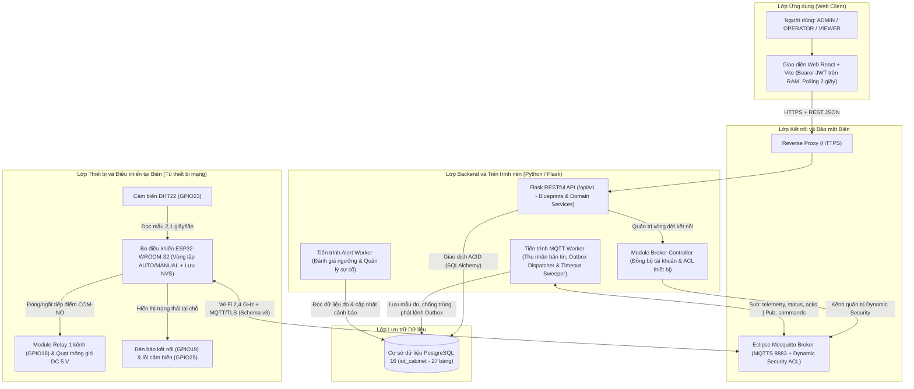
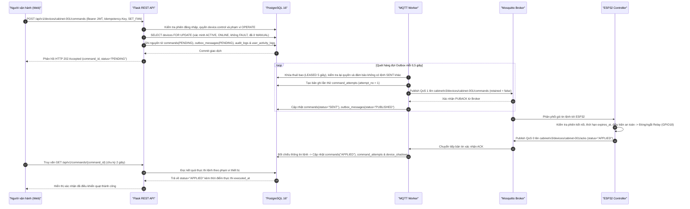
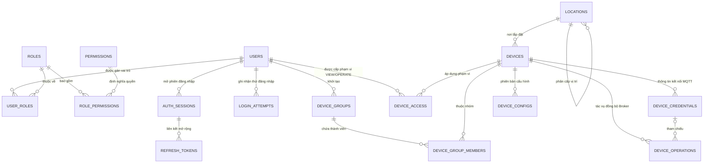
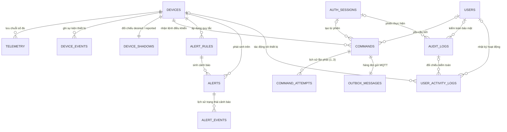
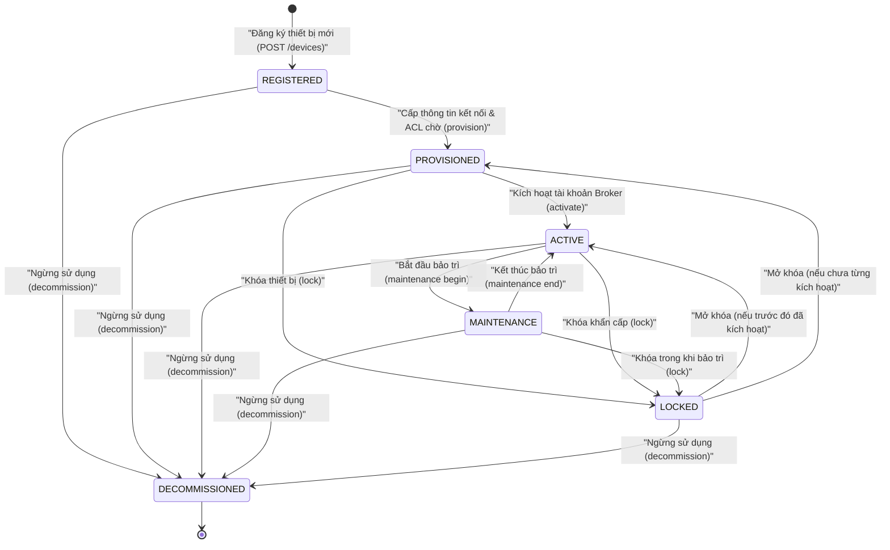
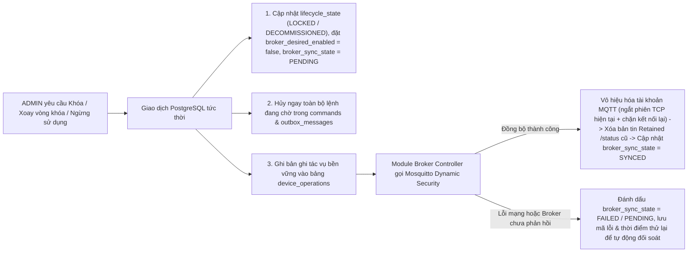

# CHƯƠNG 4: THIẾT KẾ PHẦN MỀM VÀ GIAO TIẾP DỮ LIỆU

Tiếp nối thiết kế mạch phần cứng và tổ chức phần mềm nhúng trên bo ESP32-WROOM-32 đã trình bày ở Chương 3, chương này mô tả chi tiết thiết kế hệ thống phần mềm phía máy chủ và cơ chế giao tiếp dữ liệu hai chiều của hệ thống. Nội dung chương bao gồm kiến trúc phân lớp tổng thể, lý do lựa chọn công nghệ, quy ước giao thức MQTT và luồng trao đổi bản tin, thiết kế cơ sở dữ liệu quan hệ trên PostgreSQL 16, kiến trúc Backend cùng hệ thống RESTful API và quy trình quản lý vòng đời thiết bị. Các cơ chế phân quyền chi tiết, bảo mật hệ thống, đánh giá cảnh báo và giao diện người dùng được trình bày tiếp nối ở mục 4.6 và mục 4.7.

## 4.1. Kiến trúc phần mềm

### 4.1.1. Sơ đồ kiến trúc tổng thể

Hệ thống phần mềm được thiết kế theo kiến trúc phân lớp kết hợp xử lý thông điệp bất đồng bộ qua hàng đợi cơ sở dữ liệu (Transactional Outbox), tách biệt rõ ràng giữa vòng điều khiển tự động tại biên (Edge), kênh truyền thông thông điệp IoT (MQTT Broker), khối dịch vụ xử lý nghiệp vụ và tiến trình nền (Backend API và Workers), tầng lưu trữ dữ liệu bền vững (PostgreSQL) và giao diện giám sát trên trình duyệt Web (React SPA).



*Hình 4.1 Sơ đồ kiến trúc phần mềm tổng thể của hệ thống*

Trách nhiệm kỹ thuật của từng lớp trong kiến trúc tổng thể được phân định cụ thể trong Bảng 4.1.

| Lớp kiến trúc | Thành phần triển khai | Trách nhiệm chính trong hệ thống | Khả năng mở rộng kiến trúc |
| :--- | :--- | :--- | :--- |
| **1. Lớp Thiết bị (Device Layer)** | Bo `ESP32-WROOM-32`, cảm biến `DHT22`, module relay 1 kênh, quạt `DC 5 V` hai dây, hai LED trạng thái | Thu thập nhiệt độ và độ ẩm theo chu kỳ 2,1 giây; đóng/ngắt nguồn tải quạt qua tiếp điểm `COM–NO`; lưu cấu hình bền vững trong bộ nhớ Flash `NVS` (`Preferences`). | Bổ sung node giám sát quạt độc lập đọc xung tốc độ quay (`TACH`) mà không phải thay đổi mạch điều khiển chính. |
| **2. Lớp Điều khiển tại Biên (Edge Layer)** | Tác vụ điều khiển cục bộ trên firmware ESP32 | Duy trì chế độ tự động `AUTO` theo trễ nhiệt hysteresis (bật ở 30 °C, tắt ở 28 °C); tự hủy `MANUAL` về `AUTO` khi hết thời hạn hoặc đứt mạng; ép bật quạt an toàn khi cảm biến lỗi 3 lần liên tiếp (`FAULT`). | Bổ sung bộ đệm vòng lưu tạm mẫu đo khi mất mạng để đồng bộ bù sau khi khôi phục kết nối. |
| **3. Lớp Kết nối (Connectivity Layer)** | Mạng Wi-Fi 2,4 GHz, `Eclipse Mosquitto 2.0` bật `Dynamic Security`, kênh `MQTTS` và `HTTPS` | Định tuyến bản tin hai chiều theo mô hình publish/subscribe; xác thực riêng từng thiết bị (`client_id` trùng `device_id`) và kiểm soát quyền truy cập ACL tới từng topic. | Bổ sung kênh truyền tải bản cập nhật firmware từ xa (`/ota`) trên cùng không gian tên topic. |
| **4. Lớp Backend và Tiến trình nền** | Ứng dụng `Flask` tổ chức theo `Blueprints` và `Services`, tách riêng `mqtt_worker` và `alert_worker` | Xác thực người dùng, kiểm tra phân quyền theo vai trò và phạm vi thiết bị, quản lý phiên bản cấu hình, điều phối lệnh qua hàng đợi `Outbox` và đánh giá quy tắc cảnh báo. | Ghép nối thêm dịch vụ phân tích tốc độ quay quạt hoặc tiến trình suy luận phát hiện bất thường độc lập. |
| **5. Lớp Dữ liệu (Data Layer)** | Hệ quản trị CSDL `PostgreSQL 16` (`iot_cabinet`) gồm 27 bảng quan hệ, quản lý lược đồ bằng `Alembic` | Bảo đảm tính toàn vẹn giao dịch ACID, khóa dòng chống tranh chấp cập nhật đồng thời (`SELECT ... FOR UPDATE`), lưu trữ chuỗi dữ liệu cảm biến, lịch sử lệnh, cảnh báo và nhật ký kiểm toán. | Mở rộng thêm các bảng thông tin tài sản quạt vật lý qua khóa ngoại chờ sẵn mà không sửa đổi các bảng hiện hữu. |
| **6. Lớp Ứng dụng (Application Layer)** | Ứng dụng Web đơn trang `React` + `Vite`, biểu đồ `Recharts`, cơ chế truy vấn định kỳ 2 giây | Cung cấp giao diện theo dõi nhiệt độ, độ ẩm, trạng thái quạt, gửi lệnh điều khiển `AUTO`/`MANUAL`, thay đổi ngưỡng cấu hình, xử lý cảnh báo, quản trị người dùng và xuất báo cáo CSV. | Bổ sung kênh đẩy sự kiện thời gian thực (`SSE`) cho giao diện giám sát quy mô nhiều tủ mạng. |

*Bảng 4.1 Phân chia trách nhiệm giữa các lớp trong kiến trúc phần mềm*

Để đảm bảo độ ổn định khi vận hành thực tế, kiến trúc phần mềm tuân thủ ba nguyên tắc tách biệt cốt lõi:
– **Tách rời tiến trình xử lý MQTT khỏi tiến trình phục vụ HTTP:** Máy chủ Web (`Flask`/`Gunicorn`) có thể khởi chạy nhiều tiến trình con để xử lý yêu cầu đồng thời từ trình duyệt. Nếu nhúng trực tiếp bộ lắng nghe MQTT vào tiến trình Web, mỗi bản tin cảm biến gửi lên sẽ bị nhân bản xử lý ở tất cả các tiến trình Web và gây tranh chấp cơ sở dữ liệu. Vì vậy, toàn bộ luồng thu nhận và phát bản tin MQTT được cô lập vào một tiến trình độc lập duy nhất là `mqtt_worker.py`.
– **Phối hợp liên tiến trình qua hàng đợi cơ sở dữ liệu (Transactional Outbox):** Khi người vận hành gửi lệnh bật/tắt quạt hoặc lưu cấu hình mới, `Flask API` không gọi trực tiếp hàm phát mạng MQTT trong luồng HTTP (tránh làm treo yêu cầu người dùng hoặc thất lạc lệnh khi kết nối tới Broker chập chờn). Thay vào đó, API ghi nguyên tử bản ghi lệnh (`commands`), bản tin hàng đợi (`outbox_messages`) và nhật ký thao tác vào PostgreSQL trong cùng một giao dịch rồi phản hồi `HTTP 202 Accepted`. Tiến trình `mqtt_worker` quét hàng đợi theo chu kỳ 0,5 giây để phát lệnh, theo dõi thời gian chờ phản hồi và gửi lại khi cần thiết.
– **Độc lập an toàn giữa điều khiển tại biên và phần mềm trung tâm:** Sự cố ngừng hoạt động ở tầng Backend, PostgreSQL hoặc Mosquitto Broker chỉ làm gián đoạn tạm thời việc hiển thị và điều khiển từ xa trên Web, hoàn toàn không làm ngưng trệ vòng lặp đọc cảm biến DHT22 và điều khiển relay bảo vệ nhiệt tại tủ thiết bị.

### 4.1.2. Lựa chọn công nghệ và lý do lựa chọn

Trên cơ sở khảo sát linh kiện phần cứng ở Chương 2 và Chương 3, các công nghệ phần mềm, giao thức truyền thông và cơ sở dữ liệu của hệ thống được lựa chọn dựa trên sự cân đối giữa tính tin cậy, khả năng kiểm soát bảo mật, độ phức tạp triển khai và sự phù hợp với đặc thù dữ liệu của bài toán. Bảng 4.2 tổng hợp các công nghệ được sử dụng cùng lý do lựa chọn và giải pháp khắc phục giới hạn kỹ thuật tương ứng.

| Hạng mục | Công nghệ lựa chọn | Lý do lựa chọn so với các phương án thay thế | Giới hạn kỹ thuật và biện pháp xử lý trong thiết kế |
| :--- | :--- | :--- | :--- |
| **Giao thức truyền thông IoT và Broker** | Giao thức **MQTT v3.1.1** và **Eclipse Mosquitto 2.0** (kèm plugin **Dynamic Security**) | So với việc để ESP32 gọi trực tiếp HTTP REST (tốn tài nguyên đóng/mở kết nối và khó nhận lệnh chiều xuống tức thời), MQTT duy trì một kết nối TCP nhẹ, trao đổi thông điệp hai chiều nhanh, hỗ trợ bản tin di chúc **LWT (Last Will and Testament)** để phát hiện mất kết nối tự động. Plugin **Dynamic Security** của Mosquitto cho phép tạo, khóa tài khoản thiết bị và cập nhật quyền ACL ngay khi hệ thống đang chạy mà không cần khởi động lại Broker. | Thư viện `PubSubClient` trên ESP32 chỉ hỗ trợ gửi bản tin chiều lên ở mức `QoS 0` và giới hạn bộ đệm mặc định nhỏ. Hệ thống cấu hình bộ đệm gói tin ở mức `2048 byte`, gắn số thứ tự `seq` để phát hiện mất/trùng gói tin và xác nhận lệnh bằng bản tin `ACK` ở tầng ứng dụng. |
| **Nền tảng Backend và Tiến trình nền** | **Python 3**, **Flask**, **SQLAlchemy 2.0**, **Marshmallow**, **paho-mqtt** | Kiến trúc *Application Factory* và *Blueprints* của Flask giúp tổ chức mã nguồn rõ ràng theo từng miền nghiệp vụ, đồng thời cho phép dùng chung hoàn toàn tầng mô hình dữ liệu (`Models`) và dịch vụ kiểm tra quyền (`PermissionService`) giữa máy chủ REST API với các tiến trình `mqtt_worker`, `alert_worker`. Hệ sinh thái Python cũng thuận lợi cho việc xử lý thống kê và mở rộng phân tích dữ liệu ở các giai đoạn sau. | Flask hoạt động theo mô hình đồng bộ (WSGI), không tối ưu nếu giữ hàng loạt kết nối luồng dài (WebSocket) cùng lúc. Thiết kế tách riêng tiến trình nền và giữ mọi giao dịch cơ sở dữ liệu trên API ngắn gọn, phản hồi nhanh. |
| **Hệ quản trị cơ sở dữ liệu** | **PostgreSQL 16** kết hợp công cụ quản lý phiên bản lược đồ **Flask-Migrate (Alembic)** | Với chu kỳ gửi số đo 5 giây/lần (tương đương khoảng 17.280 bản ghi/ngày/thiết bị), một hệ quản trị PostgreSQL 16 duy nhất kèm chỉ mục tổ hợp `(device_id, received_at DESC)` đáp ứng tốt tốc độ truy vấn chuỗi thời gian mà không cần vận hành thêm cơ sở dữ liệu phụ. PostgreSQL cung cấp giao dịch ACID, khóa dòng `SELECT ... FOR UPDATE`, chỉ mục duy nhất có điều kiện (*Partial Unique Index*), kiểu dữ liệu `JSONB` và thời gian chuẩn `TIMESTAMPTZ` vượt trội hơn SQLite hay các hệ lưu trữ không ràng buộc khóa ngoại. | Dữ liệu chuỗi thời gian và nhật ký tăng dần theo thời gian vận hành. Hệ thống thiết lập quy tắc giới hạn khoảng thời gian mỗi lần truy vấn (tối đa 31 ngày) và chính sách lưu giữ dữ liệu định kỳ để kiểm soát dung lượng lưu trữ. |
| **Xác thực người dùng và Quản lý phiên** | Băm mật khẩu **Argon2id** (`argon2-cffi`) và **Access JWT (15 phút)** đối chiếu phiên trên PostgreSQL | `Argon2id` có khả năng kháng tấn công dò mật khẩu bằng phần cứng chuyên dụng tốt hơn các hàm băm thông thường. Việc lưu Access JWT ngắn hạn trực tiếp trong bộ nhớ RAM của ứng dụng Web (không lưu vào `localStorage` hay `Cookie`) kết hợp kiểm tra bảng `auth_sessions` ở mỗi yêu cầu giúp ngăn nguy cơ đánh cắp token dài hạn qua XSS, loại bỏ bề mặt tấn công CSRF qua Cookie và cho phép thu hồi phiên tức thời khi đăng xuất hoặc khóa tài khoản. | Khi tải lại trang trình duyệt hoặc hết thời hạn 15 phút, người dùng cần đăng nhập lại. Sự đánh đổi này giúp cơ chế quản lý phiên đạt độ an toàn cao và minh bạch trong vận hành. |
| **Giao diện người dùng (Frontend)** | **React**, **Vite**, **React Router**, **Recharts** kết hợp cơ chế **HTTP Polling 2 giây** | React và Vite hỗ trợ xây dựng giao diện quản trị phân tách theo thành phần và vẽ biểu đồ biến thiên nhiệt độ, độ ẩm trực quan. Cơ chế truy vấn định kỳ 2 giây tới các API gọn nhẹ (`/latest`, `/commands`, `/alerts`) giúp mỗi lần cập nhật giao diện đều đi qua bước kiểm tra hiệu lực phiên và phạm vi phân quyền chuẩn xác, dễ xử lý lỗi mạng hơn kết nối WebSocket dài hạn. | Độ trễ hiển thị trên màn hình có thể cộng thêm tối đa 2 giây so với thời điểm máy chủ nhận dữ liệu, nhưng tổng độ trễ từ cảm biến đến giao diện vẫn nằm trong ngưỡng mục tiêu thiết kế (p95 ≤ 8 giây). |
| **Đóng gói và Triển khai hạ tầng** | **Docker Compose** (đóng gói PostgreSQL 16, Mosquitto 2.0, Backend API, Workers và Proxy) | Đảm bảo sự đồng nhất về phiên bản phần mềm, cấu hình mạng nội bộ và kịch bản khởi tạo dữ liệu giữa môi trường phát triển của các thành viên với môi trường chạy kiểm thử tích hợp toàn hệ thống. | Thiết bị phần cứng ESP32 nằm ngoài mạng ảo container, kết nối vào Mosquitto Broker thông qua địa chỉ IP mạng nội bộ (LAN) và cổng dịch vụ đã cấu hình mở. |

*Bảng 4.2 Tổng hợp các công nghệ phần mềm sử dụng và lý do lựa chọn*

## 4.2. Thiết kế giao thức MQTT và luồng dữ liệu

### 4.2.1. Cấu trúc Topic và quy ước đặt tên

Hệ thống chuẩn hóa không gian tên và định dạng bản tin theo hợp đồng giao tiếp **MQTT Schema v3**. Cách đánh phiên bản rõ ràng ngay trên đường dẫn topic giúp định tuyến thông điệp mạch lạc, phân tách quyền truy cập tới từng thiết bị và sẵn sàng mở rộng thêm chủng loại thiết bị mới trong tương lai mà không làm xáo trộn các thiết bị đang hoạt động.

Cấu trúc tổng quát của tất cả các topic trao đổi dữ liệu thiết bị tuân theo mẫu:

```text
cabinet/v3/devices/{device_id}/{channel}
```

Trong đó các thành phần định danh tuân thủ quy ước sau:
– **Thành phần `{device_id}`:** Là mã định danh duy nhất và bất biến của từng thiết bị trong bảng `devices`, tuân theo biểu thức chính quy `^[a-z0-9][a-z0-9_-]{2,63}$` (gồm chữ cái thường, chữ số, dấu gạch ngang hoặc gạch dưới, độ dài từ 3 đến 64 ký tự; ví dụ: `cabinet-001`, `sim-unassigned`). Khi thiết lập kết nối MQTT tới Broker, thiết bị bắt buộc sử dụng `client_id` trùng khớp với `device_id` và đăng nhập bằng tài khoản xác thực riêng đã được cấp phát.
– **Thành phần `{channel}`:** Phân tách bốn luồng thông điệp chức năng riêng biệt gồm dữ liệu đo (`telemetry`), trạng thái kết nối và nhịp tim (`status`), lệnh điều khiển từ máy chủ (`commands`) và phản hồi xác nhận thực thi lệnh (`acks`). Chi tiết thông số của từng kênh được trình bày trong Bảng 4.3.

| Kênh (`{channel}`) | Đường dẫn Topic đầy đủ | Chiều truyền dữ liệu | Mức QoS | Cờ Retained | Chức năng và chu kỳ hoạt động |
| :--- | :--- | :---: | :---: | :---: | :--- |
| **`telemetry`** | `cabinet/v3/devices/{device_id}/telemetry` | ESP32 → Backend Worker | `0` | `False` | Truyền định kỳ dữ liệu đo nhiệt độ, độ ẩm, trạng thái lỗi cảm biến, chế độ vận hành và đầu ra relay quạt (mặc định 5 giây/lần). |
| **`status`** | `cabinet/v3/devices/{device_id}/status` | ESP32 / Broker → Backend Worker | Heartbeat: `0`<br>LWT: `1` | `True` | Báo cáo trạng thái trực tuyến (`ONLINE`), thông tin phiên bản firmware/cấu hình định kỳ 15 giây/lần; và phát bản tin di chúc `OFFLINE` (`LWT`) khi mất kết nối đột ngột. |
| **`commands`** | `cabinet/v3/devices/{device_id}/commands` | Backend Worker → ESP32 | `1` | `False` | Gửi lệnh chuyển chế độ (`SET_MODE`), bật/tắt quạt thủ công (`SET_FAN`) hoặc áp dụng cấu hình ngưỡng mới (`APPLY_CONFIG`) xuống thiết bị. |
| **`acks`** | `cabinet/v3/devices/{device_id}/acks` | ESP32 → Backend Worker | `0` | `False` | Thiết bị gửi bản tin xác nhận ở tầng ứng dụng (`APPLIED` hoặc `REJECTED`) sau khi kiểm tra điều kiện an toàn và thực thi lệnh. |

*Bảng 4.3 Cấu trúc các kênh MQTT và thiết lập truyền thông của hệ thống*

Trên Mosquitto Broker, cơ chế kiểm soát truy cập danh sách quyền (ACL) thông qua plugin Dynamic Security được thiết lập theo nguyên tắc từ chối mặc định:
– Mỗi tài khoản thiết bị chỉ được cấp quyền gửi (*publish*) vào đúng ba kênh `/telemetry`, `/status`, `/acks` mang `{device_id}` của chính thiết bị đó, và chỉ được đăng ký nhận (*subscribe*) kênh `/commands` của chính mình; thiết bị hoàn toàn không thể đọc hoặc ghi dữ liệu sang topic của tủ thiết bị khác.
– Tài khoản dịch vụ của tiến trình `mqtt_worker` (`worker_service`) chỉ được quyền đăng ký nhận các kênh dữ liệu chiều lên `cabinet/v3/devices/+/{telemetry,status,acks}` và gửi lệnh vào `cabinet/v3/devices/{device_id}/commands`, tách biệt hoàn toàn với tài khoản quản trị `broker_admin` chuyên trách kênh điều khiển bảo mật động ``$CONTROL/dynamic-security/v1``.

### 4.2.2. Định dạng bản tin Telemetry và trạng thái thiết bị

Tất cả bản tin MQTT trao đổi trong hệ thống đều được mã hóa dưới dạng chuỗi JSON chuẩn UTF-8, đính kèm trường `"schema_version": 3`, giới hạn tổng kích thước gói tin không vượt quá `2048 byte` và không cho phép chứa các giá trị số thực đặc biệt ngoài chuẩn JSON (`NaN`, `Infinity`, `-Infinity`).

#### 1. Bản tin số đo môi trường và trạng thái đầu ra (`/telemetry`)

Định kỳ mỗi 5 giây, bo điều khiển ESP32 đóng gói kết quả đọc cảm biến DHT22 gần nhất cùng trạng thái điều khiển hiện hành và gửi lên topic `cabinet/v3/devices/{device_id}/telemetry` theo cấu trúc minh họa sau:

```json
{
  "schema_version": 3,
  "device_id": "cabinet-001",
  "profile": "CONTROLLER",
  "fan_binding_id": null,
  "boot_id": "4e5b9a32-c830-49c0-b86a-3b561a596389",
  "connection_id": "bdb0d8c6-70c9-414a-897e-45c451ee4ab8",
  "seq": 12,
  "measured_at": "2026-10-09T13:00:00Z",
  "clock_synced": true,
  "uptime_ms": 60000,
  "temperature_c": 31.2,
  "humidity_pct": 62.0,
  "sensor_ok": true,
  "fan_output": true,
  "mode": "AUTO",
  "config_version": 1,
  "config_hash": "3520a5738ade36fecf0a3f72ecf34e9f53fb2b2fe23e0a20245393e6a57a91cb",
  "fault_code": null,
  "extra": {}
}
```

Ý nghĩa và ràng buộc kỹ thuật của các trường dữ liệu chính trong bản tin telemetry được quy định như sau:
– **`device_id` và `profile`:** Trường `device_id` trong nội dung JSON bắt buộc trùng khớp tuyệt đối với `{device_id}` trên đường dẫn topic. Trường `profile` xác định vai trò phần cứng của node (`"CONTROLLER"` đối với bộ điều khiển nhiệt ẩm và relay quạt); trường `fan_binding_id` nhận giá trị `null` và được giữ sẵn cho mục đích ghép nối mở rộng về sau.
– **`boot_id`, `connection_id` và `seq`:** `boot_id` là mã UUID sinh mới mỗi lần vi điều khiển khởi động nguồn; `connection_id` là mã UUID sinh mới mỗi khi thiết lập lại phiên kết nối MQTT; `seq` là số nguyên không âm tăng đơn điệu theo từng mẫu phát trong cùng một lần khởi động. Bộ ba `(device_id, boot_id, seq)` tạo thành khóa định danh duy nhất cho từng mẫu dữ liệu cảm biến.
– **`clock_synced` và `measured_at`:** Khi thiết bị đã đồng bộ giờ NTP hợp lệ (`clock_synced = true`), `measured_at` ghi thời điểm đo theo chuẩn UTC ISO-8601. Trường hợp thiết bị vừa khởi động nhưng chưa đồng bộ được đồng hồ thời gian thực (`clock_synced = false`), thiết bị gửi `"measured_at": null` và máy chủ sử dụng mốc thời gian tiếp nhận `received_at` để sắp xếp chuỗi thời gian.
– **`sensor_ok`, `temperature_c`, `humidity_pct` và `fault_code`:** Khi cảm biến DHT22 đọc hợp lệ (`sensor_ok = true`), `temperature_c` nằm trong dải `[-40.0, 80.0]` (°C) và `humidity_pct` nằm trong dải `[0.0, 100.0]` (%RH). Khi cảm biến xảy ra lỗi đọc hoặc đứt dây tín hiệu (`sensor_ok = false`), cả hai trường `temperature_c` và `humidity_pct` bắt buộc đặt bằng `null` kèm mã nguyên nhân trong `fault_code` (ví dụ `"DHT_READ_TIMEOUT"`), tuyệt đối không thay thế bằng số `0` nhằm tránh làm sai lệch kết quả thống kê trung bình và đồ thị lịch sử.
– **`fan_output`, `mode`, `config_version` và `config_hash`:** `mode` nhận giá trị `"AUTO"` hoặc `"MANUAL"`. Trường boolean `fan_output` phản ánh trạng thái xuất tín hiệu điều khiển chân relay (`true` ứng với đóng tiếp điểm cấp nguồn quạt, `false` ứng với ngắt nguồn quạt). Cặp `config_version` và `config_hash` báo cáo chính xác phiên bản cùng mã băm SHA-256 của cấu hình đang lưu trong bộ nhớ NVS tại thiết bị.

#### 2. Bản tin trạng thái kết nối (`/status`) và bản tin di chúc (`LWT`)

Ngay sau khi kết nối thành công tới Mosquitto Broker và định kỳ mỗi 15 giây, ESP32 gửi bản tin trạng thái lên kênh `cabinet/v3/devices/{device_id}/status` (có cờ `retained = True`):

```json
{
  "schema_version": 3,
  "device_id": "cabinet-001",
  "profile": "CONTROLLER",
  "connection": "ONLINE",
  "boot_id": "4e5b9a32-c830-49c0-b86a-3b561a596389",
  "connection_id": "bdb0d8c6-70c9-414a-897e-45c451ee4ab8",
  "status_seq": 1,
  "config_version": 1,
  "config_hash": "3520a5738ade36fecf0a3f72ecf34e9f53fb2b2fe23e0a20245393e6a57a91cb",
  "firmware_version": "1.2.0",
  "hardware_version": "esp32-wroom32-dht22-relay-controller-v1",
  "uptime_ms": 60000,
  "clock_synced": true,
  "health": "OK",
  "fault_code": null
}
```

Đồng thời, ngay lúc bắt tay kết nối MQTT (`CONNECT`), firmware đăng ký trước với Broker bản tin di chúc **Last Will and Testament (LWT)** trên cùng topic `/status` với `QoS = 1` và `retained = True`:

```json
{
  "schema_version": 3,
  "device_id": "cabinet-001",
  "connection": "OFFLINE",
  "boot_id": "4e5b9a32-c830-49c0-b86a-3b561a596389",
  "connection_id": "bdb0d8c6-70c9-414a-897e-45c451ee4ab8",
  "reason": "LWT"
}
```

Khi thiết bị mất nguồn hoặc đứt mạng Wi-Fi khiến phiên TCP bị ngắt bất thường, Mosquitto Broker tự động phát bản tin LWT này tới `mqtt_worker`. Việc gắn kèm `boot_id` và `connection_id` vào gói LWT giúp Backend kiểm chứng đúng phiên kết nối vừa bị đứt, tránh trường hợp một gói LWT đến trễ làm ghi đè nhầm trạng thái của phiên kết nối mới vừa khôi phục.

### 4.2.3. Định dạng lệnh điều khiển và bản tin xác nhận

#### 1. Định dạng lệnh điều khiển chiều xuống (`/commands`)

Tiến trình `mqtt_worker` phát lệnh điều khiển xuống topic `cabinet/v3/devices/{device_id}/commands` với `QoS = 1` và `retained = False`. Đối với bộ điều khiển tủ mạng, hệ thống hỗ trợ ba loại lệnh chuẩn:
– **`SET_MODE`:** Chuyển chế độ làm việc của thiết bị về tự động (`"params": {"mode": "AUTO"}`) hoặc chuyển sang điều khiển thủ công có thời hạn tự thu hồi (`"params": {"mode": "MANUAL", "duration_s": 60}`, cho phép cấu hình trong khoảng 10–300 giây).
– **`SET_FAN`:** Đặt trạng thái đóng/ngắt quạt tường minh (`"params": {"on": true}` hoặc `{"on": false}`). Hệ thống sử dụng giá trị đích tuyệt đối thay cho lệnh đảo trạng thái (`toggle`) để đảm bảo tính lũy đẳng khi gửi lại gói tin, và chỉ chấp nhận lệnh này khi thiết bị đang ở chế độ `MANUAL` đã được xác nhận áp dụng.
– **`APPLY_CONFIG`:** Đồng bộ bản chụp cấu hình mới xuống thiết bị (`"params": {"config_version": 2, "config_json": "<chuỗi JSON chuẩn tắc>", "content_hash": "<mã băm SHA-256>"}`).

Cấu trúc đầy đủ của một bản tin lệnh điều khiển `SET_FAN` có dạng như sau:

```json
{
  "schema_version": 3,
  "device_id": "cabinet-001",
  "command_id": "d5cf70aa-f944-46bf-8c2d-fd36450f3276",
  "type": "SET_FAN",
  "device_command_seq": 8,
  "expected_boot_id": "4e5b9a32-c830-49c0-b86a-3b561a596389",
  "expected_connection_id": "bdb0d8c6-70c9-414a-897e-45c451ee4ab8",
  "params": {
    "on": true
  },
  "issued_at": "2026-10-09T13:00:00Z",
  "expires_at": "2026-10-09T13:00:15Z"
}
```

Đối với lệnh `APPLY_CONFIG`, để đảm bảo cả Backend Python và firmware C/C++ trên ESP32 tính ra cùng một giá trị kiểm tra toàn vẹn mà không bị sai lệch do thứ tự khóa hoặc định dạng khoảng trắng, chuỗi `config_json` được chuẩn hóa theo dạng JSON chuẩn tắc (sắp xếp khóa theo thứ tự từ điển, loại bỏ khoảng trắng thừa sau dấu phẩy và dấu hai chấm). Trường `content_hash` là mã băm `SHA-256` tính trực tiếp trên dãy byte UTF-8 của chuỗi `config_json`. Khi nhận lệnh, ESP32 kiểm tra mã băm của chuỗi nhận được khớp với `content_hash` rồi lưu bền vững vào bộ nhớ NVS trước khi gửi phản hồi xác nhận.

#### 2. Định dạng bản tin xác nhận chiều lên (`/acks`)

Sau khi kiểm tra tính hợp lệ của lệnh và cập nhật đầu ra phần cứng hoặc bộ nhớ NVS, ESP32 gửi bản tin xác nhận lên topic `cabinet/v3/devices/{device_id}/acks`:

```json
{
  "schema_version": 3,
  "device_id": "cabinet-001",
  "command_id": "d5cf70aa-f944-46bf-8c2d-fd36450f3276",
  "status": "APPLIED",
  "type": "SET_FAN",
  "boot_id": "4e5b9a32-c830-49c0-b86a-3b561a596389",
  "connection_id": "bdb0d8c6-70c9-414a-897e-45c451ee4ab8",
  "device_command_seq": 8,
  "executed_at": "2026-10-09T13:00:01Z",
  "result": {
    "fan_output": true,
    "mode": "MANUAL",
    "config_version": 1,
    "config_hash": "3520a5738ade36fecf0a3f72ecf34e9f53fb2b2fe23e0a20245393e6a57a91cb"
  },
  "error_code": null
}
```

Nếu lệnh không thỏa mãn điều kiện thực thi tại thiết bị (ví dụ: lệnh đã quá thời hạn `expires_at`, sai phiên kết nối `expected_connection_id`, sai mã băm cấu hình, hoặc yêu cầu tắt quạt trong lúc cảm biến đang ở trạng thái lỗi `FAULT`), firmware từ chối tác động lên phần cứng và trả về `"status": "REJECTED"` cùng mã lỗi cụ thể trong trường `"error_code"`.

### 4.2.4. Cơ chế QoS, timeout, gửi lại và xử lý bản tin trùng lặp

Trong môi trường mạng không dây Wi-Fi, gói tin có thể bị trễ, mất hoặc phát lặp khi kết nối chập chờn. Do đó, hệ thống kết hợp thiết lập mức chất lượng dịch vụ MQTT (QoS) với quy trình quản lý thời gian chờ (timeout), gửi lại có kiểm soát (retry) và khử trùng lặp (deduplication) ở tầng ứng dụng.

#### 1. Lựa chọn mức QoS và cờ lưu giữ bản tin (Retained)
– **Chiều từ thiết bị lên máy chủ (`/telemetry`, `/acks` dùng `QoS 0`, `retained = False`):** Phù hợp với đặc tính của thư viện `PubSubClient` trên ESP32, giảm thiểu thời gian chờ bắt tay trên vi điều khiển để ưu tiên độ ổn định cho vòng lặp đo và điều khiển quạt tại chỗ. Nếu một mẫu đo bị rớt trên đường truyền, mẫu đo tiếp theo sau 5 giây sẽ bổ sung trạng thái mới; nếu bản tin `ACK` bị mất, cơ chế gửi lại lệnh từ Worker sẽ kích hoạt thiết bị gửi lại bản tin `ACK` đã lưu đệm.
– **Chiều từ máy chủ xuống thiết bị (`/commands` dùng `QoS 1`, `retained = False`):** Đảm bảo Mosquitto Broker chuyển phát lệnh tối thiểu một lần tới phiên kết nối đang hoạt động của ESP32. Cờ `retained` bắt buộc đặt bằng `False` để ngăn nguy cơ một lệnh bật/tắt quạt thủ công cũ lưu trên Broker tự động kích hoạt lại ngoài ý muốn khi thiết bị vừa khởi động lại sau sự cố mất điện.
– **Phân tách xác nhận tầng Broker và xác nhận tầng thiết bị:** Khi `mqtt_worker` phát gói tin lệnh `QoS 1` thành công tới Mosquitto (`PUBACK`), hệ thống chỉ ghi nhận lệnh ở trạng thái đã gửi (`SENT`), tuyệt đối chưa kết luận quạt đã bật hay cấu hình đã được áp dụng. Trạng thái thành công (`APPLIED`) chỉ được xác lập khi nhận bản tin hợp lệ trên kênh `/acks` từ chính ESP32.

#### 2. Quy tắc thời hạn lệnh, lịch gửi lại và xử lý quá hạn (Timeout)
Các thông số định thời cho một vòng đời lệnh điều khiển và giám sát kết nối được chuẩn hóa trong Bảng 4.4.

| Tham số định thời | Giá trị thiết kế | Cơ chế xử lý của hệ thống |
| :--- | :---: | :--- |
| **Thời hạn hiệu lực của lệnh (`expires_at`)** | `15 giây` tính từ `issued_at` | Các lần gửi lại giữ nguyên `command_id`, `device_command_seq` và mốc `expires_at` ban đầu; không gia hạn thêm thời gian hiệu lực của lệnh. |
| **Lịch gửi lại lệnh chưa có ACK (Retry)** | Tối đa `3 lần phát` (`t = 0s, +3s, +6s`) | Nếu lệnh đang ở trạng thái `SENT` mà chưa nhận được `ACK`, bộ điều phối đặt lại hàng đợi để phát lại lần 2 ở giây thứ 3 và lần 3 ở giây thứ 6. |
| **Ngưỡng quá hạn chờ phản hồi (`ACK_TIMEOUT`)** | `10 giây` tính từ `sent_at` | Khi quá 10 giây kể từ lần gửi đầu tiên (hoặc chạm `expires_at`) mà chưa có `ACK`, lệnh được chuyển sang trạng thái `TIMEOUT` để thông báo rõ trên giao diện rằng chưa xác nhận được kết quả thực thi. |
| **Phản hồi ACK đến trễ sau Timeout** | Sau mốc `TIMEOUT` | Nếu gói `ACK` hợp lệ đến muộn sau khi lệnh đã bị đánh dấu `TIMEOUT`, Backend cập nhật trạng thái lệnh sang `APPLIED_LATE` để đồng bộ đúng lịch sử và trạng thái thực tế của thiết bị. |
| **Ngưỡng phát hiện mất kết nối (`OFFLINE`)** | `45 giây` (3 chu kỳ heartbeat) | Bên cạnh việc nhận tức thời bản tin di chúc `LWT`, bộ quét định kỳ mỗi 1 giây tại Worker sẽ chuyển các thiết bị không có bản tin hợp lệ trong 45 giây liên tiếp sang trạng thái `OFFLINE`. |

*Bảng 4.4 Quy tắc định thời, gửi lại lệnh và phát hiện mất kết nối*

#### 3. Cơ chế chống trùng lặp và bảo vệ thứ tự trạng thái
– **Chống gửi trùng yêu cầu từ trình duyệt Web:** Các API tạo lệnh điều khiển và cập nhật cấu hình yêu cầu đính kèm khóa lũy đẳng `Idempotency-Key`. Nếu trình duyệt gửi lặp cùng một yêu cầu mạng với cùng khóa và tham số, Backend trả lại đúng bản ghi lệnh đã tạo trước đó; nếu trùng khóa nhưng khác nội dung tham số, hệ thống từ chối với mã lỗi `HTTP 409 Conflict`.
– **Chống thực thi lặp lệnh trên ESP32:** Firmware lưu lại số thứ tự lệnh lớn nhất đã xử lý trong phiên kết nối cùng bộ đệm vòng kết quả `ACK` của các lệnh gần nhất. Khi nhận một gói lệnh gửi lại có cùng `command_id` và `device_command_seq`, ESP32 chỉ phát lại bản tin `ACK` tương ứng mà không đóng ngắt lại relay và không đặt lại bộ đếm thời gian của chế độ `MANUAL`.
– **Chống ghi trùng và chống lùi trạng thái tại Backend:**
  + Đối với dữ liệu cảm biến: Bảng `telemetry` áp dụng ràng buộc duy nhất `UQ(device_id, boot_id, seq)` kết hợp đối chiếu mã băm toàn bộ gói tin `raw_payload_hash`. Bản tin gửi trùng y hệt được bỏ qua an toàn; bản tin đến trễ có số thứ tự `seq` nhỏ hơn hoặc bằng `latest_seq` hiện tại vẫn được lưu vào lịch sử chuỗi thời gian nhưng không được phép ghi đè lùi trạng thái tức thời trên bảng `devices` và `device_shadows`.
  + Đối với bản tin trạng thái: Bản tin `ONLINE` mang cờ `retain = True` nhận được khi `mqtt_worker` mới khởi động lại không được dùng để cập nhật mốc `last_seen_at`; bản tin `LWT` có `connection_id` cũ khác với phiên kết nối hiện tại bị loại bỏ để bảo vệ phiên vừa kết nối lại.

### 4.2.5. Sequence Diagram cho luồng gửi dữ liệu và điều khiển quạt

Hai biểu đồ tuần tự dưới đây mô tả chi tiết trình tự tương tác giữa phần cứng ESP32, Mosquitto Broker, các tiến trình Backend, PostgreSQL và giao diện Web cho hai luồng hoạt động cốt lõi của hệ thống.

```mermaid
sequenceDiagram
  autonumber
  participant ESP as "ESP32 (DHT22 + Relay)"
  participant BRK as "Mosquitto Broker"
  participant WRK as "MQTT Worker"
  participant DB as "PostgreSQL 16"
  participant ALT as "Alert Worker"
  participant WEB as "Giao diện Web & Flask API"

  ESP->>ESP: Đọc DHT22 chu kỳ 2,1 giây, duy trì điều khiển AUTO tại chỗ
  ESP->>BRK: Publish QoS 0 lên cabinet/v3/devices/cabinet-001/telemetry (5 giây/lần)
  BRK->>WRK: Chuyển tiếp bản tin qua kiểm tra quyền ACL
  WRK->>WRK: Kiểm tra kích thước <= 2048 byte, cú pháp JSON, miền đo và schema v3
  WRK->>DB: SELECT devices FOR UPDATE (kiểm tra trạng thái ACTIVE/MAINTENANCE & config_hash)
  alt Mẫu đo mới hợp lệ (seq > latest_seq)
    WRK->>DB: INSERT telemetry, UPDATE devices (last_seen_at, latest_seq) và device_shadows
    DB-->>WRK: Xác nhận lưu giao dịch thành công
  else Bản tin trùng lặp cùng mã băm payload
    WRK-->>WRK: Bỏ qua lũy đẳng, giữ nguyên dữ liệu lịch sử
  end
  ALT->>DB: Đọc mẫu đo & cấu hình đã áp dụng, cập nhật trạng thái cảnh báo trong bảng alerts
  WEB->>DB: GET /api/v1/devices/cabinet-001/latest (kiểm tra JWT, phiên và phạm vi truy cập)
  DB-->>WEB: Trả về nhiệt độ, độ ẩm, fan_output, mode và trạng thái đồng bộ cấu hình
```

*Hình 4.2 Biểu đồ tuần tự luồng thu thập dữ liệu cảm biến và cập nhật giám sát*



*Hình 4.3 Biểu đồ tuần tự luồng điều khiển quạt thủ công từ giao diện Web xuống ESP32*

## 4.3. Thiết kế cơ sở dữ liệu

### 4.3.1. Sơ đồ thực thể liên kết (ERD)

Toàn bộ dữ liệu nghiệp vụ, cấu hình, số đo cảm biến, lệnh điều khiển, sự cố cảnh báo và nhật ký truy vết được lưu trữ tập trung trong cơ sở dữ liệu **`PostgreSQL 16` (`iot_cabinet`)** gồm **27 bảng quan hệ**. Tất cả các trường dấu thời gian đều sử dụng kiểu `TIMESTAMPTZ` chuẩn hóa theo múi giờ UTC; khóa chính của các bảng sử dụng kiểu `UUID` (riêng bảng trung tâm `devices` sử dụng mã định danh chuỗi `device_id` kiểu `VARCHAR(64)` bất biến). Để trình bày rõ ràng các mối liên kết khóa ngoại, sơ đồ thực thể liên kết được chia thành hai cụm phân hệ trực quan trong Hình 4.4 và Hình 4.5.



*Hình 4.4 Sơ đồ liên kết các thực thể phân hệ định danh, phân quyền và quản lý thiết bị*



*Hình 4.5 Sơ đồ liên kết các thực thể phân hệ dữ liệu cảm biến, điều khiển, cảnh báo và nhật ký*

### 4.3.2. Mô tả các bảng dữ liệu chính

Cấu trúc khóa chính, khóa ngoại, các cột trọng tâm và ràng buộc toàn vẹn của 27 bảng trong cơ sở dữ liệu `iot_cabinet` được trình bày theo bốn nhóm chức năng từ Bảng 4.5 đến Bảng 4.8.

| STT | Tên bảng | Các cột khóa và thuộc tính trọng tâm | Ràng buộc toàn vẹn và vai trò lưu trữ |
| :-: | :--- | :--- | :--- |
| 1 | **`users`** | `id` (UUID PK), `username`, `password_hash`, `full_name`, `status`, `must_change_password`, `token_version`, `failed_login_count`, `locked_until` | `UQ(username)`, `CHECK status IN ('ACTIVE','LOCKED','ARCHIVED')`. Lưu mật khẩu băm `Argon2id`; không lưu cột vai trò trực tiếp trên bảng `users` để tránh mâu thuẫn dữ liệu; tăng `token_version` khi khóa tài khoản hoặc đổi mật khẩu để thu hồi hiệu lực token cũ. |
| 2 | **`roles`** | `id` (UUID PK), `code` (`ADMIN`, `OPERATOR`, `VIEWER`), `name`, `is_system` | `UQ(code)`. Lưu danh mục ba vai trò người dùng chuẩn của hệ thống. |
| 3 | **`permissions`** | `id` (UUID PK), `code`, `scope_type`, `description` | `UQ(code)`, `CHECK scope_type IN ('GLOBAL','DEVICE','SELF')`. Danh mục các mã quyền thao tác nguyên tử (như `device.control`, `device.configure`, `telemetry.export`). |
| 4 | **`role_permissions`** | `PK(role_id, permission_id)`, `granted_by`, `created_at` | Bảng ánh xạ quan hệ nhiều – nhiều giữa vai trò và các mã quyền được phép thực hiện. |
| 5 | **`user_roles`** | `PK(user_id, role_id)`, `assigned_by`, `created_at` | Gán vai trò cho người dùng, bổ sung ràng buộc `UQ(user_id)` đảm bảo mỗi tài khoản giữ đúng một vai trò hệ thống tại một thời điểm. |
| 6 | **`auth_sessions`** | `id` (UUID PK), `user_id` (FK), `token_version`, `created_at`, `expires_at`, `revoked_at`, `revoke_reason`, `ip_address`, `user_agent` | Quản lý trạng thái phiên đăng nhập phía máy chủ với thời hạn 15 phút đồng bộ cùng Access JWT. Bản ghi phiên được giữ lại sau khi đăng xuất để bảo toàn khóa ngoại cho lệnh điều khiển và nhật ký kiểm toán. |
| 7 | **`refresh_tokens`** | `id` (UUID PK), `session_id` (FK), `token_hash` | Bảng dự phòng trong lược đồ cho phương án làm mới phiên tự động khi mở rộng hệ thống; không phát hành trong cấu hình Access JWT ngắn hạn hiện tại. |
| 8 | **`login_attempts`** | `id` (UUID PK), `username_key`, `ip_key`, `success`, `failure_code`, `occurred_at` | Lưu vết thử đăng nhập bằng khóa băm HMAC-SHA256 để kiểm soát giới hạn tốc độ chống đoán mật khẩu (tối đa 5 lần sai/tài khoản/15 phút và 20 lần sai/IP/15 phút) mà không lưu lộ chuỗi tên đăng nhập nhập sai. |

*Bảng 4.5 Nhóm bảng quản lý định danh, phân quyền và phiên đăng nhập*

| STT | Tên bảng | Các cột khóa và thuộc tính trọng tâm | Ràng buộc toàn vẹn và vai trò lưu trữ |
| :-: | :--- | :--- | :--- |
| 9 | **`locations`** | `id` (UUID PK), `code`, `name`, `parent_id` (FK tự tham chiếu) | `UQ(code)`. Quản lý sơ đồ phân cấp vị trí vật lý lắp đặt tủ thiết bị mạng (tòa nhà, phòng máy, dãy tủ). |
| 10 | **`device_groups`** | `id` (UUID PK), `code`, `name`, `created_by` (FK) | `UQ(code)`. Tổ chức phân nhóm thiết bị phục vụ quản lý danh mục. |
| 11 | **`device_group_members`** | `PK(group_id, device_id)`, `added_by` (FK) | Bảng liên kết gán thiết bị vào các nhóm quản lý. |
| 12 | **`devices`** | `device_id` (`VARCHAR(64)` PK), `name`, `location_id`, `device_type`, `data_source`, `lifecycle_state`, `connection_state`, `health_state`, `current_boot_id`, `current_connection_id`, `latest_seq`, `last_command_seq`, `last_seen_at`, `desired_config_version`, `applied_config_version`, `broker_desired_enabled`, `broker_actual_enabled`, `broker_sync_state` | Bảng trung tâm quản lý thiết bị. Tách biệt ba chiều trạng thái độc lập (`lifecycle_state`, `connection_state`, `health_state`), phân biệt thiết bị thật và mô phỏng (`REAL`/`SIMULATED`), đồng thời quản lý hai con trỏ phiên bản cấu hình mong muốn và cấu hình đã áp dụng. |
| 13 | **`device_access`** | `id` (UUID PK), `device_id` (FK), `user_id` (FK), `access_level` (`VIEW` / `OPERATE`), `expires_at` | `UQ(device_id, user_id)`. Quy định phạm vi truy cập trên từng thiết bị cụ thể cho tài khoản `OPERATOR` và `VIEWER`. |
| 14 | **`device_credentials`** | `id` (UUID PK), `device_id` (FK), `credential_version`, `mqtt_username`, `client_id`, `status`, `issued_at`, `revoked_at` | `UQ(device_id, credential_version)`, Partial Unique Index `WHERE status = 'ACTIVE'` bảo đảm mỗi thiết bị chỉ có tối đa một thông tin xác thực MQTT đang hiệu lực; không lưu mật khẩu dạng rõ trong CSDL. |
| 15 | **`device_configs`** | `id` (UUID PK), `device_id` (FK), `version`, `profile`, `fan_on_c`, `fan_off_c`, `temp_alert_c`, `humidity_alert_pct`, `temp_clear_margin_c`, `humidity_clear_margin_pct`, `manual_timeout_s`, `telemetry_interval_ms`, `canonical_json`, `content_hash` | `UQ(device_id, version)`. Lưu lịch sử phiên bản cấu hình bất biến kèm chuỗi chuẩn tắc `canonical_json` và mã băm `SHA-256` `content_hash`. |
| 16 | **`device_operations`** | `id` (UUID PK), `device_id` (FK), `operation_type`, `status`, `phase`, `attempts`, `error_code`, `idempotency_key`, `request_hash` | Theo dõi bền vững các tác vụ quản trị tài khoản thiết bị trên Mosquitto Broker (`PROVISION`, `ACTIVATE`, `LOCK`, `UNLOCK`, `DECOMMISSION`, `ROTATE_CREDENTIAL`); chặn chạy chồng chéo hai tác vụ đang thực thi trên cùng thiết bị. |

*Bảng 4.6 Nhóm bảng tổ chức vị trí, thiết bị, cấu hình và đồng bộ Broker*

| STT | Tên bảng | Các cột khóa và thuộc tính trọng tâm | Ràng buộc toàn vẹn và vai trò lưu trữ |
| :-: | :--- | :--- | :--- |
| 17 | **`telemetry`** | `id` (UUID PK), `device_id` (FK), `profile`, `boot_id`, `connection_id`, `seq`, `measured_at`, `received_at`, `uptime_ms`, `clock_synced`, `temperature_c`, `humidity_pct`, `sensor_ok`, `fan_output`, `mode`, `config_version`, `config_hash`, `fault_code`, `raw_payload_hash` | `UQ(device_id, boot_id, seq)` chống ghi trùng mẫu đo; đánh chỉ mục `ix_telemetry_device_received (device_id, received_at DESC)` giúp tăng tốc độ truy vấn lịch sử, thống kê và xuất tệp CSV. |
| 18 | **`device_events`** | `id` (UUID PK), `device_id` (FK), `event_type`, `source`, `boot_id`, `connection_id`, `received_at`, `details`, `dedup_key` | Ghi lại các sự kiện chuyển đổi trạng thái quan trọng của thiết bị (`BOOT`, `ONLINE`, `OFFLINE`, `FAULT`, bảo trì, khóa) thay vì lưu dàn trải mọi gói tin nhịp tim không đổi trạng thái. |
| 19 | **`device_shadows`** | `device_id` (PK & FK), `desired` (JSONB), `reported` (JSONB), `desired_version`, `reported_version`, `desired_at`, `reported_at`, `drift_status` | Quan hệ 1 – 1 với bảng `devices`, lưu ảnh chụp cấu hình mong muốn (`desired`) đối chiếu với trạng thái thực tế thiết bị báo về (`reported`) và tính trạng thái đồng bộ `drift_status` (`IN_SYNC`, `PENDING`, `STALE`, `UNKNOWN`). |
| 20 | **`commands`** | `command_id` (UUID PK), `device_id` (FK), `requested_by` (FK), `requesting_session_id` (FK), `source`, `type`, `params`, `device_command_seq`, `idempotency_key`, `status`, `requested_at`, `expires_at`, `sent_at`, `ack_at`, `executed_at`, `attempts`, `result`, `error_code` | `UQ(device_id, device_command_seq)` và chỉ mục duy nhất có điều kiện `uq_commands_single_sent_per_device` (`WHERE status = 'SENT'`) bảo đảm mỗi thiết bị chỉ có tối đa một lệnh đang chờ phản hồi ACK trên đường truyền tại một thời điểm. |
| 21 | **`command_attempts`** | `id` (UUID PK), `command_id` (FK), `attempt_no`, `dispatch_started_at`, `broker_confirmed_at`, `ack_received_at`, `outcome`, `error_code`, `worker_id` | `UQ(command_id, attempt_no)`. Lưu chi tiết từng lần phát lệnh (từ lần 1 đến lần 3), phục vụ phân biệt rõ giai đoạn Broker đã nhận gói tin với giai đoạn ESP32 đã phản hồi xác nhận. |
| 22 | **`outbox_messages`** | `id` (UUID PK), `command_id` (UUID FK Unique), `topic`, `payload` (JSONB), `qos`, `retained`, `status`, `available_at`, `lease_until`, `locked_by`, `publish_count` | Bảng hàng đợi truyền thông bền vững theo mẫu *Transactional Outbox*, sử dụng cơ chế khóa thuê bao có thời hạn (`lease_until`) để đảm bảo không mất lệnh khi tiến trình Worker khởi động lại. |

*Bảng 4.7 Nhóm bảng lưu trữ dữ liệu cảm biến, bản sao trạng thái và hàng đợi lệnh*

| STT | Tên bảng | Các cột khóa và thuộc tính trọng tâm | Ràng buộc toàn vẹn và vai trò lưu trữ |
| :-: | :--- | :--- | :--- |
| 23 | **`alert_rules`** | `id` (UUID PK), `device_id` (FK), `code`, `enabled`, `severity`, `condition_source` | `UQ(device_id, code)`. Quản lý danh mục bốn quy tắc cảnh báo cho mỗi thiết bị (`HIGH_TEMPERATURE`, `HIGH_HUMIDITY`, `OFFLINE`, `SENSOR_FAULT`). |
| 24 | **`alerts`** | `id` (UUID PK), `device_id` (FK), `rule_id` (FK), `type`, `severity`, `status` (`OPEN`/`ACKNOWLEDGED`/`RESOLVED`), `opened_at`, `cleared_at`, `acknowledged_by`, `resolved_by`, `observed_value`, `threshold`, `evaluation_quality`, `condition_active` | Ràng buộc Partial Unique Index `uq_live_alert (device_id, rule_id) WHERE status <> 'RESOLVED'` đảm bảo không sinh hai cảnh báo đang mở trùng lặp cho cùng một quy tắc trên một thiết bị. |
| 25 | **`alert_events`** | `id` (UUID PK), `alert_id` (FK), `event_type`, `actor_user_id` (FK), `actor_type`, `occurred_at`, `note`, `evidence` | Lưu lịch sử diễn biến vòng đời cảnh báo theo nguyên tắc chỉ ghi nối tiếp (*append-only*): `OPENED`, `UPDATED`, `ACKNOWLEDGED`, `CLEARED`, `REACTIVATED`, `RESOLVED`. |
| 26 | **`audit_logs`** | `id` (UUID PK), `actor_user_id` (FK), `actor_session_id` (FK), `actor_type`, `actor_name_snapshot`, `device_id`, `action`, `target_type`, `target_id`, `success`, `reason_code`, `request_id`, `ip_address`, `detail` | Nhật ký kiểm toán bảo mật bất biến phục vụ quản trị viên tra cứu; tự động loại bỏ mật khẩu, JWT và thông tin xác thực MQTT trước khi ghi. |
| 27 | **`user_activity_logs`** | `id` (UUID PK), `actor_user_id` (FK), `actor_session_id` (FK), `actor_name_snapshot`, `function_key`, `action`, `device_id`, `outcome`, `summary`, `request_id`, `related_audit_log_id`, `metadata` | `UQ(request_id, function_key, action)`. Ghi nhận lịch sử sử dụng các chức năng chính của người dùng (đăng nhập, điều khiển quạt, sửa cấu hình, xử lý cảnh báo, xuất CSV); không ghi các yêu cầu đọc định kỳ để tránh làm phình dữ liệu. |

*Bảng 4.8 Nhóm bảng quản lý cảnh báo, nhật ký kiểm toán và nhật ký hoạt động*

### 4.3.3. Quan hệ giữa người dùng, thiết bị, dữ liệu cảm biến, lệnh điều khiển và cảnh báo

Các bảng dữ liệu trong mục 4.3.2 liên kết chặt chẽ với nhau xoay quanh thực thể trung tâm `devices` nhằm đảm bảo tính nhất quán dữ liệu và khả năng truy vết xuyên suốt quá trình vận hành:

– **Quan hệ kiểm soát quyền kép giữa người dùng và thiết bị:** Quyền thao tác của một người dùng được xác định đồng thời bởi chuỗi bảng phân quyền vai trò (`users` → `user_roles` → `roles` → `role_permissions` → `permissions`) và bảng phân quyền phạm vi thiết bị (`device_access`). Tài khoản `ADMIN` có quyền quản trị toàn cục, trong khi `OPERATOR` và `VIEWER` chỉ nhìn thấy và tương tác được với những thiết bị đã được cấp bản ghi hợp lệ trong `device_access` (`VIEW` hoặc `OPERATE`). Một `OPERATOR` nếu chỉ được cấp mức `VIEW` trên một tủ thiết bị sẽ chỉ được xem số liệu mà không thể gửi lệnh bật/tắt quạt trên tủ đó; ngược lại, một `VIEWER` dù có bản ghi phạm vi cũng không thể điều khiển do vai trò không sở hữu mã quyền `device.control`. Các bảng phân loại vị trí (`locations`) và nhóm thiết bị (`device_groups`) chỉ phục vụ tổ chức hiển thị, không tự động cấp quyền ngầm vượt qua `device_access`.
– **Quan hệ giữa cấu hình mong muốn, cấu hình thực tế và dữ liệu cảm biến:** Bảng `devices` duy trì hai khóa ngoại phiên bản độc lập (`desired_config_version` và `applied_config_version`) cùng tham chiếu tới bảng `device_configs`. Khi người vận hành lưu ngưỡng nhiệt độ mới trên giao diện Web, hệ thống tạo phiên bản cấu hình mới và nâng `desired_config_version`, đồng thời phát sinh bản ghi lệnh `APPLY_CONFIG` trong bảng `commands`. Con trỏ `applied_config_version` chỉ được cập nhật khi ESP32 gửi phản hồi xác nhận `APPLIED` (hoặc báo cáo đúng cặp `config_version` và `config_hash` trong bản tin `/status`, `/telemetry`). Mỗi dòng dữ liệu trong `telemetry` cũng lưu kèm phiên bản cấu hình tại thời điểm đo để phục vụ đối chiếu lịch sử chính xác.
– **Quan hệ giữa cấu hình đã áp dụng, dữ liệu đo và sự cố cảnh báo:** Bảng `alert_rules` định nghĩa danh mục loại cảnh báo trên từng thiết bị, nhưng không lưu tách rời một bộ ngưỡng nhiệt ẩm thứ hai gây mâu thuẫn. Thay vào đó, tiến trình `alert_worker` đối chiếu trực tiếp chuỗi số đo mới trong `telemetry` với các ngưỡng cảnh báo (`temp_alert_c`, `humidity_alert_pct` và biên độ hồi phục `clear_margin`) thuộc bản ghi `device_configs` tương ứng với `applied_config_version` đang hiệu lực trên thiết bị. Khi phát hiện vi phạm kéo dài qua ngưỡng thời gian quy định, hệ thống mở một bản ghi sự cố duy nhất trong `alerts` và nối tiếp các mốc xử lý của người vận hành (`acknowledged_by`, `resolved_by`) vào bảng `alert_events`.
– **Bảo toàn toàn vẹn lịch sử khi thu hồi quyền hoặc ngừng sử dụng:** Các khóa ngoại ghi nhận tác nhân thực hiện trong `commands`, `alerts`, `audit_logs` và `user_activity_logs` đều đặt quy tắc hạn chế xóa vật lý (`ON DELETE RESTRICT`) kèm trường lưu tên hiển thị tại thời điểm thao tác (`actor_name_snapshot`). Khi một nhân sự nghỉ việc hoặc một thiết bị ngừng khai thác, hệ thống chuyển trạng thái bản ghi sang `ARCHIVED` (đối với người dùng) hoặc `DECOMMISSIONED` (đối với thiết bị) thay vì xóa bỏ dữ liệu gốc, giúp toàn bộ chuỗi lịch sử điều khiển và kiểm toán luôn nguyên vẹn.

## 4.4. Thiết kế Backend và RESTful API

### 4.4.1. Cấu trúc và các thành phần chính của Backend

Phần mềm Backend được phát triển bằng Python trên nền tảng Flask theo mẫu thiết kế **Application Factory (`create_app`)**, phân tách thành bốn tầng rõ rệt gồm: tầng định tuyến giao diện lập trình (`Blueprints / Routes`), tầng kiểm tra dữ liệu đầu vào (`Schemas / Validators`), tầng xử lý nghiệp vụ (`Domain Services`) và tầng ánh xạ cơ sở dữ liệu (`SQLAlchemy Models`). Tổ chức thư mục mã nguồn của Backend được cấu trúc như sau:

```text
backend/
├── app/
│   ├── __init__.py            # Hàm khởi tạo create_app(), gắn Blueprints và endpoint kiểm tra sức khỏe
│   ├── config.py              # Quản lý tham số cấu hình theo môi trường (Development, Testing, Production)
│   ├── extensions.py          # Khởi tạo kết nối SQLAlchemy (db), Alembic (migrate), JWT và CORS
│   ├── models/                # Mô hình ORM ánh xạ 27 bảng dữ liệu trong PostgreSQL
│   ├── security/              # Gán mã truy vết request_id, kiểm tra Origin và chuẩn hóa phản hồi lỗi JSON
│   ├── auth/                  # Xác thực Argon2id, phát hành Access JWT 15 phút và quản lý phiên đăng nhập
│   ├── users/                 # Quản trị tài khoản, gán vai trò, khóa tài khoản và đặt lại mật khẩu
│   ├── permissions/           # PermissionService kiểm tra quyền vai trò kết hợp lọc SQL theo device_access
│   ├── devices/               # Quản lý hồ sơ thiết bị, đọc trạng thái tức thời (/latest) và vòng đời thiết bị
│   ├── shadows/               # ShadowService tổng hợp trạng thái desired/reported và tính độ tươi dữ liệu
│   ├── telemetry/             # Truy vấn lịch sử số đo, tính toán thống kê min/max/avg và xuất báo cáo CSV
│   ├── commands/              # Quản lý phiên bản cấu hình (DeviceConfig) và tạo lệnh điều khiển (SET_MODE, SET_FAN)
│   ├── outbox/                # OutboxService đóng gói bản tin lệnh vào bảng hàng đợi outbox_messages
│   ├── mqtt/                  # Bộ phân tích topic, kiểm tra JSON nghiêm ngặt, MqttIngestService & Dispatcher
│   ├── broker_operations/     # Đồng bộ tài khoản và quyền ACL thiết bị với Mosquitto Dynamic Security
│   ├── alerts/                # Quản lý quy tắc cảnh báo, xác nhận (acknowledge) và đóng cảnh báo (resolve)
│   ├── audit/                 # AuditService ghi nhận nhật ký kiểm toán bảo mật bất biến
│   └── user_activity/         # UserActivityService ghi nhận nhật ký thao tác các chức năng chính
├── migrations/                # Các kịch bản quản lý phiên bản lược đồ cơ sở dữ liệu (Alembic)
├── workers/
│   ├── mqtt_worker.py         # Tiến trình nền xử lý thu nhận MQTT, phát lệnh Outbox, gửi lại và quét timeout
│   └── alert_worker.py        # Tiến trình nền đánh giá điều kiện cảnh báo định kỳ
└── seed.py                    # Kịch bản khởi tạo dữ liệu chuẩn ban đầu (vai trò, quyền, tài khoản và thiết bị mẫu)
```

Trong kiến trúc trên, mọi yêu cầu HTTP đi vào hệ thống đều được gắn một mã định danh `request_id` duy nhất để liên kết đồng bộ giữa thông báo phản hồi cho trình duyệt với bản ghi trong `audit_logs` và `user_activity_logs`. Khối `PermissionService` đóng vai trò chốt chặn trung tâm, vừa kiểm tra mã quyền chức năng vừa nhúng trực tiếp điều kiện lọc phạm vi thiết bị vào câu truy vấn cơ sở dữ liệu, ngăn chặn việc truy cập trái phép sang thiết bị ngoài phạm vi được cấp.

### 4.4.2. Xử lý bản tin MQTT và lưu dữ liệu vào cơ sở dữ liệu

Tiến trình `mqtt_worker.py` vận hành độc lập bên trong ngữ cảnh ứng dụng Flask, duy trì kết nối tới Mosquitto Broker để đăng ký nhận ba kênh chiều lên `cabinet/v3/devices/+/{telemetry,status,acks}`. Mỗi khi nhận được một bản tin mới, dịch vụ `MqttIngestService` thực hiện tuần tự quy trình kiểm chứng và lưu trữ gồm năm bước:

1. **Phân tích đường dẫn Topic và giải mã JSON nghiêm ngặt:** Hệ thống tách mã `device_id` cùng tên kênh từ topic, kiểm tra kích thước gói tin không vượt quá `2048 byte`, giải mã chuỗi UTF-8 JSON và từ chối ngay các gói tin sai cấu trúc, chứa hằng số `NaN`/`Infinity` hoặc khác `"schema_version": 3`. Các gói tin không hợp lệ bị loại bỏ sớm mà không làm thay đổi mốc thời gian hoạt động `last_seen_at` của thiết bị.
2. **Khóa dòng thiết bị và kiểm tra trạng thái vòng đời:** Worker truy vấn bản ghi thiết bị bằng câu lệnh `SELECT ... FROM devices WHERE device_id = :id FOR UPDATE` để tuần tự hóa các thao tác cập nhật trên cùng thiết bị. Hệ thống chỉ cho phép tiếp nhận dữ liệu khi thiết bị đang ở trạng thái vòng đời `ACTIVE` hoặc `MAINTENANCE`; nếu thiết bị đang ở trạng thái `REGISTERED`, `PROVISIONED`, `LOCKED` hoặc `DECOMMISSIONED`, bản tin bị từ chối ngay tại tầng Backend.
3. **Đối chiếu hồ sơ phần cứng và cặp thông tin cấu hình:** Hệ thống kiểm tra trường `profile` khớp với chủng loại thiết bị đã đăng ký và đối chiếu `device_id` trong nội dung JSON trùng với topic. Nếu bản tin có gửi kèm `config_version` và `config_hash` khác `null`, Worker tra cứu bảng `device_configs` để xác minh mã băm trùng khớp với bản ghi cấu hình do máy chủ phát hành trước khi cập nhật `applied_config_version`.
4. **Cập nhật dữ liệu chuyên biệt theo từng kênh thông điệp:**
   – *Đối với kênh `/telemetry`:* Kiểm tra tính duy nhất của bộ khóa `(device_id, boot_id, seq)` và mã băm `raw_payload_hash`. Nếu là mẫu mới hợp lệ, hệ thống thêm bản ghi vào bảng `telemetry`. Khi mẫu đo thuộc phiên khởi động hiện hành và có số thứ tự `seq` mới hơn `latest_seq`, hệ thống cập nhật trạng thái trực tuyến (`ONLINE`), tình trạng sức khỏe cảm biến (`OK` hoặc `FAULT`), thời điểm `last_seen_at`, ghi sự kiện chuyển trạng thái vào `device_events` và làm mới phần `reported` trong bảng `device_shadows`.
   – *Đối với kênh `/status`:* Nếu nhận bản tin di chúc `OFFLINE` (`LWT`) khớp với `current_connection_id` đang hoạt động, hệ thống chuyển `connection_state` sang `OFFLINE` và ghi sự kiện mất kết nối. Nếu nhận bản tin nhịp tim `ONLINE` trực tiếp (không mang cờ `retain`), hệ thống cập nhật thông tin phiên bản phần cứng/firmware, làm mới `last_seen_at`, đồng thời kiểm tra nếu `applied_config_version` đang lệch so với `desired_config_version` (do cấu hình được thay đổi trên Web trong lúc thiết bị mất mạng) thì tự động tạo lệnh hệ thống `APPLY_CONFIG` đưa vào hàng đợi để đồng bộ lại.
   – *Đối với kênh `/acks`:* Hệ thống khóa dòng bản ghi lệnh trong bảng `commands` theo `command_id`, kiểm tra khớp đồng thời mã thiết bị, loại lệnh, số thứ tự lệnh và cặp `(boot_id, connection_id)`, sau đó chuyển trạng thái lệnh sang `APPLIED` (hoặc `APPLIED_LATE`, `REJECTED`), đóng bản ghi lần thử trong `command_attempts` và cập nhật trạng thái đồng bộ `drift_status` trên `device_shadows`.
5. **Cam kết giao dịch nguyên tử:** Toàn bộ các thao tác ghi dữ liệu cảm biến, cập nhật trạng thái thiết bị, bản sao trạng thái và kết quả lệnh của một gói tin được cam kết (`commit`) trong cùng một giao dịch cơ sở dữ liệu; nếu phát sinh lỗi ràng buộc, giao dịch được hoàn tác (`rollback`) để giữ nguyên tính nhất quán.

### 4.4.3. Quy ước thiết kế RESTful API và định dạng phản hồi

Hệ thống giao diện lập trình ứng dụng phục vụ trình duyệt Web được đặt thống nhất dưới tiền tố đường dẫn **`/api/v1`**, trao đổi dữ liệu theo định dạng `application/json` (riêng chức năng xuất báo cáo lịch sử trả về luồng văn bản `text/csv`) với các quy ước thiết kế nhất quán sau:

– **Chuẩn hóa tên trường và thời gian:** Các thuộc tính JSON sử dụng quy tắc đặt tên `snake_case`. Mọi mốc thời gian gửi và nhận qua API đều biểu diễn theo chuẩn UTC ISO-8601 có hậu tố `Z` (ví dụ `"2026-10-22T15:00:00Z"`). Các truy vấn lịch sử áp dụng nửa khoảng thời gian `[from, to)`, giới hạn phạm vi tối đa 31 ngày mỗi lần tra cứu và tối đa 100.000 dòng cho mỗi lần xuất CSV (kèm bước tiền xử lý vô hiệu hóa các ký tự đầu dòng `=`, `+`, `-`, `@` để phòng chống lỗ hổng thực thi công thức khi mở bằng phần mềm bảng tính).
– **Xác thực, kiểm soát nguồn gốc yêu cầu và khóa lũy đẳng:** Các endpoint yêu cầu đăng nhập nhận Access JWT qua header `Authorization: Bearer <token>`. Hai endpoint `/api/v1/auth/login` và `/api/v1/auth/logout` kiểm tra bổ sung header `Origin` thuộc danh sách tên miền giao diện được phép (`AUTH_ALLOWED_ORIGINS`). Tất cả các yêu cầu gửi lệnh điều khiển, lưu cấu hình hoặc thay đổi vòng đời thiết bị đều bắt buộc truyền header `Idempotency-Key`.
– **Khung định dạng phản hồi (Response Envelope):**
  + Phản hồi dữ liệu đơn lẻ đặt kết quả trong khóa `"data"`; phản hồi danh sách có phân trang trả kèm đối tượng `"meta"` gồm `page`, `page_size` (mặc định 100, tối đa 500), `total` và `total_pages`.
  + Khi xảy ra lỗi, API luôn trả về khung lỗi chuẩn hóa gồm mã lỗi định danh máy đọc được (`code`), thông điệp mô tả rõ ràng (`message`) và mã truy vết yêu cầu (`request_id`), tuyệt đối không phơi lộ thông tin ngoại lệ nội bộ hay câu lệnh SQL:

```json
{
  "error": {
    "code": "CONFLICT",
    "message": "Thiết bị cần ở chế độ MANUAL đã được xác nhận trước khi gửi lệnh bật/tắt quạt.",
    "request_id": "9f8c2a10-4d3b-41e8-92a1-7b08e31d5502"
  }
}
```

– **Quy ước sử dụng mã trạng thái HTTP:**
  + `200 OK` và `201 Created`: Truy vấn dữ liệu hoặc khởi tạo tài nguyên đồng bộ thành công.
  + `202 Accepted`: Yêu cầu bất đồng bộ (gửi lệnh quạt, cập nhật cấu hình ngưỡng, thực thi thao tác trên Broker) đã được tiếp nhận hợp lệ vào hàng đợi, đang chờ thiết bị hoặc Broker xác nhận hoàn tất.
  + `400 Bad Request`: Dữ liệu đầu vào sai kiểu, thiếu trường bắt buộc, thiếu `Idempotency-Key` hoặc nằm ngoài miền giá trị cho phép.
  + `401 Unauthorized`: Chưa đính kèm Bearer token, chữ ký token không hợp lệ, token đã quá hạn 15 phút hoặc phiên làm việc đã bị thu hồi.
  + `403 Forbidden`: Người dùng đã xác thực và có quyền xem thiết bị nhưng không có quyền thực hiện thao tác yêu cầu (chẳng hạn `VIEWER` gửi lệnh điều khiển), hoặc tài khoản đang bị yêu cầu đổi mật khẩu bắt buộc (`must_change_password = true`).
  + `404 Not Found`: Tài nguyên không tồn tại hoặc thiết bị nằm ngoài phạm vi `device_access` của người dùng (trả `404` thay vì `403` để không làm lộ sự tồn tại của các thiết bị ngoài phạm vi).
  + `409 Conflict`: Xung đột phiên bản cơ sở `base_version` khi hai người dùng cùng sửa cấu hình một lúc, trùng `Idempotency-Key` nhưng khác tham số, hoặc trạng thái hiện tại của thiết bị/cảnh báo không cho phép thực hiện thao tác.
  + `429 Too Many Requests` và `503 Service Unavailable`: Lần lượt biểu thị vượt ngưỡng giới hạn đăng nhập sai (kèm thời gian chờ `Retry-After`) và trạng thái dịch vụ cơ sở dữ liệu tạm thời chưa sẵn sàng.

### 4.4.4. Các nhóm API chính

Hệ thống RESTful API dưới tiền tố `/api/v1` được chia thành năm nhóm chức năng chính, tổng hợp trong các bảng từ Bảng 4.9 đến Bảng 4.12.

| Phương thức và Đường dẫn | Chức năng xử lý chính | Quyền hạn yêu cầu |
| :--- | :--- | :--- |
| `POST /api/v1/auth/login` | Xác thực tên đăng nhập và mật khẩu, kiểm tra giới hạn thử sai, tạo phiên `auth_sessions` và cấp Access JWT 15 phút. | Công khai (kiểm tra `Origin` và giới hạn tốc độ) |
| `POST /api/v1/auth/logout` | Thu hồi hiệu lực phiên đăng nhập hiện tại (`revoked_at`) và ghi nhận nhật ký đăng xuất. | Đã xác thực (kiểm tra `Origin`) |
| `GET / PATCH /api/v1/auth/me` | Đọc thông tin hồ sơ cá nhân, vai trò và danh sách mã quyền hiện có; cập nhật họ tên hiển thị. | Đã xác thực / `profile.update` |
| `POST /api/v1/auth/change-password` | Xác minh mật khẩu hiện tại, cập nhật mật khẩu mới, tăng `token_version` và thu hồi các phiên cũ. | `password.change` |
| `GET / POST /api/v1/users` | Xem danh sách tài khoản hệ thống; tạo mới người dùng gắn với vai trò `ADMIN`, `OPERATOR` hoặc `VIEWER`. | `user.read` / `user.create` (`ADMIN`) |
| `PATCH /api/v1/users/{id}` | Cập nhật thông tin hoặc khóa/lưu trữ tài khoản, có kiểm tra bảo vệ không khóa tài khoản `ADMIN` đang hoạt động cuối cùng. | `user.update` / `user.lock` (`ADMIN`) |
| `PUT /api/v1/users/{id}/role` | Thay đổi vai trò của tài khoản người dùng (áp dụng ngay ở yêu cầu kế tiếp thông qua kiểm tra CSDL). | `user.role.assign` (`ADMIN`) |
| `POST /api/v1/users/{id}/reset-password` | Cấp mật khẩu tạm thời, bật cờ bắt buộc đổi mật khẩu (`must_change_password`) và thu hồi phiên của người dùng đó. | `user.password.reset` (`ADMIN`) |
| `GET /api/v1/roles`, `GET /api/v1/permissions` | Tra cứu danh mục vai trò và danh mục quyền nguyên tử trong hệ thống. | `user.read` (`ADMIN`) |
| `GET /api/v1/audit-logs`<br>`GET /api/v1/user-activity-logs` | Tra cứu có phân trang và bộ lọc đối với nhật ký kiểm toán bảo mật và nhật ký hoạt động chức năng người dùng. | `audit.read` / `user_activity.read` (`ADMIN`) |

*Bảng 4.9 Nhóm API xác thực, quản trị người dùng và tra cứu nhật ký hệ thống*

| Phương thức và Đường dẫn | Chức năng xử lý chính | Quyền hạn và Phạm vi (Scope) |
| :--- | :--- | :--- |
| `GET / POST /api/v1/locations`<br>`GET / POST /api/v1/device-groups` | Xem danh sách vị trí lắp đặt và nhóm thiết bị theo phạm vi; quản trị viên tạo mới vị trí hoặc nhóm thiết bị. | Phạm vi đọc / `location.manage`, `device_group.manage` |
| `PUT /api/v1/device-groups/{id}/members` | Cập nhật danh sách các thiết bị thành viên thuộc một nhóm thiết bị. | `device_group.manage` (`ADMIN`) |
| `GET / POST /api/v1/devices` | Liệt kê danh sách thiết bị được phép xem; đăng ký thiết bị mới kèm khởi tạo cấu hình mặc định phiên bản 1. | `device.read` / `device.register` |
| `GET / PATCH /api/v1/devices/{id}` | Xem hồ sơ chi tiết của thiết bị; cập nhật tên hiển thị, vị trí lắp đặt hoặc người phụ trách. | `device.read` + `VIEW` / `device.lifecycle.manage` |
| `GET / PUT /api/v1/devices/{id}/access` | Xem và gán/thu hồi phạm vi truy cập (`VIEW` hoặc `OPERATE`, thời hạn hiệu lực) cho người dùng trên thiết bị. | `device.access.manage` (`ADMIN`) |
| `POST /api/v1/devices/{id}/provision` | Khởi tạo tài khoản MQTT (trạng thái khóa chờ) cùng quyền ACL trên Broker; trả mật khẩu thiết bị duy nhất một lần. | `device.provision` (`ADMIN`) |
| `POST /api/v1/devices/{id}/activate` | Mở khóa tài khoản MQTT trên Broker và chuyển thiết bị sang trạng thái vận hành `ACTIVE`. | `device.activate` (`ADMIN`) |
| `POST /api/v1/devices/{id}/maintenance` | Bắt đầu hoặc kết thúc chế độ bảo trì có kế hoạch (`ACTIVE` ↔ `MAINTENANCE`) kèm ghi chú bảo trì. | `device.lifecycle.manage` (`ADMIN`) |
| `POST /api/v1/devices/{id}/lock`<br>`/unlock`, `/decommission` | Khóa cách ly thiết bị, mở khóa hoặc ngừng sử dụng vĩnh viễn; thu hồi quyền kết nối và ngắt phiên MQTT trên Broker. | `device.lifecycle.manage` (`ADMIN`) |
| `POST /api/v1/devices/{id}/credentials/rotate`<br>`GET /api/v1/device-operations/{op_id}` | Xoay vòng cấp mới thông tin xác thực MQTT cho thiết bị; theo dõi trạng thái tiến trình đồng bộ với Broker. | `device.credential.rotate` (`ADMIN`) |

*Bảng 4.10 Nhóm API tổ chức danh mục và quản lý vòng đời thiết bị*

| Phương thức và Đường dẫn | Chức năng xử lý chính | Quyền hạn và Phạm vi (Scope) |
| :--- | :--- | :--- |
| `GET /api/v1/devices/{id}/latest` | Đọc trạng thái tức thời của tủ: nhiệt độ, độ ẩm, `sensor_ok`, `fan_output`, `mode`, cờ dữ liệu trễ `stale`, trạng thái kết nối và phiên bản cấu hình. | `telemetry.read` + `VIEW` |
| `GET /api/v1/devices/{id}/shadow` | Đọc bản sao trạng thái đối chiếu chi tiết giữa `desired` và `reported` cùng trạng thái độ lệch `drift_status`. | `device.read` + `VIEW` |
| `GET /api/v1/devices/{id}/telemetry` | Truy vấn lịch sử chuỗi số đo có phân trang theo khoảng thời gian `[from, to)` phục vụ vẽ biểu đồ và tra cứu. | `telemetry.read` + `VIEW` |
| `GET /api/v1/devices/{id}/statistics` | Tính giá trị nhỏ nhất (`min`), lớn nhất (`max`), trung bình (`avg`) và tổng số mẫu hợp lệ của nhiệt độ, độ ẩm (tự động loại trừ mẫu lỗi `null`). | `telemetry.read` + `VIEW` |
| `GET /api/v1/devices/{id}/telemetry/export` | Kết xuất dữ liệu lịch sử ra tệp `.csv` an toàn và ghi nhận sự kiện xuất dữ liệu vào `user_activity_logs`. | `telemetry.export` + `VIEW` |
| `GET / PUT /api/v1/devices/{id}/config` | Xem cấu hình hiện hành và lịch sử phiên bản; cập nhật ngưỡng mới có kiểm tra xung đột `base_version` và phát lệnh `APPLY_CONFIG` (`202 Accepted`). | `device.read` (`VIEW`) / `device.configure` (`OPERATE`) |
| `POST / GET /api/v1/devices/{id}/commands` | Gửi lệnh điều khiển `SET_MODE` hoặc `SET_FAN` (`202 Accepted`); xem danh sách lịch sử lệnh của thiết bị. | `device.control` (`OPERATE`) / `command.read` (`VIEW`) |
| `GET /api/v1/commands/{command_id}` | Tra cứu trạng thái thực thi chi tiết của một lệnh điều khiển kèm danh sách các lần phát `attempt_history`. | `command.read` + `VIEW` |

*Bảng 4.11 Nhóm API giám sát số liệu cảm biến, cấu hình ngưỡng và điều khiển quạt*

| Phương thức và Đường dẫn | Chức năng xử lý chính | Quyền hạn và Phạm vi (Scope) |
| :--- | :--- | :--- |
| `GET /api/v1/devices/{id}/alert-rules`<br>`PATCH /api/v1/alert-rules/{rule_id}` | Xem danh sách quy tắc cảnh báo của thiết bị; bật/tắt quy tắc hoặc điều chỉnh mức độ nghiêm trọng (`severity`). | `alert.read` (`VIEW`) / `device.configure` (`OPERATE`) |
| `GET /api/v1/alerts` | Liệt kê danh sách cảnh báo lọc theo thiết bị, phân loại sự cố, mức độ và trạng thái (`OPEN`, `ACKNOWLEDGED`, `RESOLVED`). | `alert.read` + lọc phạm vi SQL |
| `POST /api/v1/alerts/{id}/acknowledge` | Người vận hành xác nhận đã tiếp nhận cảnh báo kèm ghi chú theo dõi xử lý. | `alert.acknowledge` + `OPERATE` |
| `POST /api/v1/alerts/{id}/resolve` | Đóng cảnh báo sang `RESOLVED` sau khi hệ thống xác minh điều kiện bất thường đã chấm dứt (`condition_active = false`). | `alert.resolve` + `OPERATE` |
| `GET /api/v1/devices/{id}/activity` | Xem dòng thời gian tổng hợp sự kiện kết nối, lệnh điều khiển và sự kiện cảnh báo trên thiết bị. | `activity.read` + `VIEW` |
| `GET /health/live`, `GET /health/ready` | Kiểm tra trạng thái hoạt động của tiến trình ứng dụng và độ sẵn sàng của kết nối tới PostgreSQL. | Hệ thống giám sát hạ tầng |

*Bảng 4.12 Nhóm API quản lý cảnh báo, dòng sự kiện thiết bị và kiểm tra sức khỏe dịch vụ*

### 4.4.5. Quy trình xử lý lệnh điều khiển từ Web đến ESP32

Nhằm đảm bảo giao diện Web không bao giờ báo cáo quạt đã bật/tắt thành công khi thiết bị thực tế chưa thực thi lệnh, quy trình xử lý lệnh điều khiển từ trình duyệt xuống ESP32 được thiết kế chặt chẽ qua hai giai đoạn phối hợp giữa `Flask API` và `mqtt_worker`:

#### Giai đoạn 1: Kiểm tra điều kiện tiên quyết và ghi nhận vào hàng đợi tại Flask API
1. **Xác thực phiên và kiểm tra phân quyền:** Khi người dùng gửi yêu cầu `POST /api/v1/devices/{id}/commands` kèm Bearer JWT và `Idempotency-Key`, Backend đối chiếu phiên làm việc còn hiệu lực trong `auth_sessions` và gọi `PermissionService` kiểm tra mã quyền `device.control` cùng phạm vi `OPERATE` trên thiết bị. Nếu người dùng chỉ có quyền xem (`VIEWER`), yêu cầu bị từ chối với mã `403 Forbidden` và hành vi bị từ chối được ghi vào một giao dịch kiểm toán độc lập.
2. **Khóa dòng thiết bị và kiểm tra tính lũy đẳng:** Hệ thống khóa bản ghi thiết bị (`SELECT ... FOR UPDATE`) để ngăn hai yêu cầu đồng thời can thiệp chồng chéo, sau đó kiểm tra khóa `(requested_by, device_id, idempotency_key)` trong bảng `commands`. Nếu là yêu cầu gửi lặp do nghẽn mạng phía trình duyệt, API trả lại nguyên trạng lệnh đã tạo mà không sinh lệnh mới.
3. **Kiểm tra điều kiện an toàn vận hành:** Yêu cầu tạo lệnh chỉ được chấp nhận khi thỏa mãn toàn bộ các điều kiện: thiết bị thuộc loại `CONTROLLER`, vòng đời đang là `ACTIVE` (từ chối nếu đang bảo trì hoặc bị khóa), trạng thái kết nối đang `ONLINE`, sức khỏe cảm biến khác `FAULT`, dữ liệu báo cáo gần nhất còn tươi mới (`stale = false`) và đồng hồ thiết bị đã đồng bộ NTP (`clock_synced = true`). Riêng đối với lệnh bật/tắt quạt `SET_FAN`, thiết bị bắt buộc phải đang ở chế độ `MANUAL` đã được xác nhận `APPLIED` và không có lệnh `SET_MODE` nào đang chờ xử lý.
4. **Ghi giao dịch nguyên tử và phản hồi `202 Accepted`:** Hệ thống tăng bộ đếm `last_command_seq` của thiết bị lên 1, tạo bản ghi `commands` ở trạng thái `PENDING` (lưu cố định cặp `expected_boot_id`, `expected_connection_id` hiện tại cùng thời hạn `expires_at = requested_at + 15 giây`), tạo bản ghi hàng đợi `outbox_messages` (`status = 'PENDING'`), đồng thời lưu `audit_logs` và `user_activity_logs` (`outcome = 'ACCEPTED'`). Giao diện Web nhận phản hồi `202 Accepted` và hiển thị trạng thái đang chờ thiết bị xác nhận.

#### Giai đoạn 2: Điều phối phát lệnh, gửi lại và xác nhận khép vòng tại MQTT Worker
1. **Kiểm tra lại quyền và tuần tự hóa trên từng thiết bị:** Trong chu kỳ quét mỗi 0,5 giây, `MqttDispatcherService` thu hồi các bản ghi thuê bao bị kẹt quá 5 giây, xử lý các lệnh quá hạn 10 giây sang `TIMEOUT` và đưa các lệnh chạm mốc gửi lại (+3 giây, +6 giây) về trạng thái sẵn sàng phát. Trước lần phát đầu tiên, Worker kiểm tra lại trong CSDL xem tài khoản và phiên của người gửi còn quyền `OPERATE` hay không (nếu vừa bị quản trị viên thu hồi quyền trong tích tắc chờ hàng đợi, lệnh sẽ bị hủy sang `CANCELLED`), đồng thời đảm bảo thiết bị đó không có lệnh nào khác đang ở trạng thái `SENT`.
2. **Phát bản tin MQTT QoS 1:** Worker khóa thuê bao bản ghi hàng đợi (`LEASED`), khởi tạo bản ghi lịch sử lần thử `command_attempts` và gửi gói tin lên kênh `cabinet/v3/devices/{id}/commands`. Khi nhận phản hồi `PUBACK` từ Mosquitto Broker, Worker chuyển lệnh sang trạng thái `SENT` và đánh dấu bản ghi hàng đợi là `PUBLISHED`.
3. **Thực thi tại biên và cập nhật kết quả từ bản tin ACK:** ESP32 nhận lệnh, kiểm tra đúng phiên khởi động, phiên kết nối, thời hạn hiệu lực và quy tắc an toàn nhiệt, sau đó thay đổi mức kích chân `GPIO18` của module relay và gửi bản tin xác nhận lên kênh `/acks`. Khi `MqttIngestService` nhận và kiểm chứng hợp lệ bản tin `/acks`, lệnh chính thức chuyển sang `APPLIED` (hoặc `REJECTED`), đồng thời trạng thái `fan_output` và `mode` trong `device_shadows` được cập nhật để giao diện Web hiển thị kết quả xác thực tới người vận hành ở chu kỳ truy vấn kế tiếp.

## 4.5. Thiết kế quản lý vòng đời thiết bị

### 4.5.1. Các trạng thái vòng đời thiết bị

Trong thực tế vận hành tủ thiết bị mạng, tình trạng quản trị hành chính của một thiết bị khác biệt hoàn toàn với tình trạng đường truyền mạng hay tình trạng phần cứng cảm biến. Vì vậy, thiết kế cơ sở dữ liệu trên bảng `devices` tách bạch thành ba chiều trạng thái độc lập:
– **Trạng thái vòng đời quản trị (`lifecycle_state`):** Gồm sáu trạng thái `REGISTERED`, `PROVISIONED`, `ACTIVE`, `MAINTENANCE`, `LOCKED` và `DECOMMISSIONED`.
– **Trạng thái kết nối mạng (`connection_state`):** Gồm `UNKNOWN`, `ONLINE` và `OFFLINE`.
– **Trạng thái sức khỏe cảm biến (`health_state`):** Gồm `UNKNOWN`, `OK` và `FAULT`.

Cách biểu diễn ba chiều độc lập này cho phép hệ thống mô tả chính xác mọi tình huống thực tế mà không làm mất thông tin, chẳng hạn một thiết bị đang được phép hoạt động nhưng tạm thời mất mạng Wi-Fi (`ACTIVE` + `OFFLINE`), hoặc vẫn trực tuyến bình thường nhưng đứt dây cảm biến DHT22 (`ACTIVE` + `ONLINE` + `FAULT`). Quy luật chuyển đổi giữa sáu trạng thái vòng đời quản trị được thể hiện trong Hình 4.6.



*Hình 4.6 Sơ đồ chuyển đổi các trạng thái vòng đời quản trị của thiết bị*

Ứng với mỗi trạng thái trong `lifecycle_state`, quyền kết nối trên Mosquitto Broker và hành vi xử lý của Backend được kiểm soát theo ma trận trong Bảng 4.13.

| Trạng thái vòng đời (`lifecycle_state`) | Tài khoản MQTT trên Broker | Tiếp nhận bản tin Telemetry / Status | Cho phép cập nhật cấu hình (`PUT /config`) | Cho phép gửi lệnh quạt thủ công (`SET_MODE`, `SET_FAN`) | Phát sinh cảnh báo mất kết nối mới |
| :--- | :---: | :---: | :---: | :---: | :---: |
| **`REGISTERED`** | Chưa khởi tạo | Từ chối | Không | Không | Không |
| **`PROVISIONED`** | Đã tạo (đang vô hiệu hóa) | Từ chối | Không | Không | Không |
| **`ACTIVE`** | Đang kích hoạt (`enabled`) | **Cho phép** | **Cho phép** | **Cho phép** (khi `ONLINE` và không `FAULT`) | **Có** |
| **`MAINTENANCE`** | Đang kích hoạt (`enabled`) | **Cho phép** (phục vụ kiểm tra kỹ thuật) | Chỉ tác vụ quản trị | **Từ chối** (tự động hủy các lệnh thủ công đang chờ) | Ghi nhận theo ngữ cảnh bảo trì |
| **`LOCKED`** | Bị vô hiệu hóa (`disabled`) | **Từ chối ngay** | Không | **Từ chối ngay** | Không |
| **`DECOMMISSIONED`** | Bị vô hiệu hóa vĩnh viễn | **Từ chối vĩnh viễn** | Không | **Từ chối vĩnh viễn** | Không |

*Bảng 4.13 Quy tắc kiểm soát kết nối và nghiệp vụ theo từng trạng thái vòng đời thiết bị*

### 4.5.2. Quy trình đăng ký, cấp thông tin kết nối và kích hoạt thiết bị

Quy trình đưa một bo điều khiển ESP32 mới vào vận hành trong hệ thống được thực hiện tuần tự qua ba bước dưới quyền của quản trị viên (`ADMIN`), đảm bảo không thiết bị lạ nào có thể tự ý gửi dữ liệu vào hệ thống và không lưu mật khẩu thiết bị dạng rõ trong cơ sở dữ liệu:

1. **Bước 1 – Đăng ký hồ sơ thiết bị (`REGISTERED`):** Quản trị viên gọi API `POST /api/v1/devices` khai báo mã định danh (hoặc để hệ thống cấp phát), tên hiển thị, vị trí lắp đặt, loại thiết bị (`CONTROLLER`) và phân loại nguồn dữ liệu (`REAL` hoặc `SIMULATED`). Trong một giao dịch cơ sở dữ liệu, hệ thống tạo bản ghi `devices` ở trạng thái `REGISTERED`, khởi tạo bản chụp cấu hình mặc định phiên bản 1 trong `device_configs` (`fan_on_c = 30 °C`, `fan_off_c = 28 °C`, `temp_alert_c = 35 °C`, `humidity_alert_pct = 80 %RH`, `manual_timeout_s = 60 giây`), gán `desired_config_version = 1`, khởi tạo bản ghi `device_shadows` và bốn quy tắc cảnh báo mặc định trong `alert_rules`.
2. **Bước 2 – Cấp thông tin xác thực MQTT và phân quyền Topic (`REGISTERED` → `PROVISIONED`):** Quản trị viên gọi `POST /api/v1/devices/{id}/provision`. Backend sinh mật khẩu ngẫu nhiên có độ mạnh cao lưu tạm thời trên bộ nhớ RAM, ghi thông tin định danh kết nối vào bảng `device_credentials` (`credential_version = 1`, `mqtt_username = device_id`, `client_id = device_id`, hoàn toàn không có cột lưu mật khẩu) và yêu cầu Mosquitto Dynamic Security khởi tạo tài khoản thiết bị kèm quyền ACL cho đúng bốn kênh của `{device_id}` nhưng đặt ở **trạng thái tạm vô hiệu hóa (`disabled`)**. Sau khi đồng bộ hoàn tất, thiết bị chuyển sang `PROVISIONED` và API trả mật khẩu kết nối về cho quản trị viên **duy nhất một lần** (kèm header `Cache-Control: no-store`) để nạp vào firmware/NVS của ESP32. Nếu phản hồi mạng bị thất lạc trước khi quản trị viên kịp lưu lại mật khẩu, hệ thống không thể đọc lại mật khẩu cũ từ CSDL mà thực hiện cấp lại phiên bản thông tin xác thực mới.
3. **Bước 3 – Kích hoạt vận hành chính thức (`PROVISIONED` → `ACTIVE`):** Sau khi mạch phần cứng đã được nạp thông tin kết nối và lắp đặt hoàn chỉnh, quản trị viên gọi `POST /api/v1/devices/{id}/activate`. Hệ thống gửi lệnh kích hoạt tài khoản (`enableClient`) sang Mosquitto Broker thông qua một tác vụ bền vững trong bảng `device_operations`. Chỉ khi Broker xác nhận tài khoản đã được mở khóa thành công (`broker_actual_enabled = true`, `broker_sync_state = 'SYNCED'`), trạng thái vòng đời mới chuyển sang `ACTIVE`. Khi ESP32 kết nối thành công và gửi bản tin `/status` đầu tiên, Backend sẽ tự động phát lệnh `APPLY_CONFIG` để đồng bộ cấu hình phiên bản 1 xuống bộ nhớ NVS của thiết bị.

### 4.5.3. Quản lý trạng thái hoạt động, bảo trì và khóa thiết bị

Trong quá trình khai thác lâu dài, hệ thống hỗ trợ chuyển đổi linh hoạt nhưng chặt chẽ giữa trạng thái hoạt động bình thường (`ACTIVE`), bảo trì kỹ thuật (`MAINTENANCE`) và khóa cách ly (`LOCKED`):

– **Quản lý chế độ bảo trì có kế hoạch (`ACTIVE` ↔ `MAINTENANCE`):** Khi kỹ thuật viên cần vệ sinh tủ mạng, kiểm tra đấu nối dây hoặc thử nghiệm thay thế cảm biến tại chỗ, quản trị viên chuyển thiết bị sang trạng thái `MAINTENANCE` kèm ghi chú lý do bảo trì. Ngay tại thời điểm chuyển trạng thái, Backend tự động hủy toàn bộ các lệnh điều khiển quạt thủ công (`SET_MODE`, `SET_FAN`) đang nằm chờ trong hàng đợi và khóa quyền gửi lệnh thủ công mới từ giao diện Web nhằm ngăn ngừa rủi ro người vận hành từ xa vô tình kích hoạt quạt trong lúc kỹ thuật viên đang thao tác tại tủ. Kênh thu nhận dữ liệu `/telemetry` và `/status` vẫn được mở để kỹ thuật viên kiểm tra tín hiệu mạch sau khi bảo trì, trước khi quản trị viên kết thúc bảo trì để đưa thiết bị về lại `ACTIVE`. Trong thao tác thực tế với quạt và nguồn điện, kỹ thuật viên vẫn phải ngắt nguồn tải DC vật lý tại chỗ, không dùng trạng thái phần mềm để thay thế biện pháp an toàn điện.
– **Quản lý khóa cách ly và mở khóa thiết bị (`LOCKED` và `UNLOCK`):** Khi phát hiện thiết bị gửi dữ liệu bất thường hoặc nghi ngờ lộ thông tin xác thực MQTT, quản trị viên thực hiện khóa thiết bị sang `LOCKED` từ các trạng thái `PROVISIONED`, `ACTIVE` hoặc `MAINTENANCE`. Để tránh sai sót nâng quyền ngoài ý muốn khi mở khóa (`unlock`), lịch sử tác vụ trong `device_operations` lưu vết trạng thái liền trước khi khóa: thiết bị đã từng được kích hoạt vận hành sẽ quay lại `ACTIVE`, trong khi thiết bị mới chỉ cấp thông tin xác thực mà chưa từng kích hoạt sẽ chỉ quay về `PROVISIONED`. Cần lưu ý rằng thao tác `LOCKED` trên phần mềm chỉ cách ly quyền giao tiếp mạng và điều khiển từ xa của thiết bị với máy chủ; tại tủ thiết bị, bo ESP32 khi bị ngắt kết nối MQTT sẽ tự động quay về chế độ `AUTO` cục bộ để tiếp tục duy trì thông gió an toàn cho các thiết bị mạng bên trong.

### 4.5.4. Thu hồi quyền kết nối và xử lý thiết bị bị vô hiệu hóa

Bởi cơ sở dữ liệu PostgreSQL và Mosquitto Broker là hai thành phần dịch vụ độc lập không dùng chung một giao dịch cơ sở dữ liệu phân tán, quá trình thu hồi quyền kết nối khi **khóa thiết bị (`LOCK`)**, **xoay vòng thông tin xác thực (`ROTATE_CREDENTIAL`)** hoặc **ngừng sử dụng vĩnh viễn (`DECOMMISSION`)** được thiết kế theo cơ chế chặn tức thời tại Backend kết hợp đồng bộ bền vững sang Broker như minh họa trong Hình 4.7.



*Hình 4.7 Quy trình thu hồi quyền kết nối và đồng bộ trạng thái vô hiệu hóa thiết bị với MQTT Broker*

Cơ chế xử lý thiết bị bị thu hồi quyền hoặc vô hiệu hóa đảm bảo bốn yêu cầu an toàn và toàn vẹn sau:
– **Thiết lập rào chắn tức thời tại Backend:** Ngay trong giao dịch cơ sở dữ liệu đầu tiên khi nhận lệnh từ quản trị viên, `lifecycle_state` của thiết bị được chuyển ngay sang `LOCKED` hoặc `DECOMMISSIONED`, các bản ghi thông tin xác thực cũ trong `device_credentials` được đánh dấu `REVOKED` (khi xoay vòng hoặc ngừng sử dụng) và mọi lệnh chưa gửi trong `outbox_messages` bị hủy bỏ. Nhờ đó, ngay cả trong khoảng thời gian ngắn trước khi Broker hoàn tất ngắt kết nối TCP, mọi gói tin nếu còn gửi lọt qua kết nối cũ đều bị `MqttIngestService` từ chối ngay tại cổng kiểm tra vòng đời. Nếu Mosquitto Broker tạm thời không phản hồi, hệ thống phản ánh trung thực trạng thái `broker_sync_state` là `PENDING` hoặc `FAILED` thay vì báo cáo thành công giả.
– **Ngắt kết nối cưỡng bức và nguyên tắc xoay vòng an toàn trên Broker:** Khi `Broker Controller` thực thi lệnh vô hiệu hóa tài khoản (`disableClient`) trên Mosquitto Dynamic Security, Broker lập tức đóng phiên kết nối TCP/MQTT hiện tại của ESP32 và từ chối mọi yêu cầu kết nối lại bằng thông tin xác thực đã bị thu hồi. Đối với thao tác xoay vòng thông tin xác thực (`ROTATE_CREDENTIAL`), hệ thống tuân thủ nghiêm ngặt thứ tự thu hồi và khóa tài khoản phiên bản cũ (`credential_version` cũ) trước khi kích hoạt tài khoản phiên bản mới, không để tồn tại đồng thời hai thông tin xác thực cùng hoạt động cho một thiết bị.
– **Xóa bỏ bản tin trạng thái lưu giữ (`Retained`) cũ:** Ngay sau khi vô hiệu hóa tài khoản thiết bị trên Broker, Backend phát một bản tin rỗng có cờ `retain = True` lên kênh `cabinet/v3/devices/{device_id}/status` để xóa sạch bản tin `ONLINE` lưu giữ trước đó trên Mosquitto. Bước làm sạch này ngăn chặn hiện tượng tiến trình Worker khi khởi động lại đọc phải gói tin lưu giữ cũ và hiển thị sai trạng thái của thiết bị đã bị khóa.
– **Đối soát tự động và bảo toàn dữ liệu lịch sử khi ngừng sử dụng (`DECOMMISSIONED`):** Bản ghi trong bảng `device_operations` lưu giữ đầy đủ giai đoạn thực hiện, số lần thử và mã lỗi để hệ thống có thể thực hiện đối soát lại một cách lũy đẳng cho tới khi trạng thái thực tế trên Broker khớp hoàn toàn với trạng thái mong muốn trong CSDL (`broker_actual_enabled == broker_desired_enabled`). Khi một thiết bị được chuyển sang trạng thái kết thúc vòng đời `DECOMMISSIONED` (trạng thái một chiều không thể kích hoạt lại), quyền kết nối MQTT bị thu hồi vĩnh viễn nhưng toàn bộ hồ sơ định danh thiết bị, chuỗi dữ liệu cảm biến `telemetry`, lịch sử lệnh `commands`, sự cố `alerts` và nhật ký kiểm toán `audit_logs` vẫn được lưu giữ nguyên vẹn phục vụ tra cứu và đối chiếu lịch sử hệ thống.

