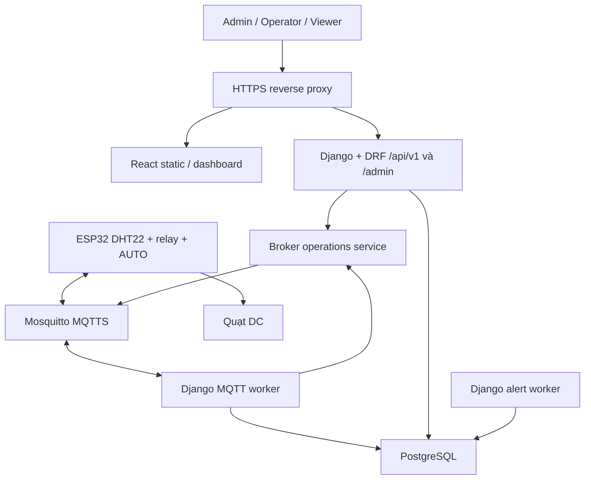
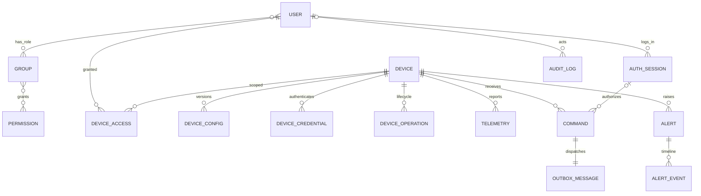
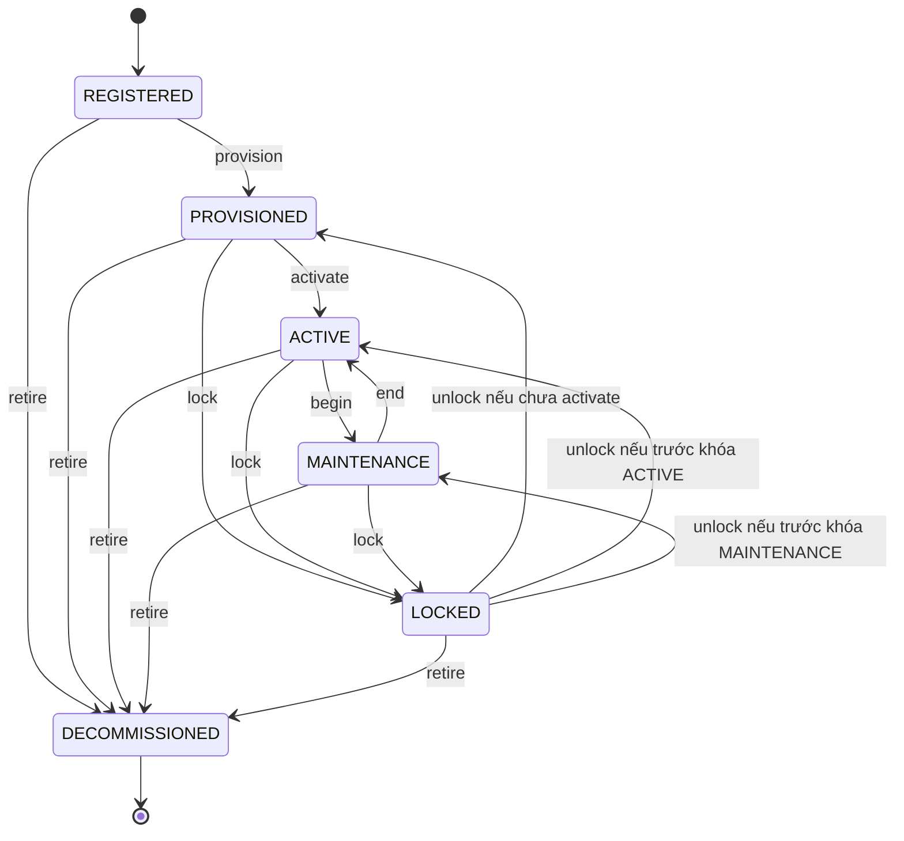
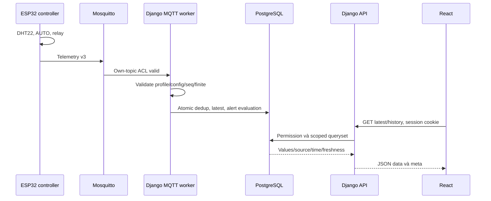
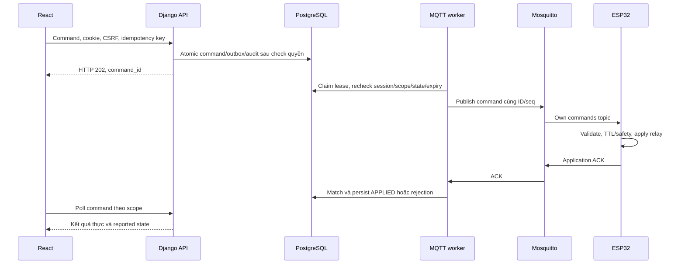

# ĐẶC TẢ CHUNG V1.4 — IoT giám sát nhiệt độ, độ ẩm và điều khiển thông gió tủ thiết bị

Bản gốc V1.3: 30/09–16/10/2026. **Điều chỉnh ngày 04/11/2026: chuyển sang Django theo xác nhận của nhóm; nhóm 4 người, đã thuyết trình, còn 7 ngày chuẩn bị demo.** Đã đối chiếu PDF đề bài và các phần liên quan trong sáu bộ slide mới bổ sung. Giữ tên file hiện tại để các liên kết đang dùng không bị đứt.

**Trạng thái:** đây là đặc tả đích và kế hoạch chuyển đổi, chưa phải mô tả phần mềm Django đã chạy. Kho hiện có Flask/SQLAlchemy/Alembic, React và tests. Mã nguồn chưa được chuyển framework trong lần sửa tài liệu này. Bản lịch sử được giữ tại [V1.3 gốc](../Description/IOT_TU_THIET_BI_DAC_TA_CHUNG_V1_3.md). Xem thêm [đánh giá tổng thể và rủi ro chuyển đổi](DANH_GIA_VA_CHUYEN_DOI_DJANGO.md).

**Quyết định P0:** một ESP32 + DHT22 + relay + quạt DC thấp áp; AUTO tại ESP32; MQTT hai chiều; Django + Django REST Framework (DRF) + PostgreSQL; React cho giám sát/vận hành; Django Admin cho quản trị. Dùng session cookie Django + CSRF, ba role ADMIN/OPERATOR/VIEWER và scope VIEW/OPERATE theo thiết bị. Một MQTT worker và một alert worker dùng chung Django models/services.

**Thay thế quyết định V1.3:** Flask/Blueprint/SQLAlchemy/Alembic → Django apps/ORM/migrations; JWT memory → Django session; bắt buộc đúng 27 bảng → schema theo nghiệp vụ/framework; hai bảng audit/activity → một nguồn AuditLog; lịch cũ → kế hoạch 7 ngày. MQTT vẫn schema_version=3. Phiên bản tài liệu khác phiên bản MQTT và firmware.

## 0. Yêu cầu học phần và phạm vi một tuần

### 0.1 Căn cứ và giới hạn đối chiếu

Nguồn yêu cầu: [Đề bài đồ án kết thúc học phần](<ĐỀ BÀI ĐỒ ÁN KẾT THÚC HỌC PHẦN.pdf>), 14 trang, đã đọc trực tiếp bản bổ sung trong docs. Số trang dưới đây tính từ trang đầu PDF. Slide dùng làm căn cứ giải thích kiến trúc/giao thức/dữ liệu/an toàn, không biến mọi chủ đề bài giảng thành yêu cầu phải triển khai. Xem [đối chiếu đề bài và checklist demo](DOI_CHIEU_DE_BAI_VA_CHUAN_BI_DEMO.md).

PDF trang 14 ghi hạn báo cáo/source 24/11/2026, demo/vấn đáp 25/11 và 02/12. **Thông tin mới nhất từ nhóm: đã thuyết trình, hiện chuẩn bị demo trong một tuần.** Kế hoạch D1–D7 phục vụ mốc demo của nhóm; không tự dời hạn này theo lịch PDF hoặc suy đoán ngày demo cụ thể.

| Yêu cầu đã đối chiếu | Đáp ứng P0 | Mức độ / căn cứ và bằng chứng |
|---|---|---|
| Bài toán, lý do IoT, ràng buộc, tiêu chí thành công | Tủ thiết bị, nhiệt/ẩm thật, quạt AUTO tại edge | Báo cáo nhu cầu, BOM, giới hạn và số đo |
| Ít nhất một thiết bị vật lý có cảm biến; khuyến nghị hai đại lượng và hai node cho nhóm 4 | Một ESP32, DHT22 đo nhiệt và ẩm | Mục 4.2 trang 3: một node vật lý bắt buộc, hai đại lượng/hai node khuyến nghị; giữ P1 hoãn |
| Giao thức hai chiều, timestamp, QoS, reconnect/retry/dedup | MQTT v3 telemetry/status/commands/ACK | Test và demo mục 8, 12 |
| Backend tự xây hoặc tùy biến đáng kể nền tảng mã nguồn mở | Django/DRF và mã nghiệp vụ nhóm xây | Mục 4.4 trang 4–6; dùng framework được phép, dashboard sẵn đơn thuần không đủ |
| Auth/hash/scope/credential/revoke/audit/TLS/privacy | Django auth/session/CSRF, DeviceAccess, ACL từng node, HTTPS/MQTTS | Django không tự giải quyết scope/MQTT/revoke |
| UI users/devices/dashboard/history/alerts/config/control | Admin cho quản trị; React cho vận hành | Mục 4.6 trang 7 không chỉ định framework; dùng Admin là suy luận thiết kế, phải demo đủ chức năng trên giao diện |
| Tests, sơ đồ, API/MQTT, báo cáo, release/demo | Mục 11–12, 15–16 | PASS/FAIL/NOT_RUN theo thực tế |
| OTA/AI và hướng nâng cao | Hoãn EXT | Không cam kết kết quả chưa làm/test |

Đề không yêu cầu JWT, Flask, số bảng cụ thể hay mọi chức năng phải có REST endpoint riêng. Phải xác thực, phân quyền backend và có giao diện quản lý thật. Ba role là khuyến nghị (4.4a), bốn loại cảnh báo, outbox, session TTL 15 phút và các mục tiêu p95 là quyết định kỹ thuật của nhóm; không trình bày chúng như chỉ tiêu do giảng viên quy định. Đề yêu cầu ít nhất một rule cảnh báo và ít nhất hai kiểm thử bảo mật.

### 0.2 Ranh giới P0 / P1 / P2

| Mức | Phạm vi | Điều kiện |
|---|---|---|
| P0 trong tuần | Một node thật; AUTO/MANUAL TTL; web; auth/RBAC/scope; history/export; config desired/applied; ACK/retry; bốn cảnh báo; onboarding/lock/revoke; audit; TLS; tests/tài liệu | Đầu cuối, không cần RPM/AI |
| P0 đơn giản giao diện | Users/role/scope/devices/lifecycle/logs dùng Django Admin; provisioning kỹ thuật có thể qua command hỗ trợ | Register/activate/lock/decommission phải thao tác được trên Admin để demo quy trình, không chỉ terminal |
| P1 sau hạn chính | Node thứ hai RPM, fan asset/binding/maintenance | Chỉ xét sau P0, tuần hiện tại không bố trí |
| P2/EXT | AI, OTA, backfill, WebSocket, tenant, rule engine, quản trị React riêng | Chỉ hướng phát triển, chưa tạo hàng loạt bảng/module |

Thiếu thời gian thì cắt hiệu ứng UI, màn quản trị tùy biến và analytics trước. Giữ đo thật → lưu → hiển thị, lệnh → ACK, phân quyền, mất mạng vẫn AUTO và thu hồi credential. Mục bắt buộc chưa đạt vẫn FAIL/NOT_RUN, không đổi nhãn thành EXT để làm đẹp kết quả.

## 1. Bài toán và tiêu chí hoàn thành

**Tên đề tài:** Hệ thống IoT giám sát nhiệt độ, độ ẩm và điều khiển thông gió tủ thiết bị mạng.

- P0: **1 ESP32 CONTROLLER cabinet-001 + 1 DHT22 + 1 relay + 1 quạt DC thấp áp**. Không cần thiết bị mạng/server thật trong tủ mô hình.
- ESP32 điều khiển ON/OFF theo hysteresis, dùng NVS khi mất mạng/backend; web xem, cấu hình và MANUAL có hạn.
- fan_output là trạng thái driver relay đã áp dụng. UI ghi **“Đầu ra quạt”** và **“Chưa có giám sát RPM”**. ACK không chứng minh quạt thực sự quay hoặc tiếp điểm relay đóng.
- Quạt thông gió không làm tủ lạnh hơn môi trường; chưa đo đối chứng thì không tuyên bố giảm nhiệt/ẩm. DHT22 có hai đại lượng nhưng vẫn một module, một node.
- Không điện lưới; tính dòng nguồn, gá dây tránh cánh. Khóa credential không cắt điện phần cứng.
- Dữ liệu cá nhân tối thiểu: username/tên hiển thị, email tùy chọn; không camera/microphone/GPS.

**Đạt P0 khi:** demo 10 bước mục 12.2 bằng node thật; permission/scope/logout/lock/reset và MQTT ACL/revoke có test; desired khác applied; mất ACK không thành công giả; mất mạng vẫn AUTO; ổn định/restore được; báo cáo phân biệt đã làm và dự kiến.

## 2. Công nghệ và kiến trúc đích

### 2.1 Stack thống nhất

| Khối | Chọn dùng | Lý do / giới hạn |
|---|---|---|
| Thiết bị | ESP32 DevKit WROOM-32 hiện có | Giữ bo/pinout đã kiểm, không đổi phần cứng theo framework |
| Firmware | Arduino/C++; DHT library + Unified Sensor; PubSubClient; ArduinoJson; Preferences | Pin version đã build; reconnect không dừng AUTO |
| Broker | Mosquitto 2.x + Dynamic Security đã thử | Credential riêng, exact ACL, disable/disconnect/reconnect denial |
| Backend | **Python 3.12 hoặc 3.13 + Django 5.2 LTS + DRF** | ORM/migrations/auth/admin sẵn; pin bản vá 5.2.x và DRF tương thích sau build thử |
| API | DRF serializers, GenericViewSet/mixins/router, permission classes | CRUD dùng sẵn; lệnh/lifecycle gọi service; không PATCH state trực tiếp |
| Tài khoản | AbstractUser; Groups/Permissions; DB sessions; CSRF | AUTH_USER_MODEL trước migration đầu; không hai hệ auth/role |
| Password | Django Argon2PasswordHasher + argon2-cffi | set_password/check_password/validators; không dùng hasher thô của Flask làm hệ auth mới |
| DB | PostgreSQL 16 + Django ORM/migrations | Đích iot_cabinet_django; test iot_cabinet_django_test tách riêng |
| MQTT Python | paho-mqtt | Khóa version/callback API đã thử; port ORM/context Flask |
| Frontend | React + Vite + Recharts hiện có; fetch cùng origin | Poll 2s; giữ phần UI dùng được |
| Quản trị | Django Admin | Tùy biến form/action gọi service; không mở sửa physical state/audit |
| Workers | Management commands run_mqtt_worker, run_alert_worker | Mỗi loại một instance; P0 không cần Redis/Celery/Kafka |
| Deploy | Compose: DB/broker/API/hai workers/HTTPS proxy phục vụ React | ESP32 ngoài Docker; DB/API ở mạng nội bộ |
| Tests/API docs | Django TestCase/TransactionTestCase, DRF APIClient; drf-spectacular | pytest-django chỉ nếu nhóm đã quen; schema từ code thật |

[Django supported releases](https://www.djangoproject.com/download/) công bố 5.2 là nhánh LTS. Chọn nhánh ổn định để giảm thay đổi tuần cuối; version chính xác phải khóa sau smoke test, bảng này không thay lockfile.

### 2.2 Vì sao đổi sang Django

Flask là microframework, vẫn là framework và vẫn làm được bài này. Vấn đề của kế hoạch cũ là phải tự ghép nhiều hạ tầng. Django giảm công user/password/session/admin/forms/migration; DRF cung cấp serializer, pagination và cấu trúc REST. **Chỉ ngắn hơn khi dùng các phần đó**, không bê nguyên hệ JWT/RBAC/27 bảng tùy biến rồi tiếp tục tự viết hết.

| Dùng sẵn | Nhóm vẫn phải xây |
|---|---|
| Auth/hash/session/CSRF | Scope DeviceAccess, last-admin guard, registry revoke, login limiter |
| Admin CRUD/form/filter | Action lifecycle/config đúng service, audit và ACK |
| ORM/migrations/atomic/row lock | Ràng buộc nghiệp vụ, data migration, dedup/desired-applied |
| DRF views/serializers/pagination | Queryset theo scope, quyền create/action, API contract |
| Test client/schema tooling | ESP32/mạng/ACL/crash/recovery và số đo thật |

FastAPI thuận tiện cho API/type validation nhưng không trực tiếp thay toàn bộ admin/auth/ORM mà nhóm muốn có. Đổi ngôn ngữ khác trong một tuần tăng công học lại. Chọn Django vì nhóm giữ Python và cần tính năng tích hợp, không khẳng định framework nào luôn nhanh hơn.

### 2.3 Kiến trúc, giao dịch và worker



Browser không truy cập DB/MQTT. Broker operations là module cùng backend; API/workers dùng cùng models/services; không cần repository abstraction bọc mọi ORM query.

- Command/config + AuditLog + outbox trong transaction.atomic(); trả 202 sau commit. Publish ngoài transaction. PUBACK chỉ broker nhận, chưa phải thiết bị APPLIED.
- on_commit có thể đánh thức worker nhưng không thay outbox: process chết sau commit vẫn phải tìm lại job.
- Worker claim row lock/lease, retry cùng command ID; kiểm lại quyền/session/lifecycle/expiry trước dispatch. Không subscribe MQTT trong AppConfig.ready(), view hoặc mỗi Gunicorn process.
- Management command chạy vòng dài phải quản lý kết nối ORM bằng close_old_connections và reconnect khi cần; nếu paho callback chạy thread khác thì không truyền DB connection/transaction/User instance đang cache giữa các thread. Callback chỉ enqueue payload hoặc gọi service với transaction riêng, không block control/ACK vì truy vấn dài.
- DB/broker không có transaction chung. DeviceOperation giữ status/phase/error/retry và desired/actual broker state; lock deny backend ngay, hoàn tất sau broker xác nhận.
- DB lỗi thì fail closed, không giả đã lưu. QoS0 có thể mất telemetry, UI hiển thị gap; chưa backfill.
- Alert tick 1s, đánh giá nhiệt/ẩm theo mẫu mới, không đếm lại một mẫu cũ thành dữ liệu liên tục. ORM transaction ngắn, lock theo thứ tự.
- Health phải có heartbeat worker gần đây qua DB hoặc health file/endpoint nội bộ; process còn sống nhưng loop treo không được ready mãi. Một model heartbeat hạ tầng nhỏ được phép nếu cần.

## 3. Linh kiện, nguồn và pinout

| Món P0 | Số lượng | Kiểm trước ghép |
|---|---:|---|
| ESP32 WROOM-32 + cáp USB dữ liệu | 1 | Pinout bo thật, CH340/CP2102 đều được |
| DHT22 module | 1 | Nguồn/pull-up DATA tương thích 3,3V |
| Relay | 1 kênh | Input 3,3V, active HIGH/LOW, nguồn cuộn relay |
| Quạt DC 5V hai dây hiện có | 1 | Dòng chạy/khởi động, chiều gió/gá |
| LED + trở khoảng 330Ω | 2 bộ | Dòng GPIO; còi/OLED tùy chọn |
| Nguồn/dây/breadboard/đầu nối | Theo mạch | Tổng dòng + dự phòng; không cấp fan từ GPIO |
| Nhiệt kế đối chiếu | Mượn | Phương pháp/độ lệch đo |

TV1 điền giá/nguồn mua thật. Không ghép USB và nguồn ngoài vào chân 5V khi chưa kiểm đường nguồn.

| Chức năng | GPIO P0 |
|---|---:|
| DHT22 DATA | 23 |
| Relay IN | 18 |
| LED mạng / cảnh báo | 19 / 25 |
| Còi IN nếu có | 26 |
| OLED SDA/SCL EXT | 21 / 22 |

Tải: +5V → relay COM → NO → fan+, fan− → GND nguồn; GND tham chiếu chung theo sơ đồ thật. Không đưa 5V/12V vào GPIO. Kiểm trạng thái relay lúc boot; GPIO chưa khởi tạo không bảo đảm fan bật. FAULT fanON là yêu cầu khi bo còn hoạt động, **không bảo đảm chạy khi mất nguồn/relay hỏng**.

P1 sau này: controller demand OUTPUT27/alive OUTPUT32; monitor INPUT27/INPUT33, TACH INPUT23; kiểm pull-up/chuyển mức/PPR theo datasheet. Tuần này chưa lắp thêm node/dây.

## 4. Firmware P0 và an toàn tại edge

| Tham số | Mặc định thử nghiệm |
|---|---|
| DHT sample / telemetry | 2s / 5s |
| Heartbeat / offline | 15s / 45s không live message hợp lệ |
| AUTO hysteresis | Bật nhiệt ≥30°C, tắt ≤28°C; giữa ngưỡng giữ trạng thái |
| Cảnh báo nhiệt/ẩm backend | 35°C / 80%RH, tồn tại 10s; clear margins 1°C / 3%RH |
| MANUAL TTL | 60s, miền 10–300s; hết TTL → AUTO |
| Wi-Fi/MQTT mất | AUTO, giữ config NVS; không replay MANUAL |
| Sensor fault | 3 lần lỗi liên tiếp → FAULT/fanON/null; 3 lần hợp lệ → AUTO |

AUTO khởi động từ NVS/fallback, không chờ NTP/backend. Sample lỗi không gửi 0/NaN; trước đủ 3 lỗi vẫn đánh dấu mẫu invalid và không dùng nhiệt giả để tắt fan. Timers control dùng monotonic time; UTC dùng cho dữ liệu/lệnh có hạn.

- Mất mạng/FAULT thắng MANUAL OFF; recovery về AUTO, không phục hồi MANUAL OFF cũ.
- SET_MODE MANUAL APPLIED trước SET_FAN; SET_FAN tuyệt đối, không toggle/gia hạn TTL. AUTO xóa manual timeout.
- Cache ACK/seq để duplicate không chạy lại/gia hạn. Boot/reconnect đổi IDs, không replay lệnh cũ.
- APPLY_CONFIG kiểm version/hash/schema/profile/range, lưu NVS trước ACK; cùng version/hash idempotent, cùng version khác hash reject.
- Control/sampling không bị reconnect/TLS/MQTT callback block lâu: state machine timeout hoặc network task+queue; đo khi broker down.
- Ngưỡng/thời gian là mục tiêu thử nghiệm, chưa phải kết quả đo.

## 5. Tài khoản, phân quyền và session Django

### 5.1 Role và scope

Custom User từ AbstractUser, UUID PK; status ACTIVE/LOCKED/ARCHIVED, must_change_password. is_active đồng bộ status; LOCKED/ARCHIVED không authenticate. Dùng **Django Group** cho ADMIN/OPERATOR/VIEWER và **Django Permission**, mỗi user đúng một role hệ thống trong P0. Không giữ thêm users.role hoặc bảng roles/permissions riêng của Flask.

Django cho phép nhiều group nên service/form admin phải enforce một role. Không mở chỉnh user_permissions/groups tùy ý ngoài form chuẩn. is_staff chỉ mở cửa Admin, không cấp quyền nghiệp vụ. ADMIN thường is_staff=true/is_superuser=false; superuser chỉ bootstrap/khẩn cấp có audit, không dùng chứng minh RBAC.

allow = user ACTIVE + session hợp lệ + permission hiện tại + scope đủ mức + trạng thái nghiệp vụ hợp lệ. ADMIN scope toàn hệ thống nhưng vẫn tuân thủ fault/lifecycle/safety. Owner/location/group thiết bị không cấp quyền ngầm.

| Hành động | ADMIN | OPERATOR | VIEWER | Scope |
|---|---|---|---|---|
| Device/latest/history/export/commands/alerts | Có | Có | Có | VIEW hoặc OPERATE |
| MANUAL/config/ACK/resolve alert | Có | Có | Không | OPERATE, state cho phép |
| Users/roles/device grants | Có | Không | Không | Admin; last-admin guard |
| Register/provision/activate/lock/unlock/decommission/rotate | Có | Không | Không | Admin action/management command, audit |
| Audit/nhật ký chức năng toàn hệ thống | Có | Không | Không | Read-only, redaction |
| Profile/đổi password/logout | Bản thân | Bản thân | Bản thân | old_password khi đổi |

VIEW chỉ đọc; OPERATE bao gồm VIEW. Viewer gán nhầm OPERATE vẫn không control. Quyền DB kiểm lại mỗi request/dispatch, không lấy frontend/cache dài hạn làm nguồn quyền.

Django có cache permission trên User instance: worker phải nạp user mới mỗi lần kiểm, không giữ instance có _perm_cache qua nhiều job; sau đổi Group/Permission trong cùng request phải xóa cache hoặc nạp lại trước kiểm tiếp.

DeviceAccess unique(user,device), level VIEW/OPERATE, expires_at?; TV3 cung cấp visible_devices(user), require_device_permission(user,action,device) và DRF permission classes; worker dùng cùng policy.

**DRF không tự lọc list theo object permission.** get_queryset() phải lọc scope cho list/history/export/count/statistics/commands/alerts; create/action kiểm target riêng. ID ngoài scope 404; đã VIEW nhưng thiếu quyền hành động 403. Mã device.control được map tập trung sang Django permission như devices.control_device đã seed. Xem [DRF permissions](https://www.django-rest-framework.org/api-guide/permissions/).

### 5.2 Session cookie + CSRF cho web cùng origin

Thay JWT V1.3 bằng cơ chế Django để giảm hạ tầng tự viết. ESP32 vẫn dùng MQTT credential, không web session.

**Lý do lựa chọn, không phải xếp hạng bảo mật:** JWT không mặc định an toàn hơn session. Trong dự án này React và Django cùng origin, Admin dùng session sẵn, còn bản JWT cũ vẫn kiểm PostgreSQL mỗi request để revoke tức thời nên không tận dụng nhiều xác minh phi trạng thái. Session giảm phần phát/xác minh token và tránh hai luồng auth cho React/Admin. JWT vẫn phù hợp khi có mobile/client bên thứ ba hoặc nhiều API cần xác minh token độc lập; có thể triển khai trong Django qua thư viện đã kiểm chứng, không cần tự viết JWT.

Độ an toàn phụ thuộc cả thiết kế: session cookie cần HTTPS/Secure/HttpOnly/SameSite và CSRF; JWT cần xác minh chữ ký/alg/issuer/audience/expiry, bảo vệ nơi lưu và chính sách revoke. JWT lưu cookie cũng cần xét CSRF; JWT lưu localStorage có thể bị JavaScript độc hại đọc khi có XSS. Scope/RBAC/audit và MQTTS/ACL vẫn bắt buộc với cả hai cách. Đây là lựa chọn giảm công cho P0, không phải yêu cầu của Django hoặc đề bài.

1. DB session backend django.contrib.sessions.backends.db. Browser giữ session ID trong cookie HttpOnly; server giữ nội dung session. P0 không phát access/refresh JWT.
2. Hết hạn tuyệt đối **15 phút từ login**: set_expiry(expires_at_datetime), SESSION_SAVE_EVERY_REQUEST=False; poll/đổi dữ liệu session không kéo dài mốc đó. Reload/tab mới dùng cùng cookie trong hạn; hết hạn login lại. Không còn quy tắc “reload phải login lại”.
3. Giữ model nhỏ AuthSession: UUID sid, user, created/expires/revoked/reason, liên kết command/audit. sid nằm trong Django session; đây là registry thu hồi, không hệ token khác. Request và MANUAL dispatch kiểm registry; không quét/giải mã toàn bộ django_session để tìm user.
4. Login dùng authenticate/login, tạo registry/audit. Logout revoke registry+audit rồi logout/flush. Lock/archive/reset/change-password revoke mọi registry trong transaction; unlock không hồi sinh phiên cũ. Đổi password bản thân cũng login lại; không giữ phiên hiện tại bằng update_session_auth_hash trong policy này.
5. Mọi điểm đăng nhập/đổi password/status/role, kể cả Admin/management command, dùng cùng policy. AdminSite login/logout và UserAdmin forms phải tích hợp registry/revoke; không để /admin bypass limiter hoặc sinh phiên thiếu registry. Request có authenticated Django session nhưng thiếu registry bị từ chối.
6. Chặn mất ADMIN ACTIVE cuối cùng, serialize đường hạ role/lock/archive bằng lock/giao dịch dùng chung; test hai thao tác đồng thời. is_staff/is_superuser/status/groups không nhận qua serializer công khai.
7. Chưa public registration/session UI/re-auth/MFA/email reset. Bootstrap password từ env/nhập ẩn, không mặc định. Password 12–128 ký tự, validate trước hash; Django validators + Argon2PasswordHasher, đo hash cost trên máy demo.

AuthSession giữ sau expiry/logout để FK còn hợp lệ; không FK bắt buộc tới django_session có thể cleanup. Nếu lưu registry/audit thất bại thì fail login và flush phiên, không trả cookie đăng nhập hợp lệ. Nguồn: [Django sessions](https://docs.djangoproject.com/en/5.2/topics/http/sessions/), [password management](https://docs.djangoproject.com/en/5.2/topics/auth/passwords/).

### 5.3 CSRF, cookie và mã lỗi

- Release cùng origin: React /, API /api/v1, admin /admin. Session cookie HttpOnly/Secure/SameSite=Lax/host-only. CSRF cookie Secure/SameSite=Lax; có thể HttpOnly và lấy masked token qua JSON. Không session ID/password trong Web Storage/URL/log.
- React GET /auth/csrf, giữ csrf_token memory, gửi X-CSRFToken cho POST/PUT/PATCH/DELETE. Login rotate CSRF; response trả token mới hoặc lấy lại /auth/csrf. Fetch same-origin/credentials, không hardcode Flask cổng 5000.
- **Anonymous login cũng bắt buộc CSRF.** Dùng Django view có csrf_protect; không dựa riêng DRF SessionAuthentication cho anonymous login. Logout/mutation đều kiểm CSRF; lỗi API trả JSON, không HTML.
- Dev dùng Vite proxy /api và /admin tới Django; browser cùng origin, không cần CORS. Secure có thể false trong HTTP local dev, release phải true. Nếu buộc tách origin: allowlist chính xác+credentials+CSRF_TRUSTED_ORIGINS, không wildcard.
- SessionAuthentication mặc định **403 khi chưa đăng nhập**. Chuẩn hóa code NOT_AUTHENTICATED cho thiếu/hết hạn/revoked session; CSRF_FAILED cho CSRF; FORBIDDEN cho thiếu quyền. Frontend chỉ về login với NOT_AUTHENTICATED, không logout khi mọi 403. Login sai credential 401 thông báo chung; validation 400; ID ngoài scope 404; conflict 409; limit 429; dependency 503. Không ép mọi 403 thành 401.
- Login limit: 5 lần sai/username/15 phút, 20/IP/15 phút, cooldown 15 phút. Port LoginAttempt/HMAC limiter hiện có sang Django ORM; khóa keys/giao dịch trước count/insert. Không counter memory; DRF throttling mặc định không đủ chứng minh chống brute-force. Admin login cũng qua limiter.
- must_change_password chỉ profile/change-password/logout; chặn điều khiển và admin chức năng khác đến khi đổi. API nhạy cảm no-store; không auto retry mutation sau lỗi auth/CSRF.

Nguồn: [Django CSRF](https://docs.djangoproject.com/en/5.2/howto/csrf/), [DRF authentication/login](https://www.django-rest-framework.org/api-guide/authentication/), [DRF throttling limits](https://www.django-rest-framework.org/api-guide/throttling/).

## 6. Database và chuyển đổi schema

### 6.1 Nguyên tắc

- Django models/migrations là nguồn schema mới. Không Alembic và Django cùng quản lý một bộ bảng. Giữ nguyên mã/migration Flask để tra cứu và rollback.
- **Bỏ chỉ tiêu đúng 27 bảng**: PDF mục 6 yêu cầu mô hình dữ liệu/ERD, không quy định số bảng. Django có bảng auth/group/permission/contenttypes/session/admin/migration riêng. ERD và nghiệm thu theo schema/chức năng thật.
- Tạo iot_cabinet_django riêng, giữ iot_cabinet cũ. Không DROP/TRUNCATE DB cũ hay sửa migration đã chạy để chuyển framework.
- AUTH_USER_MODEL từ migration đầu. Không ánh xạ raw Argon2 hash/roles/session/JWT cũ thành auth Django chỉ bằng đổi tên. inspectdb chỉ tham khảo, không tự chuyển logic/migration hoàn chỉnh.
- Ưu tiên seed lại tài khoản demo bằng password mới, provision credential mới theo quy trình; **kiểm kê dữ liệu cần giữ trước**, import có mapping/ID và chạy thử trên bản sao. Không mặc nhiên mọi dữ liệu cũ bỏ được.
- UUID cho nghiệp vụ, device_id VARCHAR(64), regex ^[a-z0-9][a-z0-9_-]{2,63}$ bất biến. Group/Permission dùng PK chuẩn framework.
- USE_TZ=True; UTC ISO8601; UI UTC+7. Số hữu hạn, nhiệt -40..80°C, ẩm 0..100; null không thành 0; seq/uptime BIGINT; JSONB metadata allowlist.
- Lịch sử FK PROTECT/RESTRICT; archive user/decommission device, không cascade xóa. Chưa tạo bảng/cột P1 chỉ để giữ chỗ; payload v3 vẫn fan_binding_id=null.

### 6.2 Models logic P0

Đây là mô hình logic; không yêu cầu một bảng vật lý cho mỗi hàng. Fields/constraints đầy đủ chốt bằng Django migrations/ERD trước port service.

| App/model | Trường cốt lõi / quy tắc |
|---|---|
| accounts.User | AbstractUser UUID; username lowercase, tên/email?; status/is_active/must_change_password/password_changed_at/created_by; Django password/last_login |
| Group/Permission/membership của Django | Seed 3 role, một role/user theo service; mapping permission; không roles/user_roles/role_permissions riêng |
| accounts.AuthSession | sid/user/created_at/expires_at/revoked_at/reason; ip/UA tối thiểu tùy chọn; không cookie/token thô |
| accounts.LoginAttempt | username_key/ip_key HMAC, user?, success/reason/time/request_id; index key+time; transaction limiter |
| devices.Device | ID/name/CONTROLLER/source REAL hoặc SIMULATED; hardware_version/firmware_version; lifecycle/connection/health/maintenance note; boot/connection/seq/status_seq/last_seen; desired/applied config; last_command_seq; broker desired/actual/sync; state_version |
| devices.DeviceAccess | user/device/level/granted_by/time/expires?; unique(user,device), index(user,device) |
| devices.DeviceCredential | device/version/username/client_id/status/broker_ref/times/actors; unique(device,version)/username; tối đa một ACTIVE; không plaintext secret |
| devices.DeviceConfig | device/version/snapshot/canonical_json/hash/actor/time; unique(device,version), immutable; full validated config |
| devices.DeviceOperation | device/type/actor/status/phase/attempts/error/next_retry/request_id/key/hash; một operation đang chạy/device; lifecycle/credential jobs |
| telemetry.Telemetry | device/boot/connection/seq/schema/measured?/received/clock/uptime; nhiệt/ẩm/sensor/output/mode/config/hash/fault/raw hash; unique(device,boot,seq), index(device,time DESC) |
| telemetry.DeviceEvent | device/type/actor hoặc SYSTEM/time/details/dedup_key?; không mỗi heartbeat một event |
| commands.Command | command_id/device/source/actor?/session?/type/params/config?/seq/expected boot+connection/key/hash/status/times/attempts/result; unique(device,seq), unique(actor,device,key) |
| commands.OutboxMessage | unique command, topic/payload/qos/retained/status/available/lease/worker/publish_count/error; không secret |
| alerts.Alert | device/type/severity/status/condition_active/quality/threshold/config/evidence/times/actors; tối đa một chưa RESOLVED/device/type |
| alerts.AlertEvent | alert/type/actor/time/note/evidence; append-only timeline |
| audit.AuditLog | actor snapshot/session?/function/action/target/device?/outcome/request_id/correlation/time/summary/redacted metadata; append-only, một nguồn audit+nhật ký chức năng |

Device lưu latest reported projection cho /latest và /shadow: mode/output, telemetry time, config version/hash và boot/connection/seq; chỉ update từ message mới đã validate. Command status: PENDING/SENT/APPLIED/APPLIED_LATE/REJECTED/TIMEOUT/FAILED/CANCELLED. Outbox: PENDING/LEASED/PUBLISHED/FAILED/CANCELLED; PUBLISHED chưa terminal của command, scheduler đưa job về PENDING nếu đến retry mà chưa ACK. DeviceOperation: PENDING/RUNNING/SUCCEEDED/FAILED, error NEEDS_REPROVISION nếu secret mất. Attempt outcome giữ trong Command/AuditLog hoặc CommandAttempt đã port.

**Giảm so với V1.3:** không refresh_tokens; không locations/device_groups/membership nhiều tầng (label vị trí đơn giản nếu cần); không user_activity_logs riêng; không alert_rules tùy biến (code cố định, ngưỡng từ applied config); không DeviceShadow table riêng (projection config+reported). Attempt metadata có thể là danh sách giới hạn trong Command/AuditLog; nếu port CommandAttempt cũ giúp ít công hơn thì giữ. Không viết lại chỉ để giảm số bảng.

Audit outcome SUCCESS/ACCEPTED/DENIED/FAILED; 202 là ACCEPTED liên kết command/operation ID. Actor/result do backend xác định. Mutation+audit cùng transaction; denied/failed sau rollback ghi log transaction riêng. Không log polling/read/health/log-read; không API sửa/xóa log. Admin xem nhật ký chức năng bằng filter/proxy view cùng nguồn AuditLog. Runtime không UPDATE/DELETE audit, retention quyền riêng.

### 6.3 Ràng buộc và transaction

- Dedup telemetry cùng key khác hash reject/quarantine; không sửa lịch sử. Latest không lùi theo gói cũ.
- Partial unique credential ACTIVE, alert chưa RESOLVED và command SENT theo device; không chỉ if Python.
- Config lock Device, compare base_version, insert immutable version+command/outbox/audit atomic; hai PUT cùng base có một success/một 409.
- command_seq cấp dưới row lock; một SENT/device, queue theo seq. Session registry thuộc đúng actor; config/credential/command/alert không tham chiếu chéo device.
- Role/status/grant/lifecycle/login/password đổi dưới shared service/transaction; test race PostgreSQL. ORM không tự giải quyết business race.
- Desired/applied config phải thuộc device (constraint phù hợp hoặc service đã test); tạo device pointers null → config v1 → desired=1, applied=null; tránh vòng bootstrap cần telemetry trước onboarding.

### 6.4 Retention, seed, backup

- Telemetry 5s: **17.280/ngày; 518.400/30 ngày**, chưa index/WAL. Raw 90 ngày, audit 180 ngày, login attempts 7 ngày, commands/alerts/events hết học kỳ. Retention job/hướng dẫn vận hành có quyền riêng; không xóa trong GET.
- clearsessions xử lý session framework hết hạn; registry còn FK được giữ, anonymize IP/UA sau 7 ngày; chỉ xóa sau hết tham chiếu.
- Seed admin_demo/operator_demo/viewer_demo password env; cabinet-001 REAL; operator OPERATE/viewer VIEW; sim-unassigned SIMULATED không grant. Không tự activate simulator thành thật.
- Runtime DB role không superuser/DDL; migration role riêng. Không publish 5432 ra LAN; dev DBeaver chỉ loopback.
- Backup DB + Dynamic Security config + CA/config/firmware settings có bảo vệ secret; restore môi trường riêng và test login/telemetry/command. Mất secret phải reprovision, không lấy lại DB.

### 6.5 ERD logic rút gọn



ERD nộp phải theo migrations/schema thật, bổ sung FK/index/bảng framework; không dùng sơ đồ rút gọn thay toàn schema.

## 7. REST API và giao diện quản trị

### 7.1 Quy ước chung

Prefix /api/v1; JSON snake_case, UTC ISO8601. Giữ envelope nghiệp vụ: thành công `{ "data": ... }`; list thêm `meta: {page,page_size,total}`; lỗi `{ "error": {"code":"...","message":"...","request_id":"..."} }`. DRF exception handler/pagination dùng chung; CSRF/auth lỗi cũng theo envelope. OpenAPI/health có response riêng ghi rõ.

Default IsAuthenticated + policy dự án. Chỉ csrf/login/health public theo thiết kế. Serializer allowlist; actor/state/ID backend kiểm soát. Không ModelViewSet mở sẵn mọi CRUD: chọn mixins/@action cần thiết, không PATCH/DELETE telemetry/command/audit.

### 7.2 Auth và quản trị

| Endpoint / giao diện | Contract P0 |
|---|---|
| GET /auth/csrf | Masked csrf_token, đảm bảo CSRF cookie, no-store, không cần login |
| POST /auth/login | username/password + X-CSRFToken; data user/expires_at/csrf_token mới; Set-Cookie session, không access_token |
| POST /auth/logout | Cookie+CSRF, revoke registry+audit, flush session |
| GET/PATCH /auth/me | Profile/role/permissions/expires_at; PATCH chỉ tên hiển thị |
| POST /auth/change-password | old/new password+CSRF, revoke all, login lại |
| /admin users/role/scope | Tạo/khóa/archive/reset password/gán role/grant; shared service và revoke |
| /admin devices/credential operations/config history | Register/metadata/lifecycle actions; config history read-only, không edit physical state/secret |
| /admin AuditLog / nhật ký chức năng | Read-only, filter actor/function/outcome/time/device; một bảng, không ghi trùng |

P0 không yêu cầu React Users/Role CRUD hoặc REST /users, /roles, /permissions, /user-activity-logs riêng. Admin là giao diện bàn giao quản trị. Nếu đề thật bắt JSON users CRUD, thêm DRF gọi cùng service sau luồng IoT, không tạo hệ quyền thứ hai.

Register/activate/lock/unlock/decommission phải có Admin form/action cho quy trình giao diện. Provision/rotate credential có thể dùng command kỹ thuật hỗ trợ cùng service/audit. REST onboarding wizard là EXT; command không thay giao diện quản trị bắt buộc.

### 7.3 API vận hành bắt buộc

Các đường dẫn trong bảng đều thêm prefix /api/v1, trừ health ghi riêng.

| Method + endpoint | Contract / permission |
|---|---|
| GET /devices, /devices/{id} | Scope list/detail; source/lifecycle/connection/health/config versions/hardware_version/firmware_version |
| GET /devices/{id}/latest | Nhiệt/ẩm/output/mode/time/source/stale/config; thiếu dữ liệu null rõ |
| GET /devices/{id}/telemetry | from/to/page/page_size, scope SQL |
| GET /devices/{id}/telemetry/export | CSV có unit/source/time, scope, chống formula; tối đa 100.000 dòng |
| GET /devices/{id}/config | desired snapshot + applied version/hash + pending/error |
| PUT /devices/{id}/config | full config + base_version + Idempotency-Key; configure+OPERATE; 202 command/version, conflict 409 |
| GET /devices/{id}/shadow | Projection desired/reported/freshness read-only, không nguồn config thứ hai |
| POST /devices/{id}/commands | type/params + Idempotency-Key; control+OPERATE; 202 command ID |
| GET /devices/{id}/commands, /commands/{id} | History/status/attempts/ACK/error theo scope |
| GET /alerts | Filter device/type/status/time; scope trước count/pagination |
| POST /alerts/{id}/acknowledge | OPERATE+permission, note?; không clear condition |
| POST /alerts/{id}/resolve | condition_active=false, quality=VALID; còn lỗi/UNKNOWN 409 |
| GET /devices/{id}/activity | DeviceEvent/Command/AlertEvent, không audit account/security |
| GET /health/live, /health/ready | Root, ngoài /api/v1; tổng quát public, detail internal/admin |

P0 bắt buộc lọc theo device/from/to theo mục 4.4c trang 5; analytics min/max/avg là tùy chọn vì đề cho lọc, thống kê hoặc tổng hợp. Page mặc định 100/tối đa 500, query tối đa 31 ngày, metric/sort allowlist; không poll toàn history. Export lớn là EXT.

### 7.4 Lệnh và config

- SET_MODE `{"mode":"MANUAL","duration_s":60}` hoặc `{"mode":"AUTO"}`; SET_FAN `{"on":true}`. Chờ MANUAL APPLIED trước SET_FAN; không toggle. UI lấy output thực từ ACK/report.
- MANUAL từ chối khi OFFLINE/LOCKED/DECOMMISSIONED/MAINTENANCE/FAULT, clock chưa tin cậy hoặc reported stale. Recheck trước dispatch/retry; logout không thu hồi vật lý lệnh đã truyền.
- ACTIVE offline vẫn lưu desired pending, applied chỉ đổi khi version+hash match. Reconnect tạo command mới cho latest desired, không replay MANUAL cũ.
- Config là thay đổi bền vững: logout không xóa config đã duyệt. Trước apply đầu kiểm tác giả còn ACTIVE+configure/OPERATE; mất quyền thì BLOCKED_AUTHORIZATION, admin duyệt bằng version mới. SYSTEM re-sync chỉ config được phép, không đổi MANUAL USER thành SYSTEM.
- Cùng actor/device/Idempotency-Key+payload hash trả cùng command/version, khác hash 409. Config dùng command key, lifecycle DeviceOperation key; không lưu plaintext credential response để replay.
- HTTP202/PENDING/PUBACK/APPLIED khác nhau. TIMEOUT nghĩa chưa rõ kết quả; ACK muộn APPLIED_LATE và giữ timeline.

## 8. MQTT contract v3 giữ ổn định

Prefix cabinet/v3/devices/{device_id}, schema_version=3, client_id=device_id, username/credential riêng. P0 profile CONTROLLER, fan_binding_id=null. Không âm thầm nhận v2/monitor như controller.

| Topic suffix | Chiều | QoS / retained |
|---|---|---|
| /telemetry | Node → worker | Publish QoS0, không retained |
| /status | Node → worker | Publish QoS0 retained; LWT QoS1 retained |
| /commands | Worker → node | QoS1, không retained |
| /acks | Node → worker | Publish QoS0, không retained |

[PubSubClient](https://github.com/knolleary/pubsubclient) chỉ publish QoS0, subscribe QoS0/1. Không ghi hai chiều đều QoS1. Buffer khởi đầu 2048 bytes gồm **topic/header/payload**, đo serialized snapshot thật; retry/dedup không tạo đảm bảo exactly-once.

### 8.1 Telemetry controller

```json
{
  "schema_version": 3,
  "device_id": "cabinet-001",
  "profile": "CONTROLLER",
  "fan_binding_id": null,
  "boot_id": "4e5b9a32-c830-49c0-b86a-3b561a596389",
  "connection_id": "bdb0d8c6-70c9-414a-897e-45c451ee4ab8",
  "seq": 12,
  "measured_at": "2026-10-09T13:00:00Z",
  "clock_synced": true,
  "uptime_ms": 60000,
  "temperature_c": 31.2,
  "humidity_pct": 62.0,
  "sensor_ok": true,
  "fan_output": true,
  "mode": "AUTO",
  "config_version": 1,
  "config_hash": "3520a5738ade36fecf0a3f72ecf34e9f53fb2b2fe23e0a20245393e6a57a91cb",
  "fault_code": null,
  "extra": {}
}
```

Fixture giữ từ V1.3, không kết quả đo. Source REAL/SIMULATED từ DB, không tin node. Validate topic ID=payload ID, profile/capability, ACTIVE/MAINTENANCE, finite/type/range/schema, version/hash. Sensor lỗi hai số đo null, sensor_ok=false; không NaN/Infinity/0 giả.

Config factory chưa đồng bộ gửi version/hash=null, vẫn lưu raw/status nhưng chưa chạy thermal rules theo config chưa xác nhận. Apply v1 thì rules chạy không cần binding. Seq tăng theo boot; connection_id đổi reconnect. Unique(device,boot,seq); duplicate khác hash reject, out-of-order không lùi latest. Retained ONLINE không refresh last_seen; LWT connection cũ không offline connection mới. Chưa backfill.

### 8.2 Status và freshness

```json
{
  "schema_version": 3,
  "device_id": "cabinet-001",
  "profile": "CONTROLLER",
  "connection": "ONLINE",
  "boot_id": "4e5b9a32-c830-49c0-b86a-3b561a596389",
  "connection_id": "bdb0d8c6-70c9-414a-897e-45c451ee4ab8",
  "status_seq": 1,
  "config_version": 1,
  "config_hash": "3520a5738ade36fecf0a3f72ecf34e9f53fb2b2fe23e0a20245393e6a57a91cb",
  "firmware_version": "1.2.0",
  "hardware_version": "esp32-wroom32-dht22-relay-controller-v1",
  "uptime_ms": 60000,
  "clock_synced": true,
  "health": "OK",
  "fault_code": null
}
```

LWT có schema/device/boot/connection, connection OFFLINE/reason LWT, chỉ tác động current connection. Heartbeat 15s; OFFLINE sau 45s không live hợp lệ hoặc LWT đúng phiên. Với telemetry 5s, quá **15s** số đo STALE dù heartbeat ONLINE; UI tách kết nối khỏi freshness. Nếu interval đổi, stale=3×interval applied, không cố định 15s. Worker dùng latest_status_seq/phiên hiện tại; retained/old boot không online giả.

### 8.3 Command và ACK

```json
{
  "schema_version": 3,
  "device_id": "cabinet-001",
  "command_id": "d5cf70aa-f944-46bf-8c2d-fd36450f3276",
  "type": "SET_FAN",
  "device_command_seq": 8,
  "expected_boot_id": "4e5b9a32-c830-49c0-b86a-3b561a596389",
  "expected_connection_id": "bdb0d8c6-70c9-414a-897e-45c451ee4ab8",
  "params": {"on": true},
  "issued_at": "2026-10-09T13:00:00Z",
  "expires_at": "2026-10-09T13:00:15Z"
}
```

```json
{
  "schema_version": 3,
  "device_id": "cabinet-001",
  "command_id": "d5cf70aa-f944-46bf-8c2d-fd36450f3276",
  "status": "APPLIED",
  "type": "SET_FAN",
  "boot_id": "4e5b9a32-c830-49c0-b86a-3b561a596389",
  "connection_id": "bdb0d8c6-70c9-414a-897e-45c451ee4ab8",
  "device_command_seq": 8,
  "executed_at": "2026-10-09T13:00:01Z",
  "result": {
    "fan_output": true,
    "mode": "MANUAL",
    "config_version": 1,
    "config_hash": "3520a5738ade36fecf0a3f72ecf34e9f53fb2b2fe23e0a20245393e6a57a91cb"
  }
}
```

- Tối đa 3 attempts: lần đầu, +3s/+6s từ sent_at đầu; ACK timeout +10s, expires=issued+15s, không reset hạn. Job quá hạn trước publish không gửi.
- Firmware kiểm ID/type/seq/expected boot+connection/expiry/NTP; cache 20 ACK và high-water seq trong phiên; duplicate không gia hạn MANUAL. Boot/reconnect không replay.
- Worker match ACK device/type/ID/seq/boot/connection; unknown/cross-device ACK không đổi command. Late ACK ghi APPLIED_LATE, không che timeout.
- APPLY_CONFIG params {config_version,config_json,content_hash}; băm bytes canonical string trước parse, validate/lưu NVS trước ACK. Config re-sync theo policy mục 7.4.

### 8.4 Config canonical và hash fixture

```json
{
  "schema_version": 3,
  "config_version": 1,
  "profile": "CONTROLLER",
  "fan_binding_id": null,
  "fan_on_c": 30,
  "fan_off_c": 28,
  "temp_alert_c": 35,
  "humidity_alert_pct": 80,
  "temp_clear_margin_c": 1,
  "humidity_clear_margin_pct": 3,
  "telemetry_interval_ms": 5000,
  "manual_timeout_s": 60,
  "extra": {}
}
```

Canonical `json.dumps(snapshot, sort_keys=True, separators=(",", ":"), ensure_ascii=False, allow_nan=False)`; SHA-256 UTF-8 không gồm digest. Gửi nguyên string, firmware không serialize float lại. Hash fixture: 3520a5738ade36fecf0a3f72ecf34e9f53fb2b2fe23e0a20245393e6a57a91cb.

Validate fan_off<fan_on, nhiệt -40..80/ẩm 0..100, margins dương và clear threshold trong miền, MANUAL 10..300s. Controller interval 2000..60000ms để hợp DHT sample 2s, **P0 chốt 5000ms**. Nếu cho sửa tới 60s: heartbeat 15s vẫn giữ online, freshness theo interval applied; không tự đổi offline 45s. Không dùng desired thay applied cho rule.

## 9. Lifecycle, cảnh báo và giao diện

### 9.1 Thiết bị và broker

REGISTERED → PROVISIONED → ACTIVE ↔ MAINTENANCE; PROVISIONED/ACTIVE/MAINTENANCE có thể LOCKED; unlock về trạng thái phù hợp trước khóa; DECOMMISSIONED là cuối. Connection UNKNOWN/ONLINE/OFFLINE, health UNKNOWN/OK/FAULT là trường riêng.



1. Register CONTROLLER, ID từ quy trình có validate/unique; seed cabinet-001 cùng quy tắc. Config v1 desired=1/applied=null; chưa ACTIVE mặc định.
2. Provision tạo client **disabled** + exact ACL: publish own telemetry/status/acks; subscribe/receive own commands; default deny, client_id=device_id. Không node khác/control topic broker.
3. Secret chỉ hiện một lần trong đường quản trị đã xác thực, no-store; không DB/outbox/log. Management command nhập secret bằng hidden prompt/bàn giao riêng, không command-line arguments/history. Worker credential và broker-controller admin credential riêng; worker không quyền quản trị broker.
4. Activate chỉ ACTIVE sau broker enable xác nhận; config chờ node apply. Admin hiển thị operation/sync state, không báo hoàn tất khi mới gửi request.
5. Lock/decommission deny backend ngay; broker disable/disconnect và deny reconnect; operation retry/reconcile nếu broker lỗi. Retained cũ không hồi sinh online; dọn sau disable theo quy trình.
6. Rotation disable credential cũ trước enable mới; username có thể -c2, client_id giữ ID. Node offline tạm, cần nạp credential mới riêng. Crash/mất response mất secret → disable orphan và NEEDS_REPROVISION; không hứa lấy lại plaintext.
7. MAINTENANCE giám sát nhưng chặn MANUAL; bảo trì cơ khí ngắt nguồn DC tải/ghi event. MQTT revoke không ngăn AUTO local hay làm cánh dừng ngay.

Admin action/management command dùng cùng DeviceService/BrokerOperationsService. Action lưu operation/job hoặc exchange timeout hữu hạn, không treo vô hạn khi broker down. Durable reconcile trong worker hiện có. Provision secret chỉ RAM, retry metadata không chứa secret.

### 9.2 Bốn loại cảnh báo

| Loại | Điều kiện / clear |
|---|---|
| HIGH_TEMPERATURE | Nhiệt ≥ temp_alert_c 10s qua mẫu mới hợp lệ; clear ≤ threshold − margin |
| HIGH_HUMIDITY | Ẩm ≥ humidity_alert_pct 10s; clear theo humidity margin |
| SENSOR_FAULT | Sensor báo lỗi/FAULT; clear recovery hợp lệ; null không thành 0 |
| OFFLINE | LWT current connection hoặc 45s không live; clear sau live hợp lệ |

Reset persistence khi gap>2 periods hoặc mẫu invalid; restart worker không dùng một sample cũ giả nóng liên tục. Tái dựng cửa sổ telemetry gần nhất hoặc lưu evaluation state gọn DB; ghi rõ cách chọn và test restart. Thermal rule chỉ dùng applied version/hash đúng.

Một incident chưa RESOLVED/device/type. OPEN → ACKNOWLEDGED → RESOLVED; ACK chỉ đã đọc, clear chỉ condition hết; resolve cần condition_active=false/quality=VALID. Thiếu dữ liệu làm UNKNOWN/STALE, không tự clear nhiệt/ẩm. Recur trước resolve append REACTIVATED. Lock/decommission không mở offline mới, cũng không giả sửa hết lỗi vật lý cũ.

Alert tick 1s và ingest mẫu mới dùng cùng service/state/lock/unique; không mở trùng hoặc nhân đôi persistence. Rule code cố định, thresholds chỉ config, không UI rule engine.

### 9.3 React và Admin

**React:** login/profile/password; device list/detail; latest/history/chart/export; AUTO/MANUAL pending/ACK; config desired/applied; alerts ACK/resolve; device activity. Gộp tab device để ít màn. ADMIN có link Quản trị.

**Admin:** users/roles/scope, register/metadata/lifecycle/credentials, config history, audit/nhật ký. Physical state/applied/telemetry/log read-only; bỏ bulk delete, không sửa command thành APPLIED. Form/action gọi service, không chỉ save_model cho chuyển trạng thái.

Poll 2s khi màn mở, dừng khi NOT_AUTHENTICATED; history theo khoảng. Source/timestamp/stale/offline/FAULT rõ; không RPM0 hoặc “quạt hỏng” khi chưa có RPM. Escape text, không HTML từ payload.

## 10. Phân công 4 người và bàn giao

| Người | Sở hữu chính | Bàn giao trong 48h đầu | Phối hợp |
|---|---|---|---|
| TV1 — firmware/phần cứng | DHT/relay/AUTO/NVS/MQTT v3/ACK/reconnect | Bo đo thật, AUTO, publish đúng fixture | TV2 command/config; TV3 credential/TLS; BOM/ảnh |
| TV2 — backend IoT | Scaffold cùng TV3; devices/config/telemetry/commands/outbox/MQTT worker | Node → DB → API; MANUAL có ACK | TV3 scope/registry/broker adapter; hỗ trợ backend alerts |
| TV3 — auth/admin/security | User/Groups/session/CSRF/DeviceAccess/audit/Admin; broker ACL adapter | Login/logout, Users Admin, role/scope/viewer deny | TV2 lifecycle; TV4 fetch/CSRF; nhận auth/proxy/TLS cùng TV1 |
| TV4 — web/alerts/tích hợp | React dashboard/history/control/config/alerts; AlertService/worker; demo/tài liệu | Fetch/proxy/layout và dashboard dữ liệu thật | TV2 hỗ trợ ORM/alerts; TV3 deployment; mọi người viết báo cáo phần mình |

TV4 không gánh một mình frontend+alerts+deployment+toàn báo cáo. Mỗi người test/thu bằng chứng phần mình, có người khác review. TV3 không cần xây React Users riêng.

**Ngày 1 chốt chung:** AUTH_USER_MODEL/app layout/ownership; envelope/mã lỗi session; fetch+CSRF helper; MQTT fixtures/hash; DeviceAccess policy; seed và broker credentials qua env. Không mỗi người một Django project rồi ghép.

- Fixture frontend phải đúng: cabinet-001 lowercase, enums uppercase, fan_output boolean. Mock hiện có CABINET-01/type khác/output số phải chỉnh khi nối API; gắn mock/real rõ.
- Mọi schema change có migration/review dependency; không gửi SQL miệng hoặc tự chạy makemigrations trên DB chung thiếu phối hợp.
- Commit nhỏ theo lát cắt, merge tích hợp mỗi ngày. AI nhận task giới hạn và diff/test được kiểm; không tự đổi API/MQTT để vượt test hoặc tự ghi PASS.

### 10.1 Cấu trúc đích chuyển đổi

```text
backend/                    # Theo cấu trúc repo bắt buộc ở PDF 8.1
  app/                      # Flask hiện có, giữ tham khảo/rollback
  migrations/               # Alembic cũ, không quản lý schema Django
  workers/                  # Entrypoints Flask cũ
  django/                   # Đích sẽ tạo, hiện chưa có
    manage.py
    config/                 # settings, urls, wsgi
    apps/
      accounts/             # User, registry, limiter, admin
      devices/              # lifecycle/config/access/models/admin
      telemetry/            # ingest/history/validators
      commands/             # outbox/ACK/retry
      alerts/               # evaluation/incidents
      audit/                # một nguồn nhật ký
      mqtt/                 # topics/client/dispatcher/broker adapter
      core/                 # errors/pagination/health/management commands
    requirements.txt
frontend/                   # Giữ React, đổi auth/fetch adapter
firmware/
hardware/
database/                   # ERD/dictionary/import mapping
deployment/                 # Compose/proxy/Mosquitto
tests/                      # Test cũ giữ, test Django không import Flask
docs/                       # Đặc tả đích và đánh giá
Description/                # Tài liệu lịch sử
```

Migrations ở từng app Django; management commands dùng chung settings/models. Sau cutover một backend phục vụ frontend/workers, không dual-write. Chưa cần xóa/đổi tên backend cũ trong tuần.

## 11. Tài liệu và triển khai

### 11.1 Chuyển đổi môi trường

- Pin requirements Django/DRF/driver/paho/argon2/OpenAPI và package-lock; ghi version Arduino thực.
- Env Django riêng: DJANGO_SETTINGS_MODULE, DJANGO_SECRET_KEY, DEBUG, ALLOWED_HOSTS, DATABASE_URL/TEST_DATABASE_URL, CSRF_TRUSTED_ORIGINS theo profile, AUTH_LOG_HMAC_KEY, MQTT credentials/CA paths. Không FLASK_APP/JWT_SECRET_KEY làm auth Django.
- .env.example chỉ placeholder, không mật khẩu demo cố định/khóa giống secret thật; sinh mới từng máy. Nếu credential từng public là thật, đổi trước demo.
- Vite proxy /api và /admin; release cùng origin. Phục vụ cả React assets và Django Admin static; collectstatic/STATIC_ROOT/route /static đúng, tránh xung đột bundle.
- Compose hiện chỉ là nền DB/broker/tool, chưa deployment hoàn chỉnh. Bổ sung API/hai workers cùng code/env và HTTPS proxy; health/restart/volumes. Adminer chỉ dev, pin image thay latest.
- HTTPS và MQTTS 8883, CA/SAN đúng hostname/IP, browser/ESP32 tin CA; không setInsecure. 1883/HTTP chỉ dev có nhãn. Mở cổng 8883 không chứng minh TLS chạy.
- ESP32 dùng IP/hostname LAN laptop, không localhost. Kiểm hotspot/AP client isolation; mạng demo và phương án dự phòng đã thử.
- DEBUG=False, trusted proxy headers chỉ khi proxy thật kiểm soát. manage.py check --deploy theo release settings, xử lý các mục áp dụng; không tin forwarded IP tùy ý.

### 11.2 Hồ sơ tối thiểu

| Artifact | Người chính |
|---|---|
| Bài toán/ràng buộc/lý do IoT/lựa chọn công nghệ/giới hạn | Cả nhóm, giải thích phần mình |
| BOM/pinout/nối dây/ảnh/tính nguồn | TV1 |
| Context/layers/deployment/ERD thật/dictionary | TV2+TV3, TV4 tổng hợp |
| OpenAPI, MQTT topic/payload/QoS/retry/hash | TV2+TV1, TV3 auth |
| Hai sequence telemetry và command/ACK | TV2+TV4 |
| Role/scope/session/CSRF/revoke/ACL/TLS/threat model | TV3 |
| README máy sạch/migrate/seed/workers/restore/dev-release | TV2+TV3+TV4 |
| Test matrix/số đo/log/screenshot/commit | Mỗi người phần mình |
| Báo cáo cập nhật theo hệ thống thực/video/tag release/source | Chia viết, TV4 điều phối; giữ slide đã thuyết trình, không làm lại buổi thuyết trình |

PDF 8.2–8.4 khuyến nghị báo cáo 20–30 trang không phụ lục, slide 8–12 trang, demo 5–7 phút và vấn đáp 5 phút; video chỉ dự phòng, không thay demo trực tiếp. Nhóm đã thuyết trình nên tuần này ưu tiên prototype, test và diễn tập; báo cáo/source vẫn cập nhật đúng hệ thống đã làm theo lịch bàn giao. Mỗi người dùng tài khoản GitHub riêng, commit có nội dung, release/tag cuối, private repo phải cấp giảng viên quyền xem (8.1). Khai báo thư viện/mã nguồn/công cụ AI đã dùng và kiểm chứng nội dung (mục 10). Nâng cao chưa làm ghi thiết kế/hướng phát triển.

## 12. Lịch 7 ngày, demo và nghiệm thu

### 12.1 Lịch tương đối

D1 là ngày bắt đầu chuẩn bị demo; nếu 04/11 thì D7 là 10/11. Nhóm xác nhận đã thuyết trình, hiện còn một tuần cho demo; không dành lịch để chuẩn bị thuyết trình lại. Không suy đoán ngày demo cụ thể từ lịch PDF; giữ thời gian nhóm đã chốt.

| Ngày | Kết quả bắt buộc | Phối hợp / điểm cắt |
|---|---|---|
| D1 | Scaffold/custom User/migrations/seed/login+CSRF+Admin, DB/broker, bo AUTO | TV2+TV3 nền; TV1 mạch; TV4 proxy/fetch. Khóa scope |
| D2 | **ESP32 thật → MQTT → ORM → API → React**, history và một MANUAL có ACK | Gate chính; chưa đạt thì cả nhóm sửa tích hợp, dừng màn phụ |
| D3 | Config desired/applied/NVS; outbox/retry/timeout/dedup; scope/logout/lock/reset | Test auth/ACK song song, không chờ UI đẹp |
| D4 | Bốn alerts+ACK/resolve; lifecycle/revoke/audit; HTTPS/MQTTS mạng demo | TV3+TV1 TLS, TV2 ops, TV4 alerts/UI |
| D5 | Freeze tính năng, các ca security/safety/crash chính; soak ≥2h/latency | Thu bằng chứng, không node2/AI |
| D6 | Restore/máy sạch/schema/API/sơ đồ, cập nhật hồ sơ thực, quay video và diễn tập | Người khác chạy README; mỗi người tập vấn đáp phần mình |
| D7 | Buffer lỗi tích hợp, diễn tập 10 bước, release/tag/gói nộp | Không upgrade thư viện/đổi contract/thiết kế lại UI |

AI giảm thời gian tạo mã nhưng không thay đo quạt, debug mạng, TLS, đọc log và hiểu bài để bảo vệ. Thiếu thời gian cắt tùy biến quản trị/statistics trước, không đánh dấu đạt khi chưa test. Cutover sau gate D2–D3 trên DB mới; không tốn thời gian bảo trì hai backend chạy song song.

### 12.2 Demo P0: 10 bước

1. Login ba role; ADMIN mở Admin; operator/viewer không được quản trị.
2. Register/activate controller trên Django Admin; provision credential bằng action/command hỗ trợ đã chuẩn bị, không lộ secret.
3. Node nhiệt/ẩm thật, output/mode/status, source REAL/timestamps.
4. Dashboard/history/export; thiếu dữ liệu không 0, stale khác offline.
5. MANUAL ON/OFF chờ ACK; TTL → AUTO; không tuyên bố đo vòng quay.
6. Config desired pending → applied/version/hash; hysteresis/NVS reboot.
7. Mất mạng/backend → AUTO local; web offline/gap; reconnect không replay MANUAL.
8. Cảnh báo nhiệt/ẩm bằng ngưỡng thử → ACK → clear → resolve; phục hồi ngưỡng sau demo.
9. Viewer control 403; sim-unassigned detail 404; pub/sub topic simulator broker deny.
10. Lock/decommission deny backend+disconnect/deny reconnect; giữ history; audit actor/function/outcome.

Video dự phòng từ luồng thật, không mock thay số đo. Secret provisioning không xuất hiện video/log/slide công khai.

### 12.3 Mục tiêu đo và checklist

| Mục tiêu | Bằng chứng |
|---|---|
| Một ESP32+DHT22+relay+fan thật | Ảnh/BOM/log AUTO/MANUAL/config/report |
| Sensor→UI p95≤8s, telemetry5s/poll2s | ≥30 mẫu, ghi đồng bộ clock; received→UI không gọi toàn tuyến sensor→UI |
| Request command→ACK p95≤3s | ≥20 lần, median/p95/fail/retry; timeout10s/hạn15s |
| Offline≤45s+tick1s khi chưa LWT | Ngắt Wi-Fi/nguồn, thời điểm last_seen/state |
| Smoke30 phút, soak≥2h | Reboot/fault/gaps/loss/CPU/RAM/mạng thực |
| Session/scope/CSRF/revoke/ACL | API test CSRF enforcement và broker thật, cookie cũ deny |
| Outbox/config/alerts/audit | Retry/crash/idempotency; desired≠applied, không success giả |
| Restore/máy sạch/demo/tài liệu | Người khác chạy, schema/grants/config/history khớp |

Đây là mục tiêu, chưa kết quả. Ghi phương pháp p95; lỗi/timeout đếm riêng, không xóa để làm đẹp số. Không bắt tải 50 node tuần này; simulator hỗ trợ scope/failure, không thay bo thật.

### 12.4 Thứ tự migration/cutover

1. Kiểm kê dữ liệu cần giữ, backup DB/broker, mapping ID/bảng và phần seed lại; không chỉnh migration Flask.
2. DB Django mới, accounts migration đầu custom User, auth/contenttypes/session/admin; rồi devices/config/access/audit, telemetry/commands/outbox, alerts. Theo dependency, không theo số bảng.
3. Seed roles/permissions/accounts/grants/simulator; import user cần reset password qua Django trừ khi conversion hasher được test. JWT/cookie cũ không chuyển sang Django.
4. Import history cần giữ có mapping ID/config/source; kiểm counts/values/FK/unique/actor/timezone; runtime/migration/test roles riêng.
5. Dừng Flask worker trước Django sở hữu topic/dispatch; không hai worker cùng client ID/outbox. Test telemetry/API/MANUAL/config/quyền qua frontend cùng origin.
6. Cutover proxy/frontend/Compose. Rollback dừng Django worker/API trước bật Flask; không tự merge dữ liệu mới ngược DB cũ. Đã có dữ liệu mới cần export/đối soát riêng để không mất history.
7. Bàn giao Django migrations/seed/README đã chạy. SQL 27 bảng và tests Flask là artifact cũ, không nguồn schema mới; port test adapters/fixtures, giữ ý nghĩa nghiệp vụ.

## 13. Nguồn kỹ thuật và giới hạn xác minh

Nguồn Django/DRF tra cứu ngày 04/11/2026. Cơ chế framework là căn cứ; DeviceAccess/AuthSession/outbox và lịch 7 ngày là thiết kế riêng của nhóm, chưa là bằng chứng triển khai.

- [Django supported releases](https://www.djangoproject.com/download/): nhánh LTS, pin bản vá sau smoke test.
- [Custom User](https://docs.djangoproject.com/en/5.2/topics/auth/customizing/): AUTH_USER_MODEL từ đầu; thay user giữa dự án cần data/schema plan.
- [Django Admin](https://docs.djangoproject.com/en/5.2/ref/contrib/admin/): quản trị nội bộ, tùy biến form/action đúng policy.
- [Sessions](https://docs.djangoproject.com/en/5.2/topics/http/sessions/), [CSRF](https://docs.djangoproject.com/en/5.2/howto/csrf/), [passwords](https://docs.djangoproject.com/en/5.2/topics/auth/passwords/).
- [DRF authentication](https://www.django-rest-framework.org/api-guide/authentication/), [permissions](https://www.django-rest-framework.org/api-guide/permissions/), [viewsets](https://www.django-rest-framework.org/api-guide/viewsets/), [throttling](https://www.django-rest-framework.org/api-guide/throttling/).
- [inspectdb](https://docs.djangoproject.com/en/5.2/ref/django-admin/#inspectdb): khảo sát DB cũ, cần review; không migration tự động hoàn chỉnh.
- [PubSubClient](https://github.com/knolleary/pubsubclient): publish QoS0; buffer/version thực phải kiểm.

Nguồn học phần đã đọc bổ sung: [PDF đề bài](<ĐỀ BÀI ĐỒ ÁN KẾT THÚC HỌC PHẦN.pdf>) và các phần liên quan trong sáu bộ slide tại docs, được chỉ rõ trong [bảng đối chiếu](DOI_CHIEU_DE_BAI_VA_CHUAN_BI_DEMO.md). PDF không có bảng điểm chi tiết cho từng tính năng; có điều kiện giới hạn điểm ở mục 9 và nêu đồ án chiếm 60% tổng kết ở trang 14. Không suy ra điểm cộng cố định cho Django/JWT/node2/AI. Tài liệu tham khảo kỹ thuật và đề bài không thay bằng chứng test/version của nhóm.

## 14. Hướng phát triển sau P0

**Tuần hiện tại không triển khai phần này.** Chỉ tạo schema/API/topic/ACL/permission khi thật sự chọn làm; vẫn đi qua Django services và edge safety.

| Nhánh | Điều kiện / giới hạn |
|---|---|
| P1 RPM | Node monitor + TACH/optical/Hall; xác minh điện/PPR; rpm=pulse_count*60000/(window_ms*PPR). Fixture150/1000ms/PPR2=4500RPM không là đo quạt thật |
| Fan asset/binding | Khi đã RPM/thay quạt; asset khác ESP32, history/provenance/scope hai node rõ |
| Phản hồi quay | Demand/heartbeat hợp lệ, startup/stop grace/persistence; RPM0 không tự chứng minh motor hỏng; UNKNOWN khi mất bằng chứng |
| P2 AI | Dataset/labels/baseline/holdout/metrics đúng asset. Một fan khỏe vài ngày chưa chứng minh dự báo failure/RUL; không publish relay thẳng |
| OTA | Flash/partitions/manifest/hash/chữ ký/TLS/boot validation/rollback thật; không mặc định ArduinoOTA đủ |
| Backfill | Buffer hữu hạn, original seq/boot/time, ACK sau commit, dedup; replay không latest/online/lệnh cũ |
| SSE/WebSocket | Sau polling ổn, có lợi ích đo được; auth/scope/reconnect/resume |
| React Admin riêng | Khi UX thực sự cần; PDF hiện không bắt cùng framework toàn UI; vẫn gọi shared policy/service |
| JWT/mobile/external API | Khi có client khác browser cùng origin; expiry/revoke/token design riêng; cookie/CSRF đã là P0 |
| Tenant/rules/cloud/monitoring | Chọn theo nhu cầu/thời gian, không thêm dịch vụ chỉ minh họa kiến trúc |

Chi tiết cũ tham khảo [V1.3 lịch sử](../Description/IOT_TU_THIET_BI_DAC_TA_CHUNG_V1_3.md); schema/framework/auth trong đó không ghi đè V1.4.

## 15. Threat model và kiểm thử

### 15.1 Nguy cơ chính

| Nguy cơ | Kiểm soát | Bằng chứng |
|---|---|---|
| Brute force/enumeration | Django hash, thông báo chung, limiter username/IP cả admin login | Restart/multi-process vẫn limit, không lộ password |
| Cookie bị lấy/phiên cũ sau unlock | HTTPS/Secure/HttpOnly, registry expiry/revoke, user ACTIVE | Replay cookie sau logout/lock/reset deny, unlock không hồi sinh |
| CSRF/login CSRF | Middleware + csrf_protect login, X-CSRFToken mutation | Anonymous login thiếu token fail, cookie tự gửi chưa đủ |
| IDOR/list leakage | Scoped queryset + permission + kiểm create/action | Viewer control403, ngoài scope404, list/count/export không lộ |
| Admin bypass | Custom forms/actions/shared service, read-only state/log, last-admin guard | Không edit APPLIED/ACTIVE tùy ý; reset/lock revoke ngay |
| Node giả/đọc chéo/revoked vẫn nối | MQTTS/credential/client ID/exact ACL/disable/disconnect | Deny cross-topic/wrong client ID/reconnect |
| Replay/ACK giả/lệnh lặp | Seq/boot/connection/expiry/hash/dedup/matching | Không gia hạn MANUAL hoặc APPLIED giả |
| Payload lỗi/SQL/XSS/CSV formula | Validation hữu hạn/range/type/size, ORM params, UI escape, CSV escape | Null/NaN/Infinity/HTML/formula test |
| Crash/thành công giả | Atomic/outbox/lease/DeviceOperation/real ACK | Crash publish, broker/DB down, UI pending/unknown |
| Lộ secret/privacy | Env placeholder, no-store/redaction, scope/retention | Repo/log/API/export không cookie/password/broker secret |
| Mất thông gió do lệnh | AUTO/TTL/FAULT fanON khi phần cứng còn hoạt động | Wi-Fi/sensor lỗi thắng MANUAL OFF |

Credential NVS có giới hạn khi tiếp cận vật lý; không tuyên bố chống trích xuất flash. Audit/nhật ký không thay bằng chứng đóng góp Git của mỗi thành viên. Không đưa secret mới lên chat/commit/video.

### 15.2 Ca nghiệm thu

| ID | Kịch bản | Expected |
|---|---|---|
| HW-01 | Bo thật DHT/relay/AUTO/MANUAL/config/reboot | Nhiệt/ẩm thật, hysteresis/TTL/NVS đúng, chưa cần RPM |
| IAM-01 | Viewer VIEW control; operator ngoài scope history/export/count | 403 control, 404 detail, list/count không lộ |
| IAM-02 | Cookie cũ sau logout/lock/archive/reset, rồi unlock | NOT_AUTHENTICATED, registry revoked, không hồi sinh |
| IAM-03 | Poll đến 15 phút; reload/tab trước và sau expiry | Không sliding; còn hạn dùng cookie, hết hạn login, không JWT/Web Storage |
| IAM-04 | Anonymous login/mutation thiếu CSRF; token rotate sau login | CSRF_FAILED, không mutation; token mới thành công |
| IAM-05 | Thiếu cookie/expired session/thiếu quyền | 403 với NOT_AUTHENTICATED/FORBIDDEN đúng, frontend phân biệt |
| IAM-06 | Hai admin cuối đồng thời hạ/khóa; admin login/reset | Giữ ≥1 ADMIN ACTIVE; registry/limiter/revoke/audit mọi đường |
| IAM-07 | Login quá limit rồi restart | 429/cooldown còn, không enumerate |
| MQTT-01 | Cross-topic pub/sub/receive; username đúng client ID sai | Broker deny, không dữ liệu chéo |
| MQTT-02 | Lock node đang nối, controller down rồi phục hồi | Deny backend ngay, op pending/failed; sau đó disconnect/deny reconnect |
| DATA-01 | ID/profile/type/range/NaN/Infinity sai, sensor null | Reject sai, null không0, invalid không last_seen |
| DATA-02 | Duplicate/out-of-order/old LWT/retained/restart | Không trùng/lùi latest/online giả |
| CMD-01 | HTTP retry cùng key/MQTT duplicate/mất ACK | Cùng ID/seq, không gia hạn TTL, timeout unknown, late ACK giữ lại |
| CMD-02 | Unknown/cross-device/old boot/expired command hoặc ACK | Không APPLIED giả, reconnect không replay |
| CMD-03 | Crash sau publish trước persist, lease hết | Reclaim/retry cùng ID, bounded attempts, dedup an toàn |
| CMD-04 | Revoke session/grant khi MANUAL PENDING | Cancel trước send, không đổi USER thành SYSTEM |
| CFG-01 | Hai PUT cùng base; ACK/hash sai; offline/reboot | Một success/một409, applied chỉ match, NVS đúng, desired pending |
| ALERT-01 | Thermal/ẩm/persistence/gap/restart/ACK/clear/recur | Một incident, UNKNOWN không clear, active resolve409 |
| OPS-01 | Broker/DB/API/Wi-Fi mất, FAULT khi MANUAL OFF | AUTO/safety đúng, stale/offline, không replay |
| LOG-01 | Admin/React/command đổi user/grant/config/lifecycle | Một nguồn actor/action/time/outcome, 202=ACCEPTED, no secret |
| LOG-02 | Operator đọc audit; sửa/delete log/state qua admin/API | Deny, append-only, không bypass service |
| DB-01 | Migrate/seed mới, constraints/import nếu có | Không phụ thuộc27 bảng, FK/unique/ID/config/source đúng |
| REC-01 | Restore/máy sạch DB+broker+CA | Login/telemetry/control/quyền chạy, không secret sẵn repo |
| PERF-01 | Soak2h, ≥20 command/≥30 thermal | Latency/loss/CPU/RAM thực, phương pháp/giới hạn rõ |

Session/CSRF test dùng APIClient(enforce_csrf_checks=True) hoặc tương đương. Client bỏ qua CSRF mặc định không đủ bằng chứng. Race test PostgreSQL/TransactionTestCase, kết nối độc lập; SQLite không thay row lock/partial index/JSONB. Test DB allowlist riêng, không DB demo/cũ.

Mỗi ca có precondition/steps/expected/actual/date/người/commit/log hoặc screenshot. **Mô tả test không có nghĩa đã PASS.** P1 chưa chọn DEFERRED; P0 chưa chạy NOT_RUN.

## 16. Hai sequence P0 và quy tắc chốt

### 16.1 Telemetry → dashboard/alerts



### 16.2 Lệnh → ACK và audit



**Chốt V1.4:** một node thermal/relay và luồng Django/React/security đầu cuối trong 7 ngày; dùng Admin/session/CSRF có sẵn để giảm tự viết. Giữ MQTT v3 và AUTO edge. Không lấy số bảng, lượng mã AI tạo hoặc thiết kế P1/P2 làm tiêu chí hoàn thành. Phần mềm phải chạy, có test/bằng chứng và cả bốn người giải thích được phần mình.
