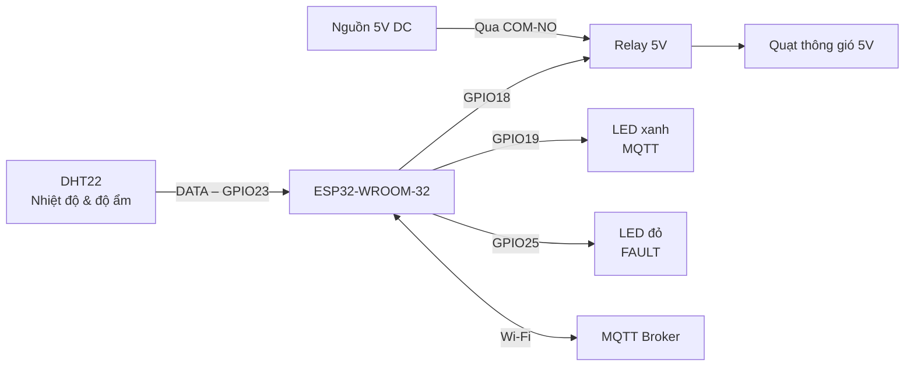

> **Node:** `cabinet-001`  
> **Nền tảng điều khiển:** ESP32-WROOM-32  
> **Phạm vi:** Phần cứng giai đoạn cốt lõi **P0** và các chân dự phòng mở rộng **P1**.

Tài liệu này mô tả các linh kiện cần chuẩn bị, chức năng của từng linh kiện và cách kết nối chúng với ESP32. Hệ thống sử dụng cảm biến DHT22 để giám sát nhiệt độ, độ ẩm trong tủ thiết bị; ESP32 xử lý dữ liệu, giao tiếp MQTT và điều khiển quạt thông gió thông qua relay.

## Mục lục

- [1. Tổng quan kết nối](#1-tổng-quan-kết-nối)
- [2. Danh sách linh kiện (BOM)](#2-danh-sách-linh-kiện-bom)
- [3. Bảng phân bổ chân GPIO](#3-bảng-phân-bổ-chân-gpio)
- [4. Hướng dẫn đấu nối](#4-hướng-dẫn-đấu-nối)
- [5. Lưu ý kỹ thuật](#5-lưu-ý-kỹ-thuật)
- [6. Mô phỏng trên Wokwi](#6-mô-phỏng-trên-wokwi)

## 1. Tổng quan kết nối

ESP32 là bộ điều khiển trung tâm. DHT22 gửi dữ liệu nhiệt độ và độ ẩm đến ESP32 qua chân GPIO23. Khi cần thông gió, ESP32 điều khiển relay tại GPIO18 để đóng/ngắt nguồn cấp cho quạt 5V. Hai LED dùng để hiển thị trạng thái kết nối MQTT và trạng thái lỗi cảm biến.

## 2. Danh sách linh kiện (BOM)

Danh sách dưới đây là cấu hình linh kiện cho giai đoạn cốt lõi **P0**.

| STT | Linh kiện | SL | Thông số / yêu cầu | Chức năng |
|:--:|---|:--:|---|---|
| 1 | Bo phát triển **ESP32-WROOM-32** | 1 | Dual-core Xtensa LX6, Wi-Fi 2.4 GHz, Flash 4 MB, mức logic 3.3 V | Bộ điều khiển trung tâm: đọc cảm biến, xử lý dữ liệu, điều khiển quạt và giao tiếp MQTT. |
| 2 | Cảm biến **DHT22 (AM2302)** | 1 | Nguồn 3.3 V; nhiệt độ: −40 đến 80 °C, độ chính xác khoảng ±0.5 °C; độ ẩm: 0–100 %RH, độ chính xác ±2 %RH theo thông số thiết kế | Đo nhiệt độ và độ ẩm không khí bên trong tủ thiết bị mạng. |
| 3 | Module relay 1 kênh | 1 | Cuộn relay/module dùng nguồn 5 V; đầu vào phải tương thích mức điều khiển 3.3 V và loại kích HIGH | Đóng/ngắt đường cấp nguồn 5 V cho quạt thông qua tiếp điểm COM–NO. |
| 4 | Quạt thông gió DC | 1 | 5 V DC, loại 2 dây; dòng định mức phù hợp với nguồn và tiếp điểm relay | Tạo luồng khí đối lưu, đưa khí nóng ra khỏi tủ thiết bị. |
| 5 | LED báo trạng thái | 2 | 1 LED xanh dương và 1 LED đỏ, loại 5 mm | LED xanh báo đã kết nối MQTT; LED đỏ báo cảm biến ở trạng thái `FAULT`. |
| 6 | Điện trở | 1 bộ | 2 điện trở 330 Ω (mỗi LED một điện trở); 1 điện trở 10 kΩ (kéo lên DATA của DHT22) | Hạn dòng cho LED và giữ đường DATA của DHT22 ở mức logic HIGH khi cần. |
| 7 | Nguồn và phụ kiện | 1 bộ | Nguồn 5 V DC đủ dòng cho ESP32, relay và quạt; cáp USB, dây nối, vỏ hộp | Cấp nguồn, kết nối các module và cố định mô hình. |

> **Lưu ý về DHT22:** Điện trở kéo lên 10 kΩ được sử dụng khi dùng cảm biến DHT22 rời. Một số module DHT22 đã tích hợp sẵn điện trở kéo lên; cần kiểm tra module thực tế trước khi lắp thêm.

## 3. Bảng phân bổ chân GPIO

Bảng dưới đây áp dụng cho node có mã định danh `cabinet-001`.

| Nhóm chức năng | Chân ESP32 / nguồn | Chân linh kiện | Mô tả kết nối |
|---|---|---|---|
| Cấp nguồn cảm biến | `3V3` | DHT22 `VCC` (`+`) | Cấp nguồn 3.3 V cho DHT22. |
| Tín hiệu cảm biến | `GPIO23` | DHT22 `DATA` (`OUT`/`SDA`) | Truyền dữ liệu nhiệt độ và độ ẩm. Nối DATA lên 3.3 V bằng điện trở 10 kΩ nếu cảm biến rời chưa có điện trở kéo lên. |
| Mass cảm biến | `GND` | DHT22 `GND` (`−`) | Nối mass cảm biến với mass ESP32. Chân `NC` để trống. |
| Điều khiển relay | `GPIO18` | Relay `IN` (`D`) | Theo cấu hình module kích HIGH: `HIGH` bật relay, `LOW` tắt relay. |
| Cấp nguồn relay | Nguồn `+5V` và `GND` | Relay `VCC` và `GND` | Cấp nguồn 5 V cho module relay. Nối chung GND với ESP32 nếu module dùng chung mass điều khiển. |
| Tải quạt – đường dương | Nguồn `+5V` → `COM` | Relay `COM`, `NO` | Nối `COM` với +5 V; nối `NO` với cực dương của quạt. |
| Tải quạt – đường âm | Nguồn `GND` | Quạt `−` | Cực âm của quạt nối trực tiếp về GND nguồn tải. Chân `NC` của relay không sử dụng. |
| LED báo MQTT | `GPIO19` | LED xanh | GPIO19 → điện trở 330 Ω → Anode (+) LED; Cathode (−) LED → GND. LED sáng khi kết nối MQTT thành công. |
| LED báo lỗi cảm biến | `GPIO25` | LED đỏ | GPIO25 → điện trở 330 Ω → Anode (+) LED; Cathode (−) LED → GND. LED sáng khi DHT22 lỗi 3 lần liên tiếp và hệ thống chuyển sang `FAULT`. |
| Dự phòng P1 – Demand Mirror | `GPIO27` (OUT) | Ngõ vào Node 2 | Xuất tín hiệu phản ánh nhu cầu điều khiển quạt (`Demand Mirror`). Chưa sử dụng trong cấu hình P0. |
| Dự phòng P1 – Heartbeat | `GPIO32` (OUT) | Ngõ vào Node 2 | Xuất xung nhịp trạng thái, đảo mức mỗi 500 ms. Chưa sử dụng trong cấu hình P0. |

## 4. Hướng dẫn đấu nối

### 4.1. Kết nối DHT22 với ESP32

| DHT22 | ESP32 |
|---|---|
| `VCC` | `3V3` |
| `DATA` | `GPIO23` |
| `GND` | `GND` |
| `NC` | Không kết nối |

Đặt điện trở kéo lên **10 kΩ giữa DATA và 3V3** nếu sử dụng cảm biến rời chưa tích hợp điện trở này.

### 4.2. Kết nối relay và quạt 5V

1. Cấp nguồn 5 V cho chân `VCC` và `GND` của module relay.
2. Nối `GPIO18` của ESP32 với chân `IN` của relay.
3. Nối cực dương nguồn tải 5 V vào chân `COM` của relay.
4. Nối chân `NO` của relay với cực dương (+) của quạt.
5. Nối cực âm (−) của quạt về `GND` nguồn tải.
6. Nối chung GND giữa nguồn điều khiển ESP32 và module relay khi mạch điều khiển yêu cầu dùng chung mass.

Khi relay được kích, tiếp điểm `COM–NO` đóng và quạt nhận nguồn 5 V. Khi relay ngắt, mạch cấp nguồn cho quạt bị hở và quạt dừng.

### 4.3. Kết nối LED trạng thái

Mỗi LED phải mắc nối tiếp với **một điện trở 330 Ω**. Không dùng chung một điện trở cho cả hai LED.

- **LED xanh:** GPIO19 điều khiển, sáng khi kết nối MQTT thành công.
- **LED đỏ:** GPIO25 điều khiển, sáng khi cảm biến DHT22 lỗi 3 lần liên tiếp (`FAULT`).

## 5. Lưu ý kỹ thuật

- **Tương thích relay:** Chỉ sử dụng module relay 5 V có đầu vào nhận được mức HIGH 3.3 V từ ESP32. Không phải module relay 5 V nào cũng đáp ứng điều kiện này. Cần kiểm tra tài liệu module trước khi đấu nối.
- **Mức kích relay:** Tài liệu này quy ước `HIGH` là bật relay và `LOW` là tắt relay. Một số module thực tế kích mức LOW; nếu sử dụng loại đó, cần thay đổi cấu hình đấu nối hoặc logic điều khiển trong chương trình.
- **Nguồn cấp:** Không cấp điện cho quạt trực tiếp từ chân GPIO của ESP32. Quạt phải lấy nguồn từ đường 5 V qua tiếp điểm relay. Nguồn 5 V cần đáp ứng dòng tiêu thụ và dòng khởi động của quạt, đồng thời bảo đảm nguồn cho các module liên quan.
- **Mass chung:** Với module relay không cách ly phần điều khiển, GND của ESP32 và GND nguồn relay cần được nối chung để tín hiệu điều khiển có cùng mốc điện áp.
- **Điện trở LED:** Mỗi LED sử dụng điện trở hạn dòng riêng 330 Ω. Dòng LED thực tế phụ thuộc vào điện áp thuận của LED.
- **Kiểm tra trước khi cấp nguồn:** Kiểm tra đúng cực tính LED, chân VCC/GND, vị trí COM/NO và điện áp định mức của quạt. Không đấu nhầm nguồn 5 V vào chân GPIO hoặc chân 3V3 của ESP32.
- **Chân dự phòng P1:** GPIO27 và GPIO32 chỉ dành cho kết nối mở rộng sang Node 2; không bắt buộc sử dụng trong giai đoạn P0.

## 6. Mô phỏng trên Wokwi

Mô hình mạch TV1 được cấu hình tại liên kết sau:

**https://wokwi.com/projects/478943345627574273**
