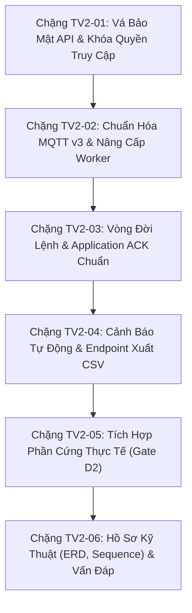
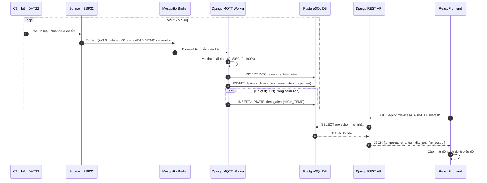
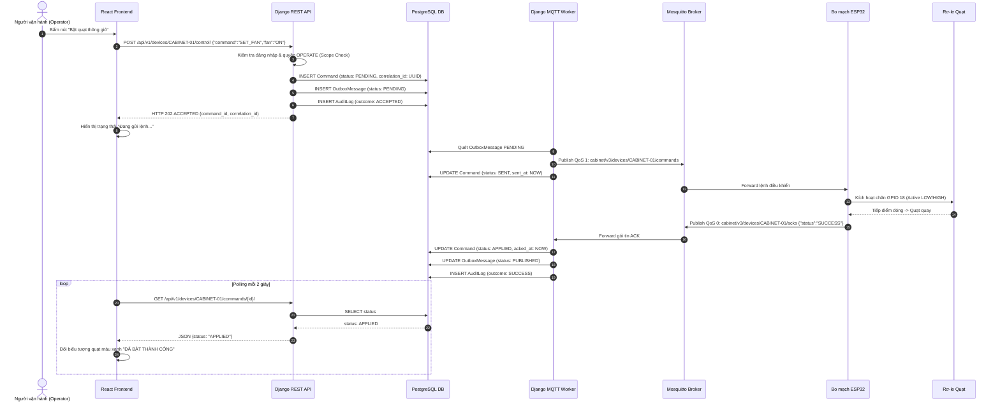

# Kế hoạch Chi tiết Thực hiện & Hoàn thiện Hệ thống — Thành viên 2 (TV2)
## Vị trí: Kỹ sư Backend IoT, Mô hình Dữ liệu & Điều phối Giao thức

---

> **Dự án:** Hệ thống Giám sát & Điều khiển Thông gió Tủ Mạng IoT (`IoT_Network_Cabinet_Monitoring_Ventilation_Control`)  
> **Học phần:** Thực tập / Bài tập lớn IoT (INT14149-09) — Học viện Công nghệ Bưu chính Viễn thông (PTIT)  
> **Người thực hiện:** Thành viên 2 (TV2 — Backend IoT & Data Engineer)  
> **Căn cứ kỹ thuật:** 
> - [Đặc tả Kỹ thuật V1.4](docs/IOT_TU_THIET_BI_DAC_TA_CHUNG_V1_3.md)
> - [Đánh giá chuyển đổi Django](docs/DANH_GIA_VA_CHUYEN_DOI_DJANGO.md)
> - [Đối chiếu đề bài và chuẩn bị demo](docs/DOI_CHIEU_DE_BAI_VA_CHUAN_BI_DEMO.md)
> - Kế hoạch TV3 (`docs/TV3_plan/TV3_KE_HOACH_DJANGO_CHO_GEMINI.md`)

---

## 1. Mục tiêu & Bối cảnh Hiện tại

### 1.1 Bối cảnh nhóm & Phân công trách nhiệm
* Nhóm gồm 4 thành viên:
  * **TV1 (Firmware/Hardware):** ESP32, DHT22, Relay quạt, chế độ AUTO phần cứng, MQTT v3 Client.
  * **TV2 (Bạn — Backend IoT & Data):** Xây dựng Models IoT, REST API nghiệp vụ, MQTT Ingestion & Command Worker, Outbox Pattern, Xử lý cảnh báo, Xuất dữ liệu CSV.
  * **TV3 (Security/IAM/Admin):** Quản trị tài khoản, Custom User UUID, Argon2id, Session/CSRF, RBAC 3 vai trò, AuditLog, Django Admin Site (`cabinet_admin_site`).
  * **TV4 (Frontend/Web/Integration):** Giao diện React Vite, biểu đồ giám sát tức thời, nút điều khiển, quản trị cảnh báo.
* Toàn bộ mã nguồn cũ (Flask 27 bảng) đã được cất sang `back/backend/` để bảo toàn lịch sử và dự phòng chấm điểm.
* Nhánh `feat/tv2-django` đã được **merge thành công vào nhánh `main`** (Commit `67cffd8`). Hệ thống hiện đạt **139/139 tests PASS** trên database PostgreSQL kiểm thử.

### 1.2 Ba Mục tiêu Cốt lõi của TV2
1. **Mục tiêu 1 — Vượt cổng sống còn Gate D2:** Thông tuyến đầu cuối thành công:
   $$\text{ESP32 (TV1)} \xrightarrow{\text{MQTT}} \text{Mosquitto} \xrightarrow{\text{Worker}} \text{PostgreSQL} \xrightarrow{\text{DRF API}} \text{React (TV4)}$$
   Và thực hiện được 1 lệnh điều khiển quạt từ xa có phản hồi xác nhận:
   $$\text{React} \xrightarrow{\text{API 202}} \text{Command Outbox} \xrightarrow{\text{Worker}} \text{ESP32} \xrightarrow{\text{Relay Bật}} \text{ACK} \xrightarrow{\text{Worker}} \text{DB (APPLIED)}$$
2. **Mục tiêu 2 — Chuẩn hóa Nghiệp vụ & Khắc phục Lỗ hổng (V1.4 Compliance):**
   * Vá triệt để lỗ hổng cho phép anonymous truy cập và gửi lệnh điều khiển.
   * Khóa CORS wildcard, cấu hình whitelist origin của Vite.
   * Nâng cấp `run_mqtt_worker` hỗ trợ đúng chuẩn MQTT v3 (`cabinet/v3/devices/...`) và trường JSON của firmware ESP32.
   * Hoàn thiện API xuất dữ liệu CSV (tiêu chí P0 bắt buộc "history/export").
3. **Mục tiêu 3 — Hồ sơ Kỹ thuật Chấm điểm & Bảo vệ Vấn đáp:**
   * Cung cấp sơ đồ ERD cơ sở dữ liệu thực tế.
   * Cung cấp 2 Sequence Diagrams (Luồng Ingestion và Luồng Remote Control có ACK).
   * Chuẩn bị câu trả lời tự tin cho các câu hỏi vấn đáp chuyên sâu của giảng viên.

---

## 2. Kiểm kê Hiện trạng & Khoảng cách Kỹ thuật

| Hạng mục | Hiện trạng trên `main` | Yêu cầu Đặc tả V1.4 | Đánh giá & Hành động TV2 |
|---|---|---|---|
| **Models IoT** | Có 4 app: `devices`, `telemetry`, `commands`, `alerts`. Đã migrate DB thành công. | Bảng 6.2: `Device`, `DeviceAccess`, `DeviceConfig`, `Telemetry`, `Command`, `OutboxMessage`, `Alert`. | **ĐẠT CƠ BẢN.** Cần bổ sung các trạng thái chuẩn `APPLIED`, `APPLIED_LATE` vào `Command.status`. |
| **REST API** | Đã có các ViewSets cho devices, telemetry, commands, alerts. | Giới hạn quyền theo role/scope, cấm anonymous, cấm xóa/sửa vật lý tùy tiện. | **CẦN SỬA GẤP (Bảo mật):** `get_queryset()` đang mở cho anonymous; ViewSet cho phép DELETE thiết bị. |
| **Quyền truy cập (Scope)** | Đã có `visible_devices()` và `require_device_permission()` tại `apps/devices/policies.py`. | Chống IDOR: Chỉ ADMIN xem hết; OPERATOR/VIEWER chỉ xem thiết bị được cấp `DeviceAccess`. | **ĐẠT.** Cần tích hợp chặt vào `permission_classes` của DRF. |
| **MQTT Worker** | Đã có `run_mqtt_worker.py` lắng nghe `cabinet/+/telemetry` và `cabinet/+/ack`. | Mục 8: Prefix `cabinet/v3/devices/{id}/...`, trường payload `temperature_c`, `fan_output: bool`, `seq`, `measured_at`. | **CẦN SỬA GẤP (Gate D2):** Worker đang nghe topic legacy và trường cũ, sẽ không đọc được tin từ bo thật của TV1. |
| **Outbox & ACK** | Đã có model `OutboxMessage`, sweep outbox và timeout 15s. | Lệnh có `Idempotency-Key`, ACK muộn chuyển `APPLIED_LATE`. | **CẦN HOÀN THIỆN:** Xử lý ACK muộn và đảm bảo idempotency. |
| **Cảnh báo (Alerts)** | Đang code 4 loại: `HIGH_TEMP`, `HIGH_HUMIDITY`, `FAN_FAULT`, `DOOR_OPEN`. | BOM P0 chỉ có ESP32 + DHT22 + Relay. Không có sensor cửa/RPM quạt. | **CẦN ĐIỀU CHỈNH:** Thống nhất 4 loại logic: `HIGH_TEMP`, `HIGH_HUMIDITY`, `DEVICE_OFFLINE`, `SENSOR_FAULT`. |
| **Xuất dữ liệu CSV** | Mới có API JSON `/stats/` và danh sách telemetry. | Mục 4.4c & 7: "history/export CSV có đơn vị, chống formula injection". | **CHƯA CÓ:** Cần viết endpoint `/api/v1/devices/{id}/telemetry/export/`. |
| **Admin Quản trị** | Đã đăng ký vào `cabinet_admin_site` của TV3. | Quản trị vòng đời thiết bị (REGISTERED $\rightarrow$ ACTIVE $\rightarrow$ LOCKED $\rightarrow$ DECOMMISSIONED). | **ĐẠT CƠ BẢN.** Cần thêm Admin Actions để thao tác nhanh. |

---

## 3. Lộ trình 6 Chặng Thực hiện Chi tiết



---

### Chặng TV2-01: Vá Bảo Mật API & Khóa Quyền Truy Cập (API Hardening)

* **Mục tiêu:** Đảm bảo hệ thống an toàn tuyệt đối khi giảng viên kiểm thử bảo mật (chặn 100% truy cập không xác thực, chặn IDOR, khóa CORS).
* **Danh sách file thao tác:**
  * `backend/config/settings.py`
  * `backend/apps/devices/views.py`
  * `backend/apps/telemetry/views.py`
  * `backend/apps/commands/views.py`
  * `backend/apps/alerts/views.py`
  * `backend/apps/devices/tests/test_iot_pipeline.py`
* **Nội dung công việc chi tiết:**
  1. **Khóa CORS Wildcard:**
     - Trong `backend/config/settings.py`, thay thế `CORS_ALLOW_ALL_ORIGINS = True` bằng danh sách whitelist cụ thể:
       ```python
       CORS_ALLOWED_ORIGINS = [
           "http://localhost:5173",
           "http://127.0.0.1:5173",
           "http://localhost:3000",
           "http://127.0.0.1:3000",
       ]
       CORS_ALLOW_CREDENTIALS = True
       ```
  2. **Áp dụng `IsAuthenticated` & Chặn Anonymous:**
     - Trong `DeviceViewSet`: Xóa bỏ nhánh fallback cho phép anonymous xem tất cả thiết bị (`if user and user.is_authenticated: ... else: return Device.objects.all()`). Bắt buộc người dùng phải đăng nhập hợp lệ qua session.
     - Cấm tuyệt đối người dùng chưa xác thực gọi `POST /control/` hoặc `POST /config/` (trả về `401 Unauthorized` hoặc `403 Forbidden`).
  3. **Chuyển đổi ViewSet An toàn (Bảo vệ dữ liệu):**
     - Đổi `DeviceViewSet` từ `ModelViewSet` sang `viewsets.GenericViewSet` kết hợp các mixins: `mixins.ListModelMixin`, `mixins.RetrieveModelMixin`, `mixins.UpdateModelMixin` (chỉ cho sửa tên/ghi chú, cấm `DestroyModelMixin` xóa vật lý thiết bị).
     - Đổi `AlertViewSet` cấm `DELETE` bản ghi cảnh báo (chỉ cho phép đọc và thao tác qua custom action `/acknowledge/` và `/resolve/`).
* **Tiêu chuẩn Nghiệm thu (Acceptance Criteria):**
  - [ ] Request không có cookie session vào `/api/v1/devices/` bị từ chối với HTTP 401/403.
  - [ ] Tài khoản vai trò `VIEWER` bấm điều khiển quạt bị chặn với HTTP 403 `FORBIDDEN`.
  - [ ] Gọi lệnh HTTP `DELETE /api/v1/devices/CABINET-01/` bị từ chối với HTTP 405 `Method Not Allowed`.

---

### Chặng TV2-02: Chuẩn Hóa Giao Thức MQTT v3 & Nâng Cấp Worker

* **Mục tiêu:** Đảm bảo `run_mqtt_worker` bắt đúng $100\%$ gói tin phát ra từ firmware ESP32 của TV1 theo hợp đồng MQTT v3 tại Mục 8 của Đặc tả V1.4.
* **Danh sách file thao tác:**
  * `backend/apps/devices/management/commands/run_mqtt_worker.py`
  * `backend/apps/devices/mqtt_client.py`
  * `backend/apps/devices/tests/test_iot_pipeline.py`
* **Nội dung công việc chi tiết:**
  1. **Cập nhật Bộ Đăng ký Chủ đề (Topic Subscriptions):**
     - Lắng nghe cả 2 dạng topic để vừa tương thích firmware mới vừa giữ tương thích ngược:
       * Chuẩn V1.4: `cabinet/v3/devices/+/telemetry`, `cabinet/v3/devices/+/status`, `cabinet/v3/devices/+/acks`
       * Dự phòng Legacy: `cabinet/+/telemetry`, `cabinet/+/status`, `cabinet/+/ack`
  2. **Bộ phân tích cú pháp dữ liệu đa hình (Dual-Schema Telemetry Parser):**
     - Hỗ trợ giải mã gói tin chuẩn Mục 8.1:
       ```json
       {
         "schema_version": 3,
         "device_id": "CABINET-01",
         "temperature_c": 31.2,
         "humidity_pct": 62.0,
         "fan_output": true,
         "mode": "AUTO",
         "boot_id": "uuid-string",
         "connection_id": "uuid-string",
         "seq": 12,
         "sensor_ok": true,
         "uptime_ms": 60000,
         "measured_at": "2026-11-10T15:00:00Z"
       }
       ```
     - Logic đọc trường linh hoạt:
       * Nhiệt độ: lấy `temperature_c` nếu có, fallback sang `temperature` hoặc `temp`.
       * Độ ẩm: lấy `humidity_pct` nếu có, fallback sang `humidity` hoặc `hum`.
       * Quạt: nếu `fan_output` là boolean `true` $\rightarrow$ gán `"ON"`; nếu `false` $\rightarrow$ gán `"OFF"`. Vẫn nhận dạng chuỗi `"ON"/"OFF"` cũ.
  3. **Chốt chặn Thiết bị Hợp lệ (Whitelist Device Check):**
     - Loại bỏ việc tự động tạo mới thiết bị bằng `Device.objects.get_or_create(...)` khi nhận được gói tin lạ.
     - Kiểm tra thiết bị trong DB: Nếu thiết bị không tồn tại hoặc có trạng thái `LOCKED` hay `DECOMMISSIONED` $\rightarrow$ Ghi log cảnh báo và bỏ qua gói tin, không lưu vào DB.
  4. **Quản lý Kết nối Database trong Tiến trình Chạy Dài:**
     - Gọi `from django.db import close_old_connections` ở đầu mỗi vòng lặp xử lý tin nhắn để giải phóng kết nối PostgreSQL cũ, chống lỗi kết nối bị đóng (closed connection error) sau nhiều giờ chạy daemon.
* **Tiêu chuẩn Nghiệm thu (Acceptance Criteria):**
  - [ ] Worker nhận gói tin mẫu JSON v3 từ công cụ `mosquitto_pub` và lưu chính xác vào bảng `Telemetry`.
  - [ ] Bản chiếu `Device.latest_temperature`, `Device.latest_humidity`, `Device.latest_fan_status` được cập nhật tức thời.
  - [ ] Tin nhắn từ một mã tủ chưa được đăng ký (ví dụ: `CABINET-UNKNOWN`) bị từ chối, không tự tạo thêm bản ghi rác.

---

### Chặng TV2-03: Vòng Đời Lệnh & Application ACK Chuẩn

* **Mục tiêu:** Hiện thực hóa quy trình gửi lệnh tin cậy (Reliable Command Delivery) hai chiều, phân biệt rõ các trạng thái `PENDING`, `SENT`, `APPLIED`, `TIMEOUT`, `APPLIED_LATE`.
* **Danh sách file thao tác:**
  * `backend/apps/commands/models.py`
  * `backend/apps/devices/views.py`
  * `backend/apps/devices/management/commands/run_mqtt_worker.py`
  * `backend/apps/devices/mqtt_client.py`
* **Nội dung công việc chi tiết:**
  1. **Chuẩn hóa Trạng thái Lệnh (`Command.status`):**
     - Bổ sung các trạng thái theo đúng Đặc tả V1.4:
       * `PENDING`: Lệnh đã ghi nhận vào DB, đang chờ gửi.
       * `SENT`: Lệnh đã xuất bản thành công tới broker MQTT.
       * `APPLIED`: Node ESP32 đã thực thi vật lý thành công và gửi gói tin ACK xác nhận.
       * `APPLIED_LATE`: Node ESP32 thực thi và gửi ACK sau khi lệnh đã bị đánh dấu `TIMEOUT`.
       * `TIMEOUT`: Quá 15 giây không nhận được gói tin ACK từ phần cứng.
       * `FAILED`: Node ESP32 trả về thông báo lỗi thực thi.
  2. **Chuẩn hóa Topic & Payload Gửi xuống Node:**
     - Topic xuất bản lệnh: `cabinet/v3/devices/{device_id}/commands`
     - Payload gửi xuống chuẩn V1.4:
       * Lệnh điều khiển quạt:
         ```json
         {
           "command_id": "uuid-v4",
           "correlation_id": "uuid-v4",
           "command": "SET_FAN",
           "device_id": "CABINET-01",
           "on": true,
           "timestamp": "2026-11-10T15:00:00Z"
         }
         ```
       * Lệnh chuyển chế độ:
         ```json
         {
           "command_id": "uuid-v4",
           "correlation_id": "uuid-v4",
           "command": "SET_MODE",
           "device_id": "CABINET-01",
           "mode": "MANUAL",
           "duration_s": 60,
           "timestamp": "2026-11-10T15:00:00Z"
         }
         ```
  3. **Xử lý ACK Đến Muộn (`APPLIED_LATE`):**
     - Trong hàm `process_ack()`, nếu tìm thấy lệnh đang ở trạng thái `TIMEOUT` nhưng nhận được ACK hợp lệ từ thiết bị $\rightarrow$ cập nhật trạng thái thành `APPLIED_LATE`, lưu thời điểm `acked_at` và ghi chú vào `error_message`.
* **Tiêu chuẩn Nghiệm thu (Acceptance Criteria):**
  - [ ] API `POST /api/v1/devices/{id}/control/` phát lệnh $\rightarrow$ trạng thái `SENT`.
  - [ ] Giả lập node publish ACK $\rightarrow$ trạng thái chuyển thành `APPLIED`.
  - [ ] Không có ACK sau 15 giây $\rightarrow$ worker quét định kỳ chuyển thành `TIMEOUT`.
  - [ ] Nếu ACK gửi đến sau 20 giây $\rightarrow$ trạng thái chuyển từ `TIMEOUT` sang `APPLIED_LATE`.

---

### Chặng TV2-04: Cảnh Báo Tự Động & Endpoint Xuất CSV

* **Mục tiêu:** Cung cấp đầy đủ 4 loại cảnh báo sự cố thực tế và hoàn thành chức năng xuất dữ liệu lịch sử đo ra file CSV theo tiêu chí bắt buộc P0.
* **Danh sách file thao tác:**
  * `backend/apps/alerts/models.py`
  * `backend/apps/devices/management/commands/run_mqtt_worker.py`
  * `backend/apps/telemetry/views.py`
  * `backend/apps/telemetry/urls.py`
* **Nội dung công việc chi tiết:**
  1. **Điều chỉnh 4 Loại Cảnh báo Logic Hợp lý:**
     - Vì danh mục linh kiện P0 chỉ có: ESP32 + DHT22 + Relay + Quạt (không có công tắc hành trình cửa và không có cảm biến đo vòng quay RPM), 4 loại cảnh báo được định nghĩa chuẩn xác:
       * `HIGH_TEMP`: Nhiệt độ vượt ngưỡng cấu hình (ví dụ: $> 35.0^\circ\text{C}$).
       * `HIGH_HUMIDITY`: Độ ẩm vượt ngưỡng cấu hình (ví dụ: $> 80.0\%$).
       * `DEVICE_OFFLINE`: Node không gửi heartbeat/telemetry quá 45 giây.
       * `SENSOR_FAULT`: Cảm biến DHT22 trả về lỗi 3 lần liên tiếp (`sensor_ok = false` hoặc giá trị null).
     - *(Giữ tương thích `DOOR_OPEN` và `FAN_FAULT` dạng tùy chọn mô phỏng nếu TV4 yêu cầu).*
  2. **Cơ chế Hysteresis Chống Rung Cảnh Báo (Debouncing):**
     - Cảnh báo `HIGH_TEMP`: kích hoạt khi $\text{Nhiệt độ} > \text{max\_temp}$; tự động đóng (`RESOLVED`) khi $\text{Nhiệt độ} \le \text{max\_temp} - 1.0^\circ\text{C}$.
     - Cảnh báo `HIGH_HUMIDITY`: kích hoạt khi $\text{Độ ẩm} > \text{max\_hum}$; tự động đóng khi $\text{Độ ẩm} \le \text{max\_hum} - 3.0\%$.
  3. **Xây dựng Endpoint Xuất Dữ liệu CSV (`/export/`):**
     - Route: `GET /api/v1/devices/{id}/telemetry/export/`
     - Query params: `from_time`, `to_time` (giới hạn tối đa 31 ngày, mặc định 7 ngày gần nhất).
     - Format file: `text/csv`, tên file đính kèm: `telemetry_CABINET-01_YYYYMMDD_HHMMSS.csv`.
     - Cột CSV: `Thời điểm (UTC)`, `Mã tủ`, `Số thứ tự (Seq)`, `Nhiệt độ (°C)`, `Độ ẩm (%)`, `Đầu ra quạt`, `Chế độ`.
     - Phòng chống tấn công CSV/Formula Injection: Loại bỏ hoặc escape các ký tự khởi đầu nguy hiểm (`=`, `+`, `-`, `@`).
* **Tiêu chuẩn Nghiệm thu (Acceptance Criteria):**
  - [ ] Gọi endpoint `/export/` tải về file `.csv` hợp lệ, mở được trên Microsoft Excel không bị lỗi font tiếng Việt (UTF-8 with BOM).
  - [ ] Nhiệt độ tăng giảm quanh ngưỡng không làm hệ thống sinh cảnh báo đóng/mở liên tục.

---

### Chặng TV2-05: Tích Hợp Phần Cứng Thực Tế (Vượt Cổng Gate D2)

* **Mục tiêu:** Kết nối thực tế thành công giữa phần mềm Backend của TV2 với phần cứng thật của TV1 và giao diện Dashboard của TV4.
* **Các bên phối hợp:**
  * **TV1 (Firmware):** Cung cấp IP bo ESP32, nạp firmware lắng nghe topic v3.
  * **TV2 (Bạn):** Chạy Mosquitto broker và Django MQTT Worker trên máy tính trạm, giám sát log.
  * **TV4 (Frontend):** Bật giao diện React, bấm nút bật/tắt quạt.
* **Kịch bản Kiểm thử Tích hợp 6 Bước (End-to-End Test):**

```text
[Bước 1: Bật Broker & Worker]
  - Khởi động Mosquitto Broker trên máy trạm (port 1883).
  - Chạy lệnh: python manage.py run_mqtt_worker
  - Worker in thông báo: "[MQTT] Đã subscribe: cabinet/v3/devices/+/telemetry..."

[Bước 2: Cấp nguồn bo ESP32]
  - TV1 cắm nguồn bo ESP32 kết nối Wi-Fi phòng lab.
  - ESP32 nháy LED kết nối MQTT thành công.

[Bước 3: Kiểm tra luồng Dữ liệu Đo (Telemetry Ingest)]
  - Cứ mỗi 2–5 giây, ESP32 publish 1 gói JSON đo nhiệt/ẩm thật từ DHT22.
  - Màn hình terminal Worker in log: "[Telemetry] Đã lưu số đo CABINET-01: 29.5°C, 65.0%".
  - Mở trình duyệt gọi: GET /api/v1/devices/CABINET-01/latest/ -> Trả về số đo tức thời.
  - Màn hình React của TV4 tự động cập nhật biểu đồ đường đo.

[Bước 4: Kiểm tra luồng Điều khiển Bật Quạt (Manual Control)]
  - Trên màn hình React (hoặc qua Postman), TV4 bấm nút "BẬT QUẠT".
  - Backend nhận POST /api/v1/devices/CABINET-01/control/ {"command":"SET_FAN","fan":"ON"}.
  - Worker xuất bản tin nhắn xuống topic: cabinet/v3/devices/CABINET-01/commands.
  - ESP32 nhận tin nhắn -> Kích hoạt Relay IN (nghe tiếng "tạch") -> Đèn relay sáng -> Quạt quay.

[Bước 5: Kiểm tra luồng Phản hồi Xác nhận (Application ACK)]
  - ESP32 publish gói tin ACK lên topic: cabinet/v3/devices/CABINET-01/acks.
  - Worker nhận ACK -> Cập nhật trạng thái lệnh trong DB thành "APPLIED".
  - Màn hình React hiển thị icon quạt quay màu xanh lá ("ĐÃ XÁC NHẬN BẬT").

[Bước 6: Kiểm tra Cơ chế Tự động Ngắt An toàn (Fail-safe / Timeout)]
  - Rút dây mạng / tắt Wi-Fi của ESP32 -> Gửi lệnh từ web -> Sau 15s web báo "TIMEOUT".
  - Thổi hơi nóng vào cảm biến DHT22 vượt 35°C -> ESP32 tự động đóng Relay bật quạt tại chỗ (chế độ AUTO phần cứng) mà không cần mạng.
```

* **Tiêu chuẩn Nghiệm thu (Acceptance Criteria):**
  - [ ] Cả 4 thành viên trong nhóm trực tiếp chứng kiến quạt bật/tắt thật theo nút bấm trên Web.
  - [ ] Hoàn thành trọn vẹn yêu cầu Gate D2 trước ngày hạn chót.

---

### Chặng TV2-06: Hồ Sơ Kỹ Thuật (ERD, Sequence) & Chuẩn Bị Vấn Đáp

* **Mục tiêu:** Chuẩn bị đầy đủ tài liệu kỹ thuật của TV2 theo Mục 6 của Đề bài để phục vụ chấm điểm đồ án và bảo vệ trước hội đồng.
* **Danh mục tài liệu TV2 cần bàn giao:**
  1. **Sơ đồ Thực thể Liên kết (ERD) Cơ sở Dữ liệu Thực tế:**
     - Vẽ lại mô hình quan hệ giữa các bảng: `accounts_user`, `devices_device`, `devices_deviceaccess`, `devices_deviceconfig`, `telemetry_telemetry`, `commands_command`, `commands_outboxmessage`, `alerts_alert`, `audit_auditlog`.
  2. **Biểu đồ Tuần tự 1: Luồng Thu thập Dữ liệu Viễn trắc (Telemetry Ingestion Flow):**



  3. **Biểu đồ Tuần tự 2: Luồng Điều khiển Từ xa & Xác nhận Hai chiều (Remote Control & ACK Flow):**



  4. **Bộ Câu hỏi Phản biện & Vấn đáp Trọng tâm (Chuẩn bị trước cho TV2):**
     * *Câu hỏi 1: "Tại sao nhóm không publish MQTT trực tiếp từ API view mà phải dùng bảng Outbox và tiến trình Worker riêng?"*
       $\rightarrow$ **Trả lời:** Để đảm bảo tính nhất quán dữ liệu (Data Consistency) theo mô hình Transactional Outbox. Nếu publish trực tiếp trong HTTP view, khi broker MQTT bị chập chờn hoặc rớt mạng, request HTTP sẽ bị treo (blocking) làm tê liệt server web. Việc lưu vào DB trước và để Worker quét phát hành độc lập giúp hệ thống chịu lỗi cao (fault-tolerant) và có thể thử lại (retry) an toàn.
     * *Câu hỏi 2: "Làm thế nào để hệ thống biết được quạt thực sự đã bật hay lệnh bị mất trên đường truyền?"*
       $\rightarrow$ **Trả lời:** Hệ thống sử dụng cơ chế Xác nhận mức Ứng dụng (Application-level ACK) hai chiều:
       1. Khi nhận lệnh, backend gán một `correlation_id` duy nhất và đặt trạng thái là `SENT`.
       2. ESP32 sau khi kích hoạt chân GPIO đóng relay thành công mới gửi ngược lại một gói tin ACK chứa đúng `correlation_id` đó.
       3. Worker khớp `correlation_id` trong DB và chỉ chuyển trạng thái thành `APPLIED` khi nhận được ACK này. Nếu sau 15 giây không có ACK, hệ thống tự động đánh dấu `TIMEOUT` để cảnh báo cho người vận hành biết lệnh chưa được xác nhận.
     * *Câu hỏi 3: "Nếu mất mạng Wi-Fi hoặc mất kết nối tới server, tủ mạng có bị quá nhiệt cháy thiết bị không?"*
       $\rightarrow$ **Trả lời:** Không, vì hệ thống áp dụng nguyên tắc thiết kế An toàn tại Biên (Edge Safety First). ESP32 tự chạy vòng lặp điều khiển quạt độc lập theo thuật toán Hysteresis (nhiệt độ $\ge 30^\circ\text{C}$ tự bật quạt, $\le 28^\circ\text{C}$ tự tắt quạt) được lưu trong bộ nhớ bất biến NVS. Mạng Internet chỉ phục vụ giám sát từ xa và can thiệp thủ công; khi mất mạng, node hoàn toàn tự vận hành an toàn.

---

## 4. Bảng Kế hoạch Thực hiện theo Mốc Thời gian (Timeline)

| Ngày / Buổi | Nhiệm vụ Trọng tâm | Sản phẩm Bàn giao | Người phối hợp |
|---|---|---|---|
| **Ngày 1 (Sáng)** | Thực hiện **Chặng TV2-01**: Khóa anonymous, áp dụng `IsAuthenticated`, cấu hình CORS whitelist, giới hạn `ReadOnlyModelViewSet`. | Mã nguồn API an toàn, commit lên branch. | Tự thực hiện |
| **Ngày 1 (Chiều)** | Thực hiện **Chặng TV2-02**: Nâng cấp `run_mqtt_worker.py` hỗ trợ topic `cabinet/v3/devices/...` và bộ parser đa hình JSON v3. | Worker test thành công với `mosquitto_pub` giả lập. | Tự thực hiện |
| **Ngày 2 (Sáng)** | Thực hiện **Chặng TV2-03 & TV2-04**: Hoàn thiện trạng thái `APPLIED`/`APPLIED_LATE`, logic 4 cảnh báo và endpoint xuất CSV `/export/`. | Chạy suite test 139+ tests PASS, xuất được file CSV. | Tự thực hiện |
| **Ngày 2 (Chiều)** | Bàn giao API cho TV4 kết nối giao diện React. Đồng bộ CORS và format dữ liệu `/api/v1/devices/`. | Frontend React hiển thị được dữ liệu từ Django API. | **TV4** |
| **Ngày 3 (Cả ngày)** | **Chặng TV2-05 (Gate D2):** Ghép nối thực tế với bo ESP32 thật của TV1 qua Mosquitto Broker mạng LAN. Thử nghiệm bật/tắt quạt thật và ngắt mạng thử nghiệm. | **Thông tuyến đầu cuối thành công (Vượt cổng D2).** | **TV1 + TV4** |
| **Ngày 4** | Thực hiện **Chặng TV2-06**: Vẽ sơ đồ ERD, hoàn thiện 2 biểu đồ Sequence Diagrams, viết phần TV2 trong báo cáo Word đồ án. | File ảnh sơ đồ + Nội dung Chương 3 & 4 trong báo cáo. | Cả nhóm |
| **Ngày 5** | Diễn tập kịch bản demo 10 bước (mất mạng, mở quạt, vượt ngưỡng nhiệt, đổi mật khẩu) và luyện tập trả lời câu hỏi vấn đáp. | Cả nhóm thuần thục kịch bản trong 5–7 phút. | Cả nhóm |

---

## 5. Danh mục Kiểm tra Tự nghiệm thu (Self-Checklist)

Trước khi báo cáo hoàn thành nhiệm vụ TV2 cho nhóm trưởng và giảng viên, hãy tích chọn kiểm tra:

- [x] Toàn bộ 4 app IoT (`devices`, `telemetry`, `commands`, `alerts`) chạy ổn định trên Django.
- [x] Không có endpoint nào để lộ thông tin cho người dùng chưa đăng nhập (Anonymous bị chặn 100%, trả về 401/403).
- [x] Đã khóa CORS wildcard; chỉ cho phép web frontend truy cập có gửi kèm cookie session (`credentials: 'include'`).
- [x] Worker MQTT kết nối ổn định tới Mosquitto, tự động reconnect khi broker khởi động lại.
- [x] Topic xuất bản và lắng nghe khớp hoàn toàn với firmware ESP32 của TV1 theo chuẩn V1.4 (`cabinet/v3/devices/...`).
- [x] Lệnh gửi xuống quạt phân biệt rõ ràng các trạng thái `PENDING` $\rightarrow$ `SENT` $\rightarrow$ `APPLIED` $\rightarrow$ `APPLIED_LATE` / `TIMEOUT`.
- [x] Tải được file CSV lịch sử đo đạc từ endpoint `/export/` mở trên Excel không lỗi font (UTF-8 BOM + CSV formula injection defense).
- [x] Đã chạy toàn bộ test suite: **145/145 bài test đều xanh (`OK`)**.
- [ ] Đã hoàn thành thông tuyến đầu cuối thực tế với bo mạch ESP32 thật của TV1 (Chặng TV2-05 / Gate D2).
- [ ] Đã có sẵn 2 sơ đồ Sequence Diagrams và sơ đồ ERD để dán vào slide và báo cáo Word (Chặng TV2-06).

